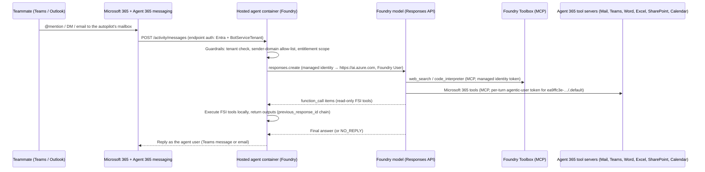

# 03 · Identity, security and governance

How an autopilot authenticates, what it can reach, who can stop it, and how that maps to what a bank's risk, compliance and audit functions will ask.

> New to blueprints and agent identities? Start with the badge-office analogy and the step-by-step permissions in [13 · Identity analogy, hiring steps and permissions](13-identity-analogy-and-hiring.md).

## 1. The Entra objects

| Object | Entra type | Created when / by | Holds | Count in this demo |
|---|---|---|---|---|
| **Agent identity blueprint** | Application + service principal | Agent creation (Foundry, automatically) | The credential every instance token chains back to; declared permission scopes | 1 per agent |
| **Agent identity** (default instance) | Service principal | Agent creation | The identity the hosted container uses for Azure (model calls, Toolbox). Granted **Foundry User** on the project by `scripts/agent-creation-script.ps1` | 1 per agent |
| **Agent identity** (per instance) | Service principal | **Hire** (Microsoft 365) | Secures the infrastructure that runs that instance | 1 per hired instance |
| **Agent user account** ("agentic user") | **User** object | **Hire** | Display name, UPN, **manager**, mailbox, calendar, OneDrive, Teams presence, org-chart position; performs Microsoft 365 actions | 1 per hired instance |

The two identity objects of an instance are never interchangeable: the **agent identity** authenticates and holds permissions; the **agent user account** is the presence in Microsoft 365 that acts as itself.

> Guardrail from Entra: **Global Administrator, Privileged Role Administrator and User Administrator can never be assigned to an agent identity.**

## 2. Runtime authentication flow

Key points:

* **Inbound** calls to the container are authorised by the agent endpoint's authorization schemes. The upstream sample sets `BotServiceRbac`; field tests showed that email and Word-comment events can lack the caller object ID it needs, so this repo sets **`Entra` + `BotServiceTenant`** (accept callers from this tenant) and filters in code: **cross-tenant activities are dropped** and **email senders must belong to `ALLOWED_SENDER_DOMAINS`**.
* **Model and Toolbox** calls use the agent's managed identity (`https://ai.azure.com` audience).
* **Microsoft 365 actions** use a **per-turn token exchange** to the agent user (`auth.exchange_token` with scope `ea9ffc3e-8a23-4a7d-836d-234d7c7565c1/.default`). The MCP servers run at `agent365.svc.cloud.microsoft`. The actions are attributed to the autopilot's own user account, not to whoever is chatting.

## 3. Two gates: consent and access

| Gate | Governs | Who sets it | Enforced by | In this demo |
|---|---|---|---|---|
| **Consent** | The **token**: which kinds of calls are ever allowed | Developer declares `optionalPermissionScopes` at publish; tenant admin grants admin consent at approval | Microsoft Entra ID | `McpServers.Mail/Teams/Word/Excel/OneDriveSharepoint/Calendar.All` (Azure DevOps scope removed) |
| **Access** | The **account**: which data those calls reach | Manager (or access manager) at onboarding: group memberships, SharePoint sites, distribution lists | Each resource, against its own membership lists | The instance can read only the SharePoint sites and chats it is added to; FSI tools are additionally limited by segment entitlement |

"Holding a tool isn't the same as holding access to the data behind it." Consent without access reaches nothing; that is what makes one blueprint safe to share across teams.

### Onboarding settings per instance

| Setting | Controls |
|---|---|
| Audience | Who can use the instance (starts as the manager only; extends up to the developer's ceiling) |
| Listening scope | Which conversations and surfaces it receives |
| Messaging scope | Who it can message |
| Access | Which business resources it can reach |
| Source of truth | Which content grounds its answers |

People outside the configured audience are **blocked by default, before the autopilot ever calls a model**.

This is the platform's model as Microsoft describes it. Learn documents no place to configure the audience, and this repo doesn't enforce one per person yet: see [18 · Governance gaps, gap 1](18-governance-gaps.md#restricting-who-can-use-an-agent-instance-out-of-the-box-options).

## 4. Who can stop it

| Control | Who | Reversible | Effect |
|---|---|---|---|
| Tighten / revoke access | Manager, business leads | Yes | Removes data reach |
| **Block instance** | Manager, business leads, anyone close to the work | **Only a tenant admin can unblock** | That instance stops |
| **Block blueprint** | Developer, tenant admin | Only a tenant admin can unblock | **Every instance stops at once** (all tokens chain to the blueprint credential) |
| Retire blueprint | Tenant admin | Yes | No new hires; existing instances continue |
| Offboard instance | Manager | **No** | Agent user removed, memberships revoked, access ends immediately |
| Delete blueprint | Tenant admin / developer | **No** | Cascades to every instance |

Blueprint defects are systemic (every instance carries the same flaw), so the kill switch lives at the blueprint.

## 5. Governance plane (Agent 365, Purview, Defender)

| Capability | What a bank gets |
|---|---|
| **Registry** (Agent 365) | One inventory of every hire: team, blueprint, version, manager, and every action attributed to its identity |
| **Audit and eDiscovery** | Agent activity in the unified audit log and eDiscovery (included for Microsoft Cloud customers) |
| **Purview for agents** (licensed) | DLP for agents (for example block IBAN / card numbers leaving the tenant), sensitivity labels honoured, Communication Compliance, Insider Risk, Data Lifecycle Management |
| **Defender for AI** (licensed) | Threat detection, posture management, hunting for agent activity |
| **Conditional Access / ID Protection for agents** (licensed) | Risk-based access policies on agent identities |
| **Observability** | Foundry traces in Application Insights (per turn, per tool call, per version); Agent 365 telemetry (hosted agents via the Agent 365 SDK and observability permissions) |

**Data residency:** Foundry data follows the **Azure region** of the Foundry resource; Agent 365 inventory, analytics and governance data follow the **Entra tenant's** geography. Individual Foundry resources can be opted out of Agent 365 data collection (`agent365Config`). Message-content capture in traces is **off** by default in this repo (`CAPTURE_MESSAGE_CONTENT=false`).

## 6. Controls implemented in this demo's code

| Control | Where | How |
|---|---|---|
| Four-eyes / no decisions | `fsi_tools.py` | Tools are **read-only** (`list`, `get`, `screen`, `compute`). There is no tool to close alerts, release or block payments, restrict accounts or file SARs. A unit test asserts this |
| Tipping-off (POL-08) | `guardrails.py`, `prompts.py` | Deterministic detector adds a control notice to the turn; instructions require refusal plus the compliant RM/RFI route |
| Untrusted content (POL-10) | `fsi_tools.py`, `guardrails.py` | Alert free text is wrapped as `untrusted_free_text` and scanned for injection patterns; detection adds a risk indicator |
| Team entitlement | `guardrails.resolve_allowed_segments` | An instance named "…Retail…" sees Retail & Wealth alerts; "…Corporate/SME…" sees Corporate & SME; others see all (demo-grade; production would enforce this in the core-banking API against the instance's Entra identity) |
| Sender allow-list and tenant pinning | `agent.py` | Email from outside `ALLOWED_SENDER_DOMAINS` and cross-tenant activities get `NO_REPLY` |
| Deterministic figures | `fsi_indicators.py` | All amounts, ratios and scores come from code, not the model. Explainable, weight-based indicators |
| Silence when not addressed | `host_agent_server.py` | `NO_REPLY` sends nothing; `canRespondWithoutMention=false` at publish |
| Data minimisation | Synthetic data | Account numbers masked; no real personal data |

## 7. Regulatory talking points for banks (not legal advice)

| Framework | Typical concern | How the autopilot model helps | Source |
|---|---|---|---|
| **US interagency MRM guidance** (OCC Bulletin 2026-13, 17 Apr 2026) | Rescinds OCC 2011-12 and the 2021 BSA/AML model-risk statement. States that **generative and agentic AI are out of its scope**, and that deterministic rule-based processes are not "models" | Governance for agentic AI must come from elsewhere. The autopilot gives each agent an inventoried identity, a named manager, version history and full action logs. The demo keeps the scoring deterministic and rule-based | [OCC 2026-13](https://www.occ.gov/news-issuances/bulletins/2026/bulletin-2026-13.html) |
| **EU AI Act** | High-risk use cases (for example creditworthiness, Annex III) need risk management, logging, human oversight | The demo is designed as decision support with mandatory human decisions and full logging. Assess classification per use case | Regulation (EU) 2024/1689 |
| **DORA** | ICT risk management, third-party register, incident response | Each instance is a registered ICT identity with an owner; blueprint-level block gives immediate containment | Regulation (EU) 2022/2554 |
| **GDPR Art. 22** | No solely automated decisions with legal or similarly significant effects | Autopilot proposes; a named human decides | Regulation (EU) 2016/679 |
| **AML directives (tipping-off)** | Disclosure of reports or investigations is an offence | Hard rule in instructions plus code detector; no customer-contact capability | National AML laws transposing the EU AMLD |
| **FINRA Rule 3110 / Notice 24-09, SEC 17a-4** | Supervision and retention of communications, including AI-generated ones | Messages are sent from a real, identifiable mailbox and Teams identity, so they flow through the same Purview retention and supervision as staff | [FINRA 24-09](https://www.finra.org/rules-guidance/notices/24-09) |
| **PRA SS1/23, MAS FEAT** | Named accountability, independent validation | Manager of record per instance; blueprint as the single versioned artefact to validate | PRA, MAS |

## Sources

* [Autopilot lifecycle](https://learn.microsoft.com/azure/foundry/agents/concepts/autopilot-lifecycle) and [overview](https://learn.microsoft.com/azure/foundry/agents/concepts/autopilot-overview)
* [Agent 365 integration with Foundry](https://learn.microsoft.com/azure/foundry/agents/concepts/agent-365-integration)
* [What are agent identities?](https://learn.microsoft.com/entra/agent-id/what-are-agent-identities) and [agent users](https://learn.microsoft.com/entra/agent-id/agent-users)
* [Agent ID authorization](https://learn.microsoft.com/entra/agent-id/authorization-agent-id)
* [Microsoft Agent 365 licensing FAQ](https://www.microsoft.com/licensing/faqs/122)
* [aiappsgbb/foundry-autopilots lessons](https://github.com/aiappsgbb/foundry-autopilots) (endpoint auth schemes, NO_REPLY)
