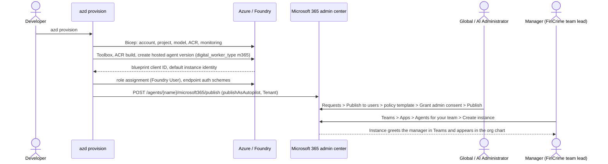

# 04 · Architecture and components

 — open `docs/architecture.drawio` in draw.io / diagrams.net or the VS Code Draw.io extension (six pages: *Solution*, *Identity*, *Lifecycle*, *RFP Bid Desk*, *Hiring steps & permissions*, *Analogy*). The last three are explained in [13 · Identity analogy, hiring steps and permissions](13-identity-analogy-and-hiring.md).

## Services at a glance

| Layer | Service | Used for | Billing |
|---|---|---|---|
| Azure | **Microsoft Foundry** account + project | Hosts the model, the hosted agent, the Toolbox and traces | No standing charge |
| Azure | **Foundry Models**: `gpt-6.1-sol`, Global Standard, 100K TPM | Reasoning and tool calling (Responses API) | Per token |
| Azure | **Foundry Agent Service**: hosted agent, 1 vCPU / 2 GiB container | Runs the autopilot's code (Microsoft 365 activity protocol) | Per vCPU-hour and GiB-hour while sessions are active |
| Azure | **Foundry Toolbox**: web search + code interpreter | Public research and ad-hoc analysis | Per use |
| Azure | **Azure AI Content Safety** (default guardrails incl. Prompt Shields) | Filters every model call; blocked the jailbreak scenario | Included with the model deployment |
| Azure | **Azure Container Registry** Basic + ACR Tasks | Stores and builds the agent image in the cloud | About USD 5/month + build time |
| Azure | **Application Insights + Log Analytics** | Traces per turn, tool call and version | Per GB ingested (first 5 GB/month free) |
| Entra | **Microsoft Entra Agent ID** | Agent identity blueprint, agent identities, one agent user per instance | Free (foundational) |
| Microsoft 365 | **Microsoft Agent 365** (Frontier preview) | Approval, registry, hiring, blocking, Microsoft 365 MCP tool servers, notifications | Frontier seats USD 0 in preview; per human user at GA |
| Microsoft 365 | **Exchange Online, Teams, OneDrive/SharePoint, Word, Excel, Outlook calendar** | The autopilot's workplace: mailbox, chats, case notes | Included in E7 + Teams |
| Microsoft 365 | **Microsoft 365 admin center** (Agents, Copilot Frontier setting) | Enrollment, approval wizard, registry | Included |
| Microsoft 365 (optional) | **Microsoft Purview** (audit, DLP), **Microsoft Defender** for AI | Audit trail, data protection, threat detection for agents | Included in E7 |
| Tooling | **Microsoft Graph** | Demo scripts: send the alert email, create the personas | Free |
| Azure (optional, RFP Bid Desk) | **Azure AI Search** Basic, Entra ID only | One answer-library index per bid team; each hired instance's own identity reads only its index ([12](12-rfp-bid-desk.md)) | About USD 75/month while deployed (`ENABLE_BID_DESK=true`) |

**Not used:** Cosmos DB, Azure Storage, Key Vault, API Management, an Azure Bot Service resource (the Microsoft 365 channel is built into the hosted agent endpoint), Copilot Studio, Windows 365 for Agents. Azure AI Search is deployed only with the optional RFP Bid Desk. Private networking (VNet, private endpoints, Azure Firewall) is available as an optional variant but isn't deployed; see [19 · Private networking and channel security](19-private-networking-and-channel-security.md) for what changes when it is. Measured costs are in [05 · Cost model](05-cost-model.md).

## 1. Components

### Azure (deployed by `azd provision` into `rg-fsi-autopilot`, Sweden Central)

| Component | Resource | Purpose | Notes |
|---|---|---|---|
| Foundry account | `Microsoft.CognitiveServices/accounts` kind `AIServices`, SKU S0 (`fsifincrime03acct`) | Hosts the project, model deployment and agent runtime | System-assigned identity; public network access (private variant available) |
| Foundry project | `accounts/projects` (`fsifincrime03proj`) | Agents, Toolbox, connections, traces | System-assigned identity with AcrPull and monitoring roles |
| Model deployment | `gpt-6.1-sol` 2026-09-29, **GlobalStandard, 100K TPM** | The autopilot's reasoning model (Responses API + tool calling) | GA until 2028-03; configurable (`MODEL_NAME_OVERRIDE`, `MODEL_CAPACITY`) |
| **Hosted agent** | Agent `fsifincrime03-fincrime-autopilot`, `kind: hosted`, `digital_worker_type: m365` | Runs the container (1 vCPU / 2 GiB) serving the **activity protocol 2.0.0** at `/activity/messages` | Each `azd provision` creates a new immutable **agent version** pinned to a unique image tag |
| Container registry | ACR Basic (`fsifincrime03acr`) | Stores `fincrime-autopilot:<timestamp>` images | Images are built **in the cloud** with ACR Tasks (no local Docker) |
| Foundry Toolbox | `foundry-autopilot-tools` | One managed MCP endpoint for **web search** and **code interpreter** | Agent authenticates with its managed identity |
| Monitoring | Log Analytics + Application Insights (connected to the project) | Foundry traces per turn, tool call and version | Message content capture off by default |

### Microsoft Entra ID

| Object | Created by |
|---|---|
| Agent identity blueprint (app + service principal) | Foundry, at agent creation |
| Agent identity (default instance) | Foundry, at agent creation |
| Agent identity + **agent user account** per hired instance | Microsoft 365, at hire |

### Microsoft 365 / Agent 365

| Component | Role in the demo |
|---|---|
| Microsoft 365 admin center **Agents** page | Blueprint request appears in **Requests**; approval wizard (publish to users, policy template, consent, review); **Registry** shows the fleet |
| Teams store **Agents for your team** / Copilot **Agents** | Where managers **Create instance** |
| Exchange Online mailbox, Teams presence, OneDrive, org chart | The autopilot's own workplace identity |
| Agent 365 tool servers (MCP): Mail, Teams, Word, Excel, OneDrive/SharePoint, Calendar | Microsoft 365 actions as the agent user |
| Agent 365 notifications | Email, Word/Excel/PowerPoint comment events delivered to the container |
| Purview / Defender for agents | DLP, audit, eDiscovery, communication compliance, threat detection (licensed) |

### Inside the container (this repository)

| Module | Responsibility |
|---|---|
| `host_agent_server.py` | Microsoft 365 Agents SDK host (aiohttp): `/activity/messages`, `/readiness`; Teams message and Agent 365 notification handlers; `NO_REPLY` suppression; App Insights / OpenTelemetry |
| `agent.py` | Per turn: tenant and sender checks, entitlement context, instructions, MCP tool bundle with the per-turn agentic token, Toolbox, and the FSI tool loop |
| `prompts.py` | FinCrime triage instructions (memo format, four-eyes, tipping-off, data handling, untrusted content, `NO_REPLY`) |
| `tool_loop.py` | Responses API loop: resolves local `function_call` items and chains `previous_response_id` |
| `fsi_tools.py` | Seven **read-only** function tools with strict JSON schemas |
| `fsi_indicators.py`, `fsi_screening.py`, `fsi_data.py` | Deterministic risk indicators, sanctions/PEP screening, synthetic data access |
| `guardrails.py` | `NO_REPLY`, sender allow-list, cross-tenant check, tipping-off and injection detectors, segment entitlement |
| `data/*.json` | Synthetic Contoso Bank data: 6 customers, 6 alerts, 53 transactions, sanctions/PEP lists, 11 policies |
| `scenario.py` | `AUTOPILOT_SCENARIO` switch (`fincrime` default, `rfp` = RFP Bid Desk): help text, `/whoami` parsing. One image serves both autopilots |
| `token_debug.py` | Token inspector (`TOKEN_DEBUG`): decodes the JWT payload only, logs one-line claim summaries with structured dimensions, `/whoami`, optional reply footer (`TOKEN_FOOTER`). Never logs raw tokens |
| `instance_tokens.py` | Per-instance tokens for Azure resources: agent identity (T1 + client assertion), session identity, agent user, or the shared container credential |
| `rfp_tools.py`, `rfp_prompts.py`, `search_client.py`, `ToolingManifest.rfp.json` | RFP Bid Desk brain: past-answer search tools over Azure AI Search with the instance's own token, instructions, scoped MCP tools ([12](12-rfp-bid-desk.md)) |

## 2. Key flows

### 2a. Build → publish → approve → hire



#### Publication request versus generated manifest

**Yes: Foundry generates a Microsoft 365/Teams app manifest and ZIP package when
publishing.** The local publish script supplies the request metadata, not the
finished package. These artifacts are different:

| Artifact | Meaning |
|---|---|
| Publication-request JSON | The body sent by `scripts/publish-digital-worker.ps1`: display metadata, `appVersion`, scope, permissions and optional template settings. |
| `manifest.json` in the generated ZIP | Microsoft 365 app metadata, service-generated app/bot identities, capabilities and asset references. The package also contains `icon-color.png`, `icon-outline.png` and any supporting files. |
| `agenticUserTemplateManifest.json` | Companion agent-user template referenced by the app manifest's `agenticUserTemplates` array. The reference has `id` and `file`; the companion uses `id`, `schemaVersion`, `agentIdentityBlueprintId` and `communicationProtocol`. These are not the PascalCase publish-request property names. |
| Entra application manifest | Identity-registration settings, not the Microsoft 365 app package. |
| `ToolingManifest.json` / `ToolingManifest.rfp.json` | This repository's MCP server/tool configuration, not a publication manifest. |
| Hosted agent definition/version | Container, runtime and agent configuration, independently versioned from the published app. |

`appVersion` is the published app metadata version, not the hosted runtime version.
An older technical name and a newer friendly name can reflect different publication
metadata; the labels alone do not prove which runtime version is serving traffic.

**Offline preview (no authentication or cloud calls):**

```powershell
# Uses the current process environment, or the script's defaults; does not load azd.
$output = Join-Path $env:TEMP "fincrime-publication-request.preview.json"
.\scripts\publish-digital-worker.ps1 -BlueprintClientId "<blueprint-client-id>" `
    -Preview -OutputPath $output
Get-Content -LiteralPath $output
```

`-Preview` uses the same body builder and JSON serialization as publishing, then
returns before token acquisition, REST calls or `azd env set`. Without `-OutputPath`,
it emits the JSON on the success stream. `-OutputPath` is rejected without
`-Preview`; missing directories and other file-write errors fail explicitly.
The usual environment overrides still apply. The placeholder blueprint ID is
unused unless `INCLUDE_AGENTIC_USER_TEMPLATE=true`; a placeholder in that mode
remains an illustrative request, not publishable identity data. Real identifiers
and environment-specific output must stay out of version control.

**Obtaining a service-generated package is a separate operation.** Microsoft's
[Foundry portal guide](https://learn.microsoft.com/azure/foundry/agents/how-to/publish-copilot#download-and-customize)
documents **Publish > Teams and Microsoft Copilot > Next: Publish options >
Download & customize > Download ZIP**. Extract it and inspect `manifest.json`
and its referenced files; do not upload it merely to inspect it. Preserve
service-generated IDs and agent sections when customizing metadata or icons.

The [REST download operation](https://learn.microsoft.com/azure/foundry/agents/how-to/publish-copilot-virtual-network#download-and-inspect-the-app-package)
is `POST {endpoint}/agents/{agent-name}/microsoft365/zip?api-version=v1`, using
the publication request body. It generates and validates a package; it is **not
a historical export of an already-published version**. Although it does not
submit to the catalog or create a publish record, package preparation **can
update the agent endpoint configuration** and requires agent write permission.
Do not treat download/generation as a read-only cloud operation. The local
preview never calls it.

Schemas: [Microsoft 365 app manifest](https://learn.microsoft.com/microsoft-365/extensibility/schema/)
and [agentic user template reference and companion schema](https://learn.microsoft.com/microsoft-365/extensibility/schema/agentic-user-template-ref).
The [autopilot quickstart](https://learn.microsoft.com/azure/foundry/agents/how-to/agent-365)
documents the optional template's publish-request shape. A preview is not a
schema-validated app package or evidence of any tenant's published contents.

### 2b. Event-driven triage: alert email with nobody present

1. The transaction-monitoring system (simulated by `demo/send-tm-alert.ps1`) emails **the autopilot's own mailbox**: `[TM ALERT] ALR-2026-1043 …`.
2. Agent 365 delivers an **email notification** to `/activity/messages`.
3. The container checks tenant and sender domain, builds the entitlement context from the instance's name, and calls the model with the email instructions.
4. The model calls `get_alert`, `get_customer_profile`, `get_transactions`, `compute_risk_indicators`, `screen_party` and `get_policy`. The container executes them locally.
5. The final triage memo goes back **as an email reply from the autopilot** and, if `TRIAGE_NOTIFY_CHAT_NAME` is set, as a three-line summary in the team chat.

### 2c. Group chat collaboration

An analyst @mentions the instance in the team chat. The host sends a typing indicator (no "working on it" noise in groups), runs the same loop, and replies in the thread. Messages not meant for the autopilot get `NO_REPLY`. Requests to "post to / email" someone add the Teams or Mail MCP tool for that turn only.

### 2d. Word / Excel / PowerPoint comment @mention

A user @mentions the instance in a document comment (for example, pastes an alert email into Word and assigns the comment to the instance). Agent 365 delivers a `message` activity on the `agents` channel (sub-channel `word`, `excel` or `powerpoint`) with a `WpxComment` entity. The host hands it to the comment flow: the model reads the document with `GetDocumentContent` and replies on the thread with `ReplyToComment` from the matching Word/Excel/PowerPoint MCP server.

The `agents` channel (email and document comments) accepts only `message` and `event` activities. It rejects `typing` with HTTP 400 `BadArgument`, so the host sends typing indicators only on chat channels such as Teams.

### 2e. Per-instance identity for Azure data (RFP Bid Desk)

The FinCrime instances call Azure only through the shared default instance identity, and their segment entitlement is enforced in code. The RFP Bid Desk shows the stronger pattern: for each Search call the container obtains **the token of the instance that received the activity** (its agent identity by default), and Azure AI Search authorises it against an index-scope role assignment. The container's own identity has no Search role. `/whoami` shows each identity's claims, in any channel. Details, flows and the KQL query: [12 · RFP Bid Desk](12-rfp-bid-desk.md).

## 3. Configuration (azd environment → container)

| Variable | Default | Effect |
|---|---|---|
| `MODEL_NAME_OVERRIDE`, `MODEL_VERSION_OVERRIDE`, `MODEL_CAPACITY` | `gpt-6.1-sol`, `2026-09-29`, `100` | Model deployment |
| `ALLOWED_SENDER_DOMAINS` | *(empty = any)*; set to the tenant domain here | Email sender allow-list |
| `TRIAGE_NOTIFY_CHAT_NAME` | *(unset)* | Teams chat to post email-triggered triage summaries |
| `SEGMENT_SCOPE_RULES` | built-in (retail / corporate / sme / cib) | JSON map from instance-name keyword, or agent-user object ID, to entitled segments. It replaces the built-in rules. Teams activities carry only the agent user's ID, so map each instance's ID too (docs/08 Step 5) |
| `AGENT_CPU`, `AGENT_MEMORY` | `1`, `2Gi` | Container size (multiplies compute cost) |
| `AGENT_AUTH_SCHEMES` | `Entra,BotServiceTenant` | Endpoint authorization schemes |
| `CAPTURE_MESSAGE_CONTENT` | `false` | Prompt/response text in Application Insights traces |
| `AGENT_DISPLAY_NAME`, `AGENT_APP_VERSION`, `CAN_RESPOND_WITHOUT_MENTION` | `FinCrime Alert Triage`, `1.0.0`, `false` | Publication metadata (raise the version to republish) |
| `INCLUDE_AGENTIC_USER_TEMPLATE` | `false` | Adds the quickstart's explicit agentic-user template fields to the publish call |
| `MAX_TOOL_ROUNDS` | `8` | Upper bound on tool-calling rounds per turn |
| `TOKEN_DEBUG`, `TOKEN_FOOTER` | `false`, `false` (bid desk: `BID_DESK_TOKEN_DEBUG=true`) | Token inspector: claim summaries in logs, `/whoami`; "Acted as" footer on replies |
| `ENABLE_BID_DESK` | `false` | Deploys Azure AI Search, the answer-library indexes and the second hosted agent `<env>-rfp-bid-desk` |
| `BID_DESK_SEARCH_TOKEN_FLOW` | `agent_identity` | How the bid desk gets each instance's Search token (`agent_identity`, `session_identity`, `agent_user`) |
| `BID_TEAM_CHAT_NAME`, `BID_TEAMS`, `BID_TEAM_RULES` | *(unset)*, built-in | Reminder chat; team → index map; instance-name keyword → team |
| `BID_COLLEAGUES`, `COLLEAGUE_MAX_TURNS`, `COLLEAGUE_WINDOW_SECONDS` | *(unset: off)*, `3`, `600` | Bid desk only: agent-user object ID → instance name of the hired instances (written by `sync-bid-desk-instances.ps1`), and the per-chat budget for turns sent by another instance ([doc 17](17-agents-collaborating-in-meetings.md)) |
| `MCP_ENFORCE_ALLOWLIST` | `true` | Passes each server's `allowedTools` (scenario manifest) as `allowed_tools` |

## 4. What changed versus the official sample

| Area | Sample | This repo | Why |
|---|---|---|---|
| Brain | Single Responses API call with Microsoft 365 MCP + Toolbox | Adds seven read-only FSI function tools and a tool loop | Deterministic, auditable domain evidence |
| Model | `gpt-chat-latest` 2026-05-28 (preview, deprecates 2026-12-08), capacity 5 | `gpt-6.1-sol` (GA), capacity 100 | Longevity and headroom for tool-heavy turns |
| Endpoint auth | `BotServiceRbac` | `Entra` + `BotServiceTenant` with code-level tenant and sender checks | Email-triggered alerts must reach the agent |
| Group behaviour | Responds to every message | `canRespondWithoutMention=false`, `NO_REPLY`, ack only in 1:1 chats | No noise in team chats |
| Tokens in scripts | `az … --tenant` | `az … --subscription` | Avoids silently using a guest identity |
| Image | `:latest` | Unique tag per build | Immutable versions, reliable rollback |
| Bicep | Project and model deployment in parallel | Serialised | Fixes `RequestConflict` on first provision |
| Azure DevOps MCP | Optional scope requested | Removed | Smaller consent surface |
