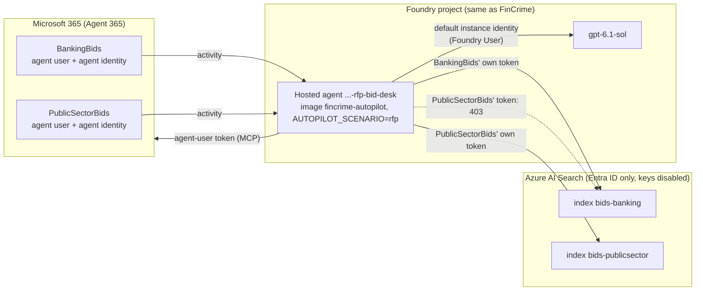

# 12 · RFP Bid Desk: per-instance identity, end to end

A second autopilot next to FinCrime, built to show **per-instance identity**: one container image, one blueprint, one hosted agent, and several hired instances. Each instance can read **only its own team's data**, and Azure, not the prompt, enforces it. A **token inspector** (`/whoami`) shows which identity each call used.

> All companies, clients, past bids and answers are **fictional, synthetic** data (Fabrikam Cloud Services is the bidder). Humans own submission, pricing and commitments.

## 1. The problem

Pre-sales bid teams answer RFPs, RFIs and security questionnaires: often 300 questions in 2 to 4 weeks. About 70% of the answers already exist in past bids, buried in Word files. Bid managers spend days copying, chasing SMEs and tracking status in Excel. And answers written for one client or industry must not leak into another team's bids (a banking data residency commitment is not a public sector one).

## 2. What the autopilot does

| Channel | Example | What happens |
|---|---|---|
| **Email intake** | The bid manager emails the RFP to `bankingbids@…` (text in the body, or a link to the Word document) | The instance extracts up to 15 requirements, searches **its own team's answer library** (`search_past_answers_batch`), creates a Word document *"Bid WB-2026-117 - compliance matrix and draft (AI draft)"* with the matrix (Reusable answer found / Needs SME / Human decision, proposed owner, source) and the draft answers, each with **Source: past bid, client, year, section**, shares it and replies with a summary and the link |
| **Word comment** | "@BankingBids make 4.2 stronger, mention ISO 27001 recertification" | Reads the section, finds supporting past answers, and replies **on the comment thread** with the proposed replacement text and sources. It can't edit the body: a human applies the change. Claims the library doesn't support (for example a date) are flagged for SME confirmation |
| **Teams group chat** | "What's still open?" | Finds its bid documents in its OneDrive, reads them and lists the open items, owners and the deadline |
| **Teams, proactive** | Daily deadline check | A scheduler emails `[bid-desk:daily-check]` to the instance, which posts reminders for bids due within 7 days to `BID_TEAM_CHAT_NAME` (§7) |
| **1:1 chat / Microsoft 365 Copilot** | "What did we commit on data residency to banks last year?" | Searches the library and answers with the exact wording and citations |
| **Isolation** | Ask **PublicSectorBids** for banking answers | The search call carries PublicSectorBids' own token. **Azure AI Search returns HTTP 403** because that identity has no role on `bids-banking`. The instance says so, and `/whoami` shows the refused identity |

What it never does: submit a bid, set prices, accept contractual terms, invent certifications or figures, or read another team's library.

**Why an autopilot, not Copilot:** the work arrives without a person prompting it (an RFP email, the daily deadline check), each bid team needs its own accountable colleague with access to its own library only, and IT governs all the hires from one approved template. The value story for both autopilots, with the customer line, is in [11 §0](11-customer-demo-pitch.md#0-the-story-across-both-autopilots-read-this-first).

## 3. Architecture

Editable diagram: page *RFP Bid Desk* in [architecture.drawio](architecture.drawio); identity analogy and permissions per step: [doc 13](13-identity-analogy-and-hiring.md).



| Identity | What it is | Azure AI Search access |
|---|---|---|
| Container default instance identity (`FOUNDRY_AGENT_DEFAULT_INSTANCE_CLIENT_ID`) | Shared by every instance; used for the model and the Toolbox | **None** (`/whoami probe` shows 403) |
| BankingBids' agent identity (service principal) | Created when BankingBids was hired | **Search Index Data Reader on `bids-banking` only** |
| PublicSectorBids' agent identity | Created at hire | **Search Index Data Reader on `bids-publicsector` only** |
| Agent users (`bankingbids@…`) | Mailbox, Teams, OneDrive | Only with `SEARCH_TOKEN_FLOW=agent_user` (then the role goes on the agent user) |
| Deployer | You | Search Service Contributor + Search Index Data Contributor (creates and loads the indexes) |

The past-bid libraries live in `demo/rfp/library/` and are loaded by `scripts/setup-search-indexes.ps1`. They are **not** in the container image: the container has no copy of any team's data.

Code: `scenario.py` (switch, help text, `/whoami` parsing), `rfp_prompts.py`, `rfp_tools.py` (three function tools), `search_client.py` (REST, Entra bearer), `instance_tokens.py` (per-instance tokens), `token_debug.py` (inspector), `ToolingManifest.rfp.json` (scoped MCP tools).

## 4. Per-instance tokens: three routes to the same goal

The hard part: one container serves every instance, and its own credential is shared. The Search call must carry **the token of the instance that received the activity**. `SEARCH_TOKEN_FLOW` selects how:

| Flow | How the token is obtained | Token claims | RBAC on | Consent |
|---|---|---|---|---|
| `agent_identity` **(default)** | The Agents SDK connection issues the blueprint exchange token T1 for this instance (`get_agentic_application_token`, the same first step as the MCP tokens). The agent identity then uses T1 as its client assertion for `https://search.azure.com/.default` ([autonomous app flow](https://learn.microsoft.com/entra/agent-id/agent-autonomous-app-oauth-flow)) | `idtyp=app`, `xms_sub_fct` contains 11, `oid` = agent identity SP, `azp`/`appid` = agent identity, `xms_par_app_azp` = blueprint | Agent identity | None (Azure data-plane roles) |
| `session_identity` | The hosted-agent token service called **without a client ID** returns the current session's instance identity | Same as above | Agent identity | None |
| `agent_user` | `auth.exchange_token(scopes=["https://search.azure.com/.default"])`: the same T1 → T2 → `user_fic` chain as the MCP tools ([agent user flow](https://learn.microsoft.com/entra/agent-id/agent-user-oauth-flow)) | `idtyp=user`, `xms_sub_fct` contains 13, `oid` = agent user, `scp=user_impersonation` | Agent user | Delegated grant of Azure AI Search `user_impersonation` on the agent identity (the grant script adds it), or blueprint consent with Azure AI Search listed as [inheritable](https://learn.microsoft.com/entra/agent-id/concept-inheritable-permissions) |

Why `agent_identity` is the default: Microsoft Entra recommends Azure RBAC on the **agent identity** at the narrowest scope, it needs no OAuth consent, and it also works for autonomous turns with no user (the daily check). The routes have been verified offline only, because Bid Desk instances haven't been hired yet. **Verify in your tenant** with `/whoami probe` (§5): it acquires a Search token with each flow and queries every library, so you can see which flows return 200 on the own index and 403 on the other. If `agent_identity` fails, switch with `azd env set BID_DESK_SEARCH_TOKEN_FLOW agent_user` (or `session_identity`), redeploy the bid desk, and re-run the grant script with the matching `-Flow`.

The same `agent_identity` flow works for **your own API or MCP server**, for example one published behind an API Management AI gateway that checks `roles`: request `api://<your-api>/.default` and give each instance's agent identity an app role. See [doc 15](15-mcp-behind-ai-gateway.md).

Tokens are cached per instance and scope until 5 minutes before expiry. A failure never crashes the turn: the tool returns `token_unavailable`, and the model says the library is unavailable.

## 5. Token inspector

Enabled per agent version with `TOKEN_DEBUG=true` (on by default for the bid desk, off for FinCrime: `BID_DESK_TOKEN_DEBUG`, `TOKEN_DEBUG`). It only ever base64-decodes the JWT **payload**. Raw tokens and signatures are never logged, returned or stored.

### `/whoami` in every channel

| Channel | How to ask | Reply |
|---|---|---|
| Teams 1:1, group chat (@mention), Microsoft 365 Copilot | `/whoami` or `/whoami probe` | Markdown in the conversation |
| Email | `/whoami` in the subject or body | Email reply (HTML) |
| Word / Excel comment | `@BankingBids /whoami` | Reply on the comment thread |

It lists the instance (agent identity and agent user IDs, tenant), then the claims of: (1) the agent-user token for the Microsoft 365 tools, (2) the shared container credential, and (3) the Search token for the configured flow, followed by a live query of every library (HTTP 200 / 403). `probe` adds the other flows and a query with the container credential, which must be refused. With `TOKEN_DEBUG` off it replies that the inspector is off.

### Claims shown

| Claim | Meaning |
|---|---|
| `kind` | Derived: `agent-user` (`idtyp=user` + `xms_sub_fct` 13), `agent-identity` (`idtyp=app` + `xms_sub_fct` 11), `container-default-identity` (actor = default instance), `human-user-delegated` |
| `instance` | The hired instance, when `oid` matches the activity's agent user or `azp` its agent identity |
| `oid` | Agent user (user flows) or agent identity service principal (app flows) |
| `azp` / `appid` | Actor: the agent identity's application ID |
| `xms_par_app_azp` | Parent: the blueprint |
| `idtyp`, `xms_sub_fct`, `xms_act_fct` | Subject type and facets (11 = agent identity, 13 = agent user) |
| `scp` / `roles` | Delegated scopes / application roles |
| `aud`, `tid`, `exp` | Audience, tenant, minutes to expiry |

Reference: [Token claims for agents](https://learn.microsoft.com/entra/agent-id/agent-token-claims).

### In logs and Application Insights

Every token acquisition (MCP, Search, container credential) logs one line, for example
`🔑 token[search] kind=agent-identity instance=BankingBids oid=… appid=… xms_par_app_azp=… idtyp=app xms_sub_fct=9 3 11 aud=https://search.azure.com exp_in=59m`,
with the same values as structured dimensions (`token_kind`, `token_instance`, `token_oid`, `token_azp`, `token_appid`, `token_parent_app`, `token_idtyp`, `token_sub_fct`, `token_act_fct`, `token_aud`, `token_tid`, `token_scp`, `token_roles`) and as `agent.token.<label>.*` attributes on the current span.

```kusto
// Which identity called what, per instance (last 24 h)
AppTraces
| where TimeGenerated > ago(1d)
| where Properties has "token_kind"
| extend p = parse_json(Properties)
| project TimeGenerated, label = tostring(p.token_label), kind = tostring(p.token_kind),
          instance = tostring(p.token_instance), oid = tostring(p.token_oid),
          actor = coalesce(tostring(p.token_azp), tostring(p.token_appid)), parent = tostring(p.token_parent_app),
          idtyp = tostring(p.token_idtyp), sub_fct = tostring(p.token_sub_fct), aud = tostring(p.token_aud), OperationId
| order by TimeGenerated desc

// Isolation beat: library calls refused by Azure RBAC
AppTraces
| where TimeGenerated > ago(1d)
| where Message startswith "RFP tool" and Message has "access_denied"
| project TimeGenerated, Message, OperationId
```

### Optional reply footer

`TOKEN_FOOTER=true` (`BID_DESK_TOKEN_FOOTER`, off by default) appends `Acted as: BankingBids · agent identity 1a2b3c4d · token for https://search.azure.com` to Teams and email replies. It prefers the per-instance Search token used in the turn, otherwise the last token used. Comment replies are posted by a tool, so they carry no footer.

## 6. Microsoft 365 tools: scoped

`ToolingManifest.rfp.json` attaches only Word, Mail, OneDrive/SharePoint and Teams (no Excel, no Calendar). For Word and OneDrive/SharePoint, `allowedTools` is passed to the Responses API as `allowed_tools`, so delete, move and rename tools are never offered. Mail and Teams are not allowlisted: their live tool names differ from the published references, and a list that matches nothing silently removes every tool (on 2026-11-02 Teams offered `[]`, so the daily check couldn't post). The container logs `MCP tools offered by <server>: [...]` once per server, and warns when a server offers none. Add an allowlist only from names seen in that log line, or set `MCP_ENFORCE_ALLOWLIST=false` while you fix one. Limits that shape the design: the Mail tools can't download attachments or attach files (RFP text goes in the body, or as a Word link). The Word tools create documents and reply to comments, but can't edit the body. The Excel tools aren't documented, so the compliance matrix is a Word table.

## 7. Proactive reminders (trigger)

Hosted agents only run when an activity arrives. The lightest trigger needs no extra Azure service: an email from an allowed sender with `[bid-desk:daily-check]` in the subject (and, to be safe, at the start of the body).

Agent 365 delivers email as a `message` on the `agents` channel with a `productInfo` entity `email`, and the subject only in `conversation.topic`, which the Agents SDK model drops. The host keeps the topic from the raw request, and the agent recognises email by the entity. Before this fix (2026-11-02), emails on that path were treated as chat messages, so the daily check never ran.

* **Demo:** `pwsh ./demo/send-bid-reminder.ps1 -To bankingbids@<domain> -WithinDays 14`. The window defaults to 7 days, and the instance stays silent when no bid is due within it: the demo bid WB-2026-117 is due 2026-11-13, so use 14 before 2026-11-06. Verified on 2026-11-02, when BankingBids read the bid document and posted the 9 open items with owners to "Woodgrove bid team".
* **Every day:** a Power Automate scheduled cloud flow (Recurrence 08:00 → Office 365 Outlook *Send an email (V2)*, same subject, body starting with `[bid-desk:daily-check]`, to each instance), owned by a service account in `ALLOWED_SENDER_DOMAINS`.

The instance treats it as a scheduler message: it posts reminders to the Teams chat named `BID_TEAM_CHAT_NAME` (plain text, open items with owners, days left) and doesn't reply to the email. A Logic App recurrence works too, but adds an Azure resource.

## 8. Deploy

Prerequisites: the FinCrime deployment (same azd environment), Owner on the subscription (activate PIM first in Zava), and **2 free Frontier seats** for the two hires.

```powershell
azd env set ENABLE_BID_DESK true
azd env set BID_TEAM_CHAT_NAME "Woodgrove bid team"     # optional, for reminders
# optional: azd env set BID_DESK_SEARCH_TOKEN_FLOW agent_identity | session_identity | agent_user
# optional: azd env set BID_DESK_SEARCH_LOCATION northeurope      # Search in another region when the main one has no capacity (needs semantic ranker support)
azd provision -e fsifincrime03 --no-prompt              # Search service, indexes + data, second agent, publish
```

`azd provision` registers `Microsoft.Search`, deploys `<env>-bids-search` (Basic, keys disabled, free semantic ranker), runs `setup-search-indexes.ps1` (indexes `bids-banking` and `bids-publicsector`), then `deploy-bid-desk-agent.ps1`. That script creates the hosted agent `<env>-rfp-bid-desk` (`AUTOPILOT_SCENARIO=rfp`, `TOKEN_DEBUG=true`), retires old sessions and publishes **"RFP Bid Desk"** for approval. Its azd values are written with the `BID_DESK_` prefix (`BID_DESK_AGENT_BLUEPRINT_CLIENT_ID`, …), so FinCrime's are kept. Code-only updates: `azd hooks run postprovision` (rebuilds the image and creates new versions of **both** agents).

Then (humans):

1. **Approve** "RFP Bid Desk" in the Microsoft 365 admin center (Agents > Requests), as for FinCrime ([08](08-deployment-runbook.md) Step 4).
2. **Hire** `BankingBids` and `PublicSectorBids` (Teams > Apps > Agents for your team > RFP Bid Desk > Create instance). Only hires made this way appear under the agent's **Instances** in the admin center. The instance name decides the default library (`banking` / `publicsector` keywords; override with `BID_TEAM_RULES`).
3. **Wire up the hires** (developer, Owner active). Teams activities carry only an instance's IDs, not its name, and each hire gets new IDs. One script maps the current instances' agent-user and agent-identity IDs in `BID_TEAM_RULES` (dropping deleted ones), grants each instance Search Index Data Reader on **its own index only**, and rolls out a new bid desk version. Without `-Apply` it only prints the plan:
   ```powershell
   pwsh ./scripts/sync-bid-desk-instances.ps1 -Apply
   ```
   To grant one instance by hand instead: `pwsh ./scripts/grant-bid-team-access.ps1 -Instance BankingBids -Team banking -Apply`. It warns about any wider Search role.

   **Without the admin center (API only, used in Zava on 2026-11-01, replaced on 2026-11-02):** grant the blueprint's admin consent with Microsoft Graph (as a Global Administrator): `POST /oauth2PermissionGrants` from the bid desk blueprint principal to *Agent Tools* (`ea9ffc3e-…`, scope `McpServers.Word.All McpServers.Mail.All McpServers.OneDriveSharepoint.All McpServers.Teams.All`) and to *Messaging Bot API Application* (`5a807f24-…`, `AgentData.ReadWrite`), consent type `AllPrincipals`, plus the *Agent365Observability* app role `Agent365.Observability.OtelWrite`. Then hire with `pwsh ./scripts/create-instance-entra.ps1 -Name BankingBids -Alias bankingbids -Manager <you> -BlueprintAppId <BID_DESK_AGENT_BLUEPRINT_CLIENT_ID> -Apply` (and `PublicSectorBids`). Instances created this way work in Teams and email but **don't appear under the agent's Instances** in the admin center, and there is no API to register them afterwards. To switch to admin-center hires, delete the agent user and agent identity, purge both from the deleted items (otherwise the alias stays taken), re-hire in Teams and run the sync script.
4. **Verify** (allow a few minutes for RBAC): chat `/whoami probe` with each instance. Expect HTTP 200 on its own library, 403 on the other, and 403 for the shared container.
5. Create a Teams group chat "Woodgrove bid team" with both humans and BankingBids. After a re-hire, add the new BankingBids to the chat again: the old member was deleted with its agent user.

Cost: Azure AI Search Basic is billed per hour (about USD 75 per month; check the [pricing calculator](https://azure.microsoft.com/pricing/calculator/)). Semantic ranker free plan: 1,000 queries per month. Delete it with `scripts/teardown.ps1` (whole resource group), or set `ENABLE_BID_DESK=false` and remove the service.

## 9. Run of show (12 minutes)

| # | Beat | Do | Point to make |
|---|---|---|---|
| 1 | Intake | `pwsh ./demo/send-rfp.ps1 -To bankingbids@<domain>` | An RFP becomes a cited draft and a matrix in minutes. Pricing (Q12) is a Human decision; post-quantum (Q11) is "Needs SME" |
| 2 | Word comment | In the shared document: "@BankingBids make 4.2 stronger, mention ISO 27001 recertification" | The reply lands on the thread with sources. The human applies it |
| 3 | Team chat | "@BankingBids what's still open?", then `demo/send-bid-reminder.ps1 -WithinDays 14` | It tracks the bid and nudges owners proactively |
| 4 | Recall | 1:1 or Microsoft 365 Copilot: "What did we commit on data residency to banks last year?" | Exact wording with the source (Northwind Mutual 2025, §5.4) |
| 5 | Isolation | Ask **PublicSectorBids**: "What did we commit on data residency to banks?" then `/whoami probe` | **Azure returned 403**: the boundary is Azure RBAC on each instance's own identity, not a prompt. The inspector shows which identity was refused |

## 10. Roles

| Who | Role | For |
|---|---|---|
| Deployer | Owner (or Contributor + Role Based Access Control Administrator) on the resource group | Search service and its role assignments |
| Deployer | Search Service Contributor + Search Index Data Contributor (assigned by Bicep) | Create and load the indexes |
| Whoever runs `grant-bid-team-access.ps1` | Owner or User Access Administrator on the Search service; Graph read of agent identities. For `agent_user`: also Agent ID Administrator or Cloud Application Administrator (delegated grant) | Index-scope role assignments |
| Global or AI Administrator | Approve "RFP Bid Desk" | Publication |
| Managers | Licensed users in the hiring scope | Hire and onboard the instances |

## 11. Known limitations

* **Verified live in Zava on 2026-11-01** (agent version 3, hires created with the Entra APIs, Search in North Europe):
  * `/whoami probe` in Teams: BankingBids' own agent-identity token → `bids-banking` HTTP 200, `bids-publicsector` HTTP 403; PublicSectorBids the reverse; the shared container identity → 403 on both. The `agent_identity` and `session_identity` flows both returned the instance's agent identity; `agent_user` returned no token (no Azure AI Search consent on the agent identity), so keep the default `agent_identity`.
  * Recall (1:1 chat): BankingBids quoted the data-residency commitments with sources (Northwind Mutual 2025 §5.4, Woodgrove Bank 2025 §3.1). Isolation: PublicSectorBids, asked for banking answers, replied that Azure AI Search denied its identity (403).
  * Email intake: `demo/rfp/woodgrove-bank-rfp.md` emailed to BankingBids → within about 75 seconds a shared Word "compliance matrix and draft" and a summary reply (3 reusable, 3 Needs SME, 6 Human decision; no prices proposed).
  * Group chat "Woodgrove bid team": "@BankingBids what's still open?" → 9 open items with owners; the first attempt hit SharePoint throttling (retry after 120 s). PublicSectorBids, also in the chat, stayed silent apart from its greeting.
  * Application Insights shows the `token[search:…]` lines per instance (`oid` of each agent identity).
  * Not automated: the Word-comment beat (Graph has no API to post Word comments with @mentions); test it by hand.
* Index-scope role assignments can't be made in the Azure portal or Bicep (indexes aren't ARM resources). The script uses the Azure CLI.
* Azure RBAC changes on the Search data plane can take several minutes.
* The app-specific Agent 365 MCP servers (Mail, Word, Teams, OneDrive/SharePoint) are documented as backward compatibility; Work IQ is the long-term path.
* Intake handles up to 15 requirements per email, to stay within the tool budget of a turn. A 300-question RFP needs batching (or a document-processing step) beyond this demo.
