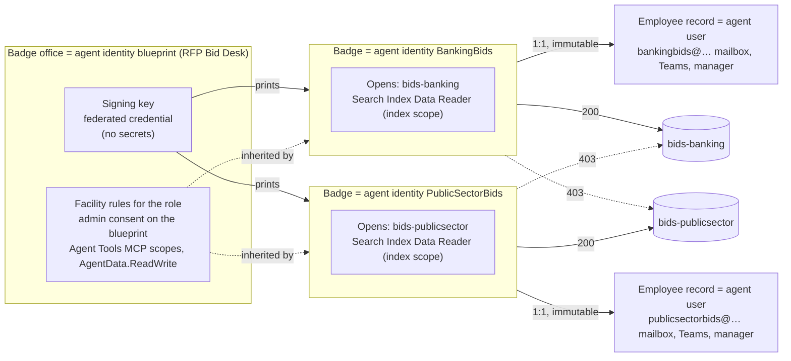
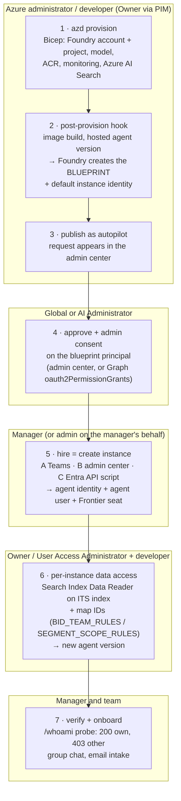

# 13 · Blueprint, agent identity and agent user: analogy, hiring steps and permissions

This page explains the three Entra Agent ID objects behind every autopilot with one analogy, then shows the **prerequisites**, the **steps to get a working instance**, **who does each step**, and **which permission is granted where**. It uses the two autopilots deployed in the Zava demo tenant: *FinCrime Alert Triage* (MiraRetail, TheoCorporate) and *RFP Bid Desk* (BankingBids, PublicSectorBids, verified end to end on 2026-11-01).

Visuals: the Mermaid diagrams below render on GitHub; the editable versions are pages **Analogy**, **Hiring steps & permissions** and **RFP Bid Desk** in [architecture.drawio](architecture.drawio) (open in [draw.io](https://app.diagrams.net) or the VS Code Draw.io extension).

## 1. The analogy: a badge office, a badge and an employee record

[10 · Learning guide §2](10-learning-guide.md#2-mental-model-one-blueprint-many-hires) introduces the HR picture (job description → employees). This section zooms in on **who holds the key, who holds the permissions and who shows up in the audit log**, because that is where people get confused.

> **The blueprint is the badge office for one job role.** It keeps the badge printer and the signing key, and it can do exactly one thing: print or revoke badges for that role.
> **Each agent identity is one printed badge.** Doors (Azure, Microsoft 365) check the *badge*, not the badge office. Permissions are attached to the badge, and the access log records the badge.
> **Each agent user is the employee record behind one badge**: a desk, a mailbox, a Teams account, a place in the org chart and a manager.

| In the badge office | In Entra Agent ID | Zava example (RFP Bid Desk) |
|---|---|---|
| Badge office for the role "bid desk analyst", with the printer and the signing key | **Agent identity blueprint** (application + blueprint principal). Holds the credential (a federated credential from the Foundry managed identity, no secrets). It can only create and delete agent identities | `…-rfp-bid-desk-…-AgentIdentityBlueprint`, client ID `887b8e0d-…` |
| Facility rules for everyone in that role: canteen, intranet | **Admin consent on the blueprint**: OAuth permissions granted to the blueprint apply to all agent identities created from it | Agent Tools `McpServers.Word/Mail/OneDriveSharepoint/Teams.All`, Messaging Bot API `AgentData.ReadWrite` |
| One printed badge | **Agent identity**: a service principal per instance. It is the *actor* in every token (`azp`/`appid`) and in the sign-in and audit logs | BankingBids `35b5cd0a-…`, PublicSectorBids `94b2c6ce-…` |
| A door that opens for one badge only | **Azure RBAC or Microsoft 365 access on that agent identity** | `Search Index Data Reader` on `bids-banking` only, for BankingBids |
| The employee's desk, mailbox, Teams account and manager | **Agent user**: a user object whose parent is the agent identity (1:1, immutable). It holds the Frontier licence | `bankingbids@…` (`76c77979-…`), manager `sanjaytest` |
| The office's own staff pass, used to run the building | **Default instance identity** of the hosted agent: what the shared container uses for Foundry (model, Toolbox) | `733f9c53-…`: no Search role, so Search returns 403 |
| Switch off the printer: every badge from that office stops working | **Disable or delete the blueprint**: none of its agent identities can authenticate; deleting cascades to all of them | Kill switch for the whole fleet |
| Deactivate one badge | **Block or offboard one instance** | Block BankingBids only |
| Security cameras record the badge number and which office printed it | Token claims: `azp`/`appid` = agent identity, `xms_par_app_azp` = parent blueprint, `oid` = whoever the token is *for* | `/whoami` shows these (doc 12 §5) |

**Why the split matters.** The badge office (blueprint) holds the only key, so a compromised blueprint affects every badge it printed; that's why the blueprint count is a security boundary. Permissions live on each badge, so two badges from the same office can open different doors. That is exactly what the RFP Bid Desk shows: **one container, one blueprint, two instances, two different Azure AI Search indexes**, and Azure itself refuses the wrong one.

### The three kinds of token, in badge terms

| Situation | Analogy | Token | `idtyp` / `xms_sub_fct` | Used here for |
|---|---|---|---|---|
| The badge office proves who it is to the printer | The office's master key | **T1**: blueprint token (federated credential of the Foundry managed identity) | n/a (never sent to a resource) | Input to the next two exchanges |
| The badge is swiped at a door | Badge swipe | **Agent identity token** (autonomous, app-only) | `app` / `11` (agent identity) | Azure AI Search as the instance (`SEARCH_TOKEN_FLOW=agent_identity`) |
| The employee logs in at their own desk | Employee login | **Agent user token** | `user` / `13` (agent's own user account) | Microsoft 365 tools (Mail, Teams, Word, SharePoint MCP servers) |

## 2. Prerequisites

| # | Prerequisite | Who | How to check | Zava |
|---|---|---|---|---|
| P1 | Tenant enrolled in **Frontier**, with free **Frontier seats** (one per instance) | Global Administrator | Microsoft 365 admin center > Billing > Licenses | `MICROSOFT_AGENT_365_TIER_3`, 5 of 25 used |
| P2 | **Owner** (or Contributor + Role Based Access Control Administrator) on the subscription or resource group, **active** | Azure administrator | `az role assignment list --assignee <you> --all` | PIM-eligible: activate first in the Azure portal > Privileged Identity Management > My roles > Azure resources > Owner > **Activate** |
| P3 | **Global Administrator or AI Administrator** to approve the blueprint and grant admin consent | Tenant administrator | Entra > Roles | `sanjaytest`, standing Global Administrator |
| P4 | A **licensed manager** in the hiring scope (mailbox, Teams) | Licence administrator | Admin center > Users | `sanjaytest` holds an E7 |
| P5 | **Model and service capacity** in the chosen regions | Developer | `azd provision` errors such as `InsufficientResourcesAvailable` | Search moved to North Europe (`BID_DESK_SEARCH_LOCATION`) |
| P6 | Azure CLI, Azure Developer CLI with the Foundry extension, PowerShell 7 | Developer | `scripts/preflight.ps1` | ✅ |

## 3. Steps to a working instance, with roles and permissions

### What each step grants

| Step | Who runs it | Permission or object created | Granted to | Scope | How |
|---|---|---|---|---|---|
| 1 | Developer (Owner) | **Foundry User** | Deployer (`AZURE_PRINCIPAL_ID`) | Foundry project | Bicep (`project.bicep`) |
| 1 | Developer | **Log Analytics Reader** | Deployer | Application Insights + Log Analytics workspace | Bicep (`monitoring.bicep`) |
| 1 | Developer | **Search Service Contributor**, **Search Index Data Contributor** | Deployer | Search service (to create and load the indexes) | Bicep (`search.bicep`) |
| 1 | Developer | **AcrPull**, **Cognitive Services User**, **Monitoring Metrics Publisher**, **Log Analytics Reader**, **Privileged Monitoring Data Reader** | Foundry project managed identity | ACR, Foundry account, Application Insights | Bicep |
| 2 | Foundry (on agent version create) | **Blueprint** (app + principal) and **default instance identity** | n/a | Entra | Foundry hosted agent API |
| 2 | Hook | **Foundry User** | Default instance identity (container credential) | Foundry project | `agent-creation-script.ps1` |
| 2 | — | *Nothing on Search* | Default instance identity | — | Deliberate: the shared container must get 403 |
| 3 | Hook | Publish request (`publishAsAutopilot`, declared scopes) | n/a | Microsoft 365 | `publish-digital-worker.ps1` |
| 4 | Global/AI Administrator | **Admin consent** (`AllPrincipals`): Agent Tools `McpServers.*`, Messaging Bot API `AgentData.ReadWrite`; app role `Agent365.Observability.OtelWrite` | **Blueprint principal** (applies to all its agent identities) | Microsoft 365 | Admin center *Accept permissions*, or Graph (doc 12 §8) |
| 5 | Manager / admin | **Agent identity**, with the manager as owner and sponsor | n/a | Entra | Teams or admin center hire; or `create-instance-entra.ps1` |
| 5 | Manager / admin | **Agent user** (parent = agent identity), manager, usage location | n/a | Entra / Microsoft 365 | same |
| 5 | Licence administrator | **Frontier seat** | Agent user | Tenant | automatic on hire; `assignLicense` in the script |
| 5 (API path only) | Global Administrator | Same delegated grants as the blueprint | **Agent identity** | Microsoft 365 | `create-instance-entra.ps1` (direct creation doesn't add them) |
| 6 | Owner / User Access Administrator | **Search Index Data Reader** | **Agent identity** of that instance | **One index** (`…/indexes/bids-banking`) | `grant-bid-team-access.ps1` (Bicep can't scope to an index) |
| 6 | Developer | Routing map from instance IDs to team or segment | Container configuration | Hosted agent version | `BID_TEAM_RULES` / `SEGMENT_SCOPE_RULES`, then a new version |
| 7 | Manager | Membership of group chats, shared documents | Agent user | Teams, SharePoint | Teams UI |

### Hiring paths compared

| | A · Teams "Create instance" | B · Admin center "Create instance" | C · Entra Agent ID API script |
|---|---|---|---|
| Needs the blueprint approved in the admin center | Yes | Yes | No, only admin consent (UI or Graph) |
| Delegated grants on the agent identity | Inherited | Inherited | Added by the script |
| Appears under the agent's **Instances** in the admin center (Agent 365 registry) | Yes | Yes | **No** |
| Teams agent settings | Work | Work | "This agent can't be found" (chat and email still work) |
| Used in Zava | — | MiraRetail, TheoCorporate (rehired 2026-11-01) | BankingBids, PublicSectorBids |

## 4. Where to put a new permission

| You need… | Put it on | Example |
|---|---|---|
| Something **every** instance of this autopilot needs | **Blueprint** (admin consent, inheritable) | A new Microsoft 365 MCP server scope |
| Data that **differs per team** | **That instance's agent identity** (Azure RBAC) or its agent user (Microsoft 365 access) | One Search index, one storage queue, one SharePoint site per team |
| Running the shared container (model, Toolbox, telemetry) | **Default instance identity** or the project managed identity | Foundry User |
| Business data | **Never** the default instance identity: every instance would get it | — |
| Access to **your own API or MCP server** (for example behind an API Management AI gateway that checks `roles`) | An **app role** on that instance's agent identity, or on the blueprint principal with the API listed as inheritable for every instance | `Mcp.Bids.Banking` for BankingBids only: [doc 15](15-mcp-behind-ai-gateway.md#3-where-to-assign-what) |
| Tenant-wide guardrails: Conditional Access, audit, DLP, risk detection | A **policy template** at approval, plus Entra, Purview and Defender policies | [14 · Agent policy templates](14-agent-policy-templates.md) |
| Limiting **who can talk to** an instance | No permission does this: it's an audience decision, not a grant. Use information barriers for segments and an allowlist in code for named people | [18 · Governance gaps](18-governance-gaps.md#restricting-who-can-use-an-agent-instance-out-of-the-box-options) |

Permissions decide what an instance can reach, not who can use it or where it can send things. For the gaps that remain and how to close them, see [18 · Governance gaps](18-governance-gaps.md).

## 5. Verify it yourself

* `/whoami` or `/whoami probe` to any bid desk instance (Teams, Copilot, email, Word comment): shows the actor, the parent blueprint and the HTTP result per index ([doc 12 §5](12-rfp-bid-desk.md#5-token-inspector)).
* Application Insights: the `token[search:…]` log lines per instance `oid` (KQL in doc 12).
* Entra admin center > Agent ID: the blueprint, its agent identities and their agent users.
