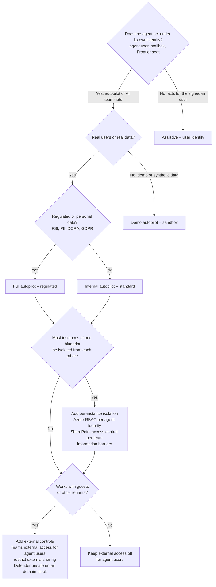

# 14 · Agent policy templates: the options and which one to use

The Microsoft 365 admin center asks for a **policy template** every time an administrator activates an agent, including the *Apply template* step when you approve an autopilot blueprint ([08 · Step 4](08-deployment-runbook.md#step-4--approve-the-blueprint-global-or-ai-administrator)). This page lists every option a template can carry, the policy layers that sit next to it, the licence each needs, and **which template fits which scenario**, with concrete templates for the two autopilots in this repo.

> **Preview:** policy templates for agents with their own identity ("AI teammates", which includes Foundry autopilots) are preview and Frontier-only. Claims below were checked against Microsoft Learn on **2026-11-02**. Anything marked **[unverified]** is our reading of the UI or an inference, not a documented fact. Not legal or compliance advice.

## 1. What a policy template is

| Question | Answer | Source |
|---|---|---|
| What is it? | A named bundle of predefined governance and security policies from **Microsoft Entra, Microsoft Purview, SharePoint Online and Microsoft Defender**, applied to an agent in one step | [Policy templates](https://learn.microsoft.com/microsoft-agent-365/admin/policy-template) |
| Where do I create one? | Microsoft 365 admin center > **Agents** > **Policy templates** > **Add Policy template** (Learn still says *Settings > Templates > Add a New Template*) | Tenant UI; [Policy templates](https://learn.microsoft.com/microsoft-agent-365/admin/policy-template#add-a-new-template) |
| Wizard steps | **Details** (name, description, *What kind of agent can use this policy template? (preview)*) → **Security policies and protections** → **Review** | Tenant UI |
| When is it applied? | (1) The **Apply template** step of the activation wizard: *Publish to users → Apply template → Accept permissions → Review and finish*. (2) An **agent management rule** with the *Apply template* action, a one-time bulk run on existing agent instances | [Activate agents](https://learn.microsoft.com/microsoft-agent-365/admin/agent-actions#activate-agents), [Agent management rules](https://learn.microsoft.com/microsoft-agent-365/admin/agent-settings#apply-a-template) |
| Who applies it? | **Global Administrator** or **AI Administrator** at activation. AI Administrators can't configure Conditional Access or custom security attributes; they can create and apply access packages | [Activate agents](https://learn.microsoft.com/microsoft-agent-365/admin/agent-actions#overview-of-the-activation-process), [Custom template prerequisites](https://learn.microsoft.com/microsoft-agent-365/admin/policy-template#custom-template-prerequisites) |
| Licence | Policy templates need **Microsoft 365 E7 / G7 or Agent 365**. They aren't in the base Microsoft 365 plans. Custom Entra policies need an Agent 365 licence | [Agent 365 service description](https://learn.microsoft.com/office365/servicedescriptions/microsoft-agent-365/microsoft-agent-365#feature-availability) |
| Licence assignment | The **Microsoft default template assigns the agent licence automatically** at activation, so each hired instance gets its seat. The *Apply template* step shows how many autopilot licences are free | [Default template automatic license assignment](https://learn.microsoft.com/microsoft-agent-365/admin/agent-actions#default-template-automatic-license-assignment), [Autopilot quickstart](https://learn.microsoft.com/azure/foundry/agents/how-to/agent-365#approve-the-blueprint) |
| Can I change it later? | Editing a template affects **new activations only**; agents already approved keep what they got. The activation wizard can't re-apply a template to an approved agent | [Edit a template](https://learn.microsoft.com/microsoft-agent-365/admin/policy-template#edit-a-template), [FAQ](https://learn.microsoft.com/microsoft-agent-365/admin/policy-template#frequently-asked-questions-faq) |
| And the bulk rule? | The *Apply template* rule evaluates registry agents **that have an agent identity**. It **doesn't apply to agent blueprints or AI teammates**, so it can't fix an autopilot after approval | [Apply a template](https://learn.microsoft.com/microsoft-agent-365/admin/agent-settings#apply-a-template) |

**Choose the template before you approve an autopilot.** After approval, change the underlying policies directly in Entra, Purview, SharePoint or Defender.

### The agent-type selector (preview)

| Option in *Details* | What the UI says | Matches | Microsoft default template |
|---|---|---|---|
| **Agents without their own identity** | "Other agents may operate with the user's identity" | Assistive agents (delegated, on-behalf-of) and app agents | *Default policy template for all agents except AI teammates* |
| **Agents with their own identity** | "Some agents operate under their own identity and can share information with all users" | **AI teammates / autopilots**: an agent user with a mailbox, Teams presence and a Frontier seat. Both autopilots in this repo | *Default policy template for AI teammates in Frontier* |

Learn describes the selector only as "Indicate if this template applies to agents with their own access". The mapping to the two default templates is **[unverified]** but consistent with [Select a template](https://learn.microsoft.com/microsoft-agent-365/admin/policy-template#select-a-template). The warning in the UI matters: an agent with its own identity has **persistent, accumulating access**, and anyone who can talk to it may get answers based on everything it can reach ([How content is shared with agents](https://learn.microsoft.com/microsoft-agent-365/share#content-access-behavior)).

### What a template does not do

| Not in the template | Where it lives instead |
|---|---|
| Admin consent to the blueprint's scopes (Mail, Teams, Word…) | The **Accept permissions** step of the same wizard ([doc 13 §3](13-identity-analogy-and-hiring.md#what-each-step-grants)) |
| Who can hire (the hiring scope) | **Publish to users > Activate** in the same wizard |
| Azure RBAC on an agent identity (for example Search Index Data Reader on one index) | Azure; `grant-bid-team-access.ps1` ([doc 13 step 6](13-identity-analogy-and-hiring.md#3-steps-to-a-working-instance-with-roles-and-permissions)) |
| The agent user's group memberships, sites and chats | The manager at onboarding ([doc 03 §3](03-identity-and-governance.md#3-two-gates-consent-and-access)) |
| Writing DLP, retention, label, Insider Risk or Defender block rules | Purview portal and Defender portal (§3) |
| Teams external access, meeting and messaging policies for agent users | Teams admin center (§3) |

## 2. Every option in *Security policies and protections*

### 2a. Microsoft default policies (locked)

These appear locked in every template. Some are on automatically; others need setup in the product's own portal before they do anything. Learn uses slightly different names on two pages; both are given.

| Service | Policy | What it does | Applies to | Setup beyond the template | Status | Source |
|---|---|---|---|---|---|---|
| Entra | **Identity protection** | Flags risky agent identities (sign-in spike, unfamiliar resource, suspicious credential on a blueprint, threat intelligence…) in the *Risky agents* report | Autonomous agent identities. On-behalf-of risk is attributed to the **user** | A Conditional Access policy to act on agent risk (§2b) | Agent risk condition in CA is **preview** | [ID Protection for agents](https://learn.microsoft.com/entra/id-protection/concept-risky-agents) |
| Entra | **Network visibility** | Global Secure Access logs and filters agent network traffic | **Copilot Studio agents and agents on user devices** | Global Secure Access | Status not stated. Not applicable to Foundry hosted agents **[unverified]** | [Secure Web and AI Gateway for agents](https://learn.microsoft.com/entra/global-secure-access/concept-secure-web-ai-gateway-agents) |
| Entra | **Lifecycle management for agents** | Sponsor-driven lifecycle workflows: notify co-sponsors, move sponsorship to the manager when a sponsor leaves | Agent identities with a sponsor | Lifecycle workflows in Entra ID Governance | **Preview** | [Governing agent identities](https://learn.microsoft.com/entra/id-governance/agent-id-governance-overview), [Sponsor tasks](https://learn.microsoft.com/entra/id-governance/agent-sponsor-tasks) |
| Purview | **Purview audit enabled** / *Audit enabled* | Agent-to-human, human-to-agent, agent-to-tool and agent-to-agent activity in the unified audit log | Every agent instance, **automatically** | None | GA | [Purview for Agent 365](https://learn.microsoft.com/purview/ai-agent-365#auditing-and-ai-interactions) |
| Purview | **Detect sensitive information (DSPM) in AI interaction** / *Know your data policy* | Classifies sensitive data in prompts and responses; shows it in **DSPM > AI observability** | Every agent instance, **automatically** | Review DSPM recommendations | GA | [Purview for Agent 365](https://learn.microsoft.com/purview/ai-agent-365#dspm-and-dspm-for-ai-classic) |
| Purview | **Purview AI compliance assessment** | Adds the instance to Compliance Manager's **Assessments for AI regulations** | Every agent instance, **automatically** | Work the assessment | GA | [Compliance Manager for AI](https://learn.microsoft.com/purview/compliance-manager-assessments#assessments-for-ai-regulations) |
| SharePoint | **Agent access insights** | Report of which agents accessed which sites and OneDrives | All registered agents | SharePoint admin creates the report in the SharePoint admin center | GA | [Agent access insights](https://learn.microsoft.com/sharepoint/insights-on-agent-access) |
| SharePoint | **Restrict external sharing of sites and its content** | Allows only authorised agent blueprints to share SharePoint or OneDrive content with guests | Agents with their own identity | SharePoint Advanced Management policy | GA | [SharePoint integration](https://learn.microsoft.com/microsoft-agent-365/admin/sharepoint-integration#access-and-sharing-controls) |
| SharePoint | **Access control for sites and OneDrive** | Restricted access control: only members of named groups (which can include agent users) reach a site | Agent users and people | Per-site policy in the SharePoint admin center | GA | [Restricted access control](https://learn.microsoft.com/sharepoint/restricted-access-control) |
| SharePoint | **Content permissions insights** | Data access governance reports: every site an agent can reach | All agents | Run the report | GA | [Data access governance reports](https://learn.microsoft.com/sharepoint/data-access-governance-reports) |
| Defender | **AI real time protection and investigation** / *Real-time protection for Microsoft Agent 365* | Built-in **Default** rule audits all agents; custom rules **block** malicious content, secret exfiltration, evasion, unsafe email domains | Agent 365 agents using Work IQ MCP tools; **Foundry agents (preview)**: requests, responses, tool calls | Custom block rules in Defender > Settings > Security for AI | **Preview** | [Real-time protection](https://learn.microsoft.com/defender-xdr/security-for-ai/ai-agent-real-time-protection) |
| Defender | **Advanced hunting** / *Investigation and advanced hunting* | Near-real-time alerts and KQL over `CloudAppEvents`, `AgentsInfo`, `BehaviorInfo` | **Published** Foundry agents; hosted agents need Agent 365 observability | Enable security for AI agents (Microsoft 365 app connector) | **Preview** | [Detect and investigate](https://learn.microsoft.com/defender-xdr/security-for-ai/ai-agent-detection-protection) |

SharePoint options need a Microsoft 365 Copilot licence in the tenant and a Global or SharePoint Administrator to finish setup in the SharePoint admin center ([prerequisites](https://learn.microsoft.com/microsoft-agent-365/admin/policy-template#sharepoint-online-prerequisites)).

### 2b. Custom policies (Entra)

| Policy | What it does | Must exist first | Who can add it | Licence | Source |
|---|---|---|---|---|---|
| **Conditional access** | Grant or block token issuance by agent, resource, risk and (for agent users) device or network | A CA policy in Entra with **at least one agent identity selected**. A policy scoped to **all agent identities** is selected automatically and can't be removed | Conditional Access Administrator or higher (not AI Administrator) | E7, or Agent 365 + Entra P1 / M365 E3. Risk-based: + Entra P2 / M365 E5 | [Policy templates](https://learn.microsoft.com/microsoft-agent-365/admin/policy-template#conditional-access), [CA for agents](https://learn.microsoft.com/entra/identity/conditional-access/agent-id) |
| **Access packages** | Bundles groups, OAuth permissions and Entra roles for agent identities, with approval, expiry and sponsor renewal | An access package whose policy allows *All agents* | AI Administrator can create and apply it | E7, or Agent 365 + Entra P1 / M365 E3 | [Access packages for agents](https://learn.microsoft.com/entra/id-governance/agent-id-governance-overview#assigning-access-to-agent-identities) |
| **Custom security attribute** | Tags agent identities (for example `AgentApprovalStatus = Compliance_Approved`) so CA can target them by attribute | An attribute set and attribute | **Attribute Assignment Administrator** (a Global Administrator can assign it to themselves) | Free in all Entra editions; the CA policy that uses it needs the CA licence | [Custom security attributes](https://learn.microsoft.com/entra/fundamentals/custom-security-attributes-overview), [CA by attribute](https://learn.microsoft.com/entra/identity/conditional-access/policy-autonomous-agents#use-custom-security-attributes) |

Two caveats from Learn:

* "Scenarios for AI templates are in preview and available only for Frontier tenants. **Custom policies aren't yet supported.**" Expect a template for *agents with their own identity* to carry only the Microsoft defaults today. Create the Entra policies directly; the effect is the same, the template is only a delivery mechanism. **[unverified]** whether your tenant already shows custom policies for this agent type.
* Entra policies apply only when the agent authenticates with Entra. **API keys bypass Conditional Access.** In this repo, Azure AI Search uses an agent identity token and Microsoft 365 tools use an agent user token, so both are covered.

## 3. Policy layers next to the template

### Which policy hits which token

Conditional Access evaluates the **subject of each token**. A policy for agent identities doesn't cover the agent user, and a policy for "Users" doesn't cover agent users ([CA limitations](https://learn.microsoft.com/entra/identity/conditional-access/agent-id#boundaries-and-limitations)). Map it to the three tokens in [doc 13 §1](13-identity-analogy-and-hiring.md#the-three-kinds-of-token-in-badge-terms):

| Token in this repo | Subject | Policies that apply |
|---|---|---|
| Agent identity token (Azure AI Search, `SEARCH_TOKEN_FLOW=agent_identity`) | Agent identity | CA targeting **agent identities** or the **blueprint**; ID Protection; access packages; Azure RBAC |
| Agent user token (Mail, Teams, Word, SharePoint MCP servers) | Agent user | CA targeting **Agent users**; Purview DLP, labels, retention, Insider Risk, communication compliance; Teams policies; SharePoint access control; information barriers |
| Foundry managed identity (model, Toolbox) | Managed identity | Azure RBAC only. Not an agent, so no agent CA |
| A user's token in an assistive agent (on-behalf-of) | The user | The **user's** CA policies; risk attributed to the user |

### The other layers

| Layer | Control | Where | Combines with the template | Licence | Status | Source |
|---|---|---|---|---|---|---|
| Entra | CA **targeting a blueprint** | Entra > Conditional Access | One policy covers every current and future instance of an autopilot. Covers agent identities, **not** agent users | As §2b | GA; agent risk preview | [CA and blueprints](https://learn.microsoft.com/entra/identity/conditional-access/agent-id#conditional-access-policies-and-agent-identity-blueprints) |
| Entra | CA for **agent users**: block risky agent users, require compliant network or device | Entra > Conditional Access > *Agents* > agent users | The template's CA option needs an agent identity; agent-user policies are created separately | As §2b | GA | [Secure agent users](https://learn.microsoft.com/entra/identity/conditional-access/policy-agent-user) |
| Entra | **Disable** blueprint or agent identity | Entra admin center > Agent ID; My Account for sponsors | The real kill switch (doc 03 §4). The admin center **Block** only hides a **Foundry** agent from Copilot Chat | Included | GA | [Disable agent identities](https://learn.microsoft.com/entra/agent-id/disable-agent-identities), [Block agents](https://learn.microsoft.com/microsoft-agent-365/admin/agent-actions#block-or-unblock-agents) |
| Agent 365 | **Hiring scope** | Activation wizard > Publish to users > Activate | Set in the same wizard; separate from the template | Included | Preview (autopilots) | [Autopilot quickstart](https://learn.microsoft.com/azure/foundry/agents/how-to/agent-365#approve-the-blueprint) |
| Agent 365 | **Agent and plugin access**, **User access**, **Sharing** | Agents > Settings | Tenant-wide; who may see and install agents | Included | GA | [Agent settings](https://learn.microsoft.com/microsoft-agent-365/admin/agent-settings) |
| Agent 365 | **Tools** registry: block an MCP server, plugin or connector tenant-wide | Agents > Tools | Narrows what consent allows. Tool-level blocking needs Azure API Management AI Gateway (preview) | Agent 365 | GA; APIM preview | [Tools page](https://learn.microsoft.com/microsoft-agent-365/admin/agent-tools-overview), [APIM](https://learn.microsoft.com/azure/api-management/agent-365) |
| Purview | **DLP** | Purview > DLP | Add agent users (or a group of them) to the policy like users. Blocks in Teams, SharePoint, OneDrive and email. The agent doesn't know it was blocked | Agent 365 | GA | [DLP for agents](https://learn.microsoft.com/purview/ai-agent-365#data-loss-prevention-and-ai-interactions) |
| Purview | **Sensitivity labels** | Purview > Information protection | Encrypted labels must grant the agent **VIEW and EXTRACT**; "all users in the organisation" isn't enough. Content an agent creates isn't labelled automatically | Agent 365 | GA | [Labels for agents](https://learn.microsoft.com/purview/ai-agent-365#sensitivity-labels-and-ai-interactions) |
| Purview | **Retention**, **eDiscovery**, **communication compliance**, **Insider Risk** (*Risky AI usage* template) | Purview | Include the agent instance as a user | Agent 365 | GA | [Purview for Agent 365](https://learn.microsoft.com/purview/ai-agent-365) |
| Purview | **Information barriers** | Purview | Agent users are governed like users | Purview IB licence | Preview (Frontier) | [Content sharing principles](https://learn.microsoft.com/microsoft-agent-365/share#key-principles) |
| SharePoint | **Application Restrictions**: allow or deny apps and **blueprints** per site | SharePoint Online PowerShell | Keys on application or blueprint IDs, so it can't separate two instances of one blueprint **[unverified for single agent identities]** | SharePoint Administrator; licence not stated | GA | [Application Restrictions](https://learn.microsoft.com/sharepoint/restrict-application-agent-access) |
| Teams | **External access, guest access, meeting and messaging policies** for agent users | Teams admin center | Agent users follow the user policy model | Included | GA | [Teams policies for agents](https://learn.microsoft.com/microsoftteams/manage-policies-for-agents) |
| Defender | **Custom real-time protection rules** scoped to agents | Defender > Settings > Security for AI | Turns the template's audit-only default into blocking | Agent 365 | Preview | [Real-time protection](https://learn.microsoft.com/defender-xdr/security-for-ai/ai-agent-real-time-protection) |
| Power Platform | Connector policies | Power Platform admin center | Copilot Studio agents only; not used here | Power Platform | GA | [Tools page](https://learn.microsoft.com/microsoft-agent-365/admin/agent-tools-overview#view-power-platform-connector-usage-preview) |
| Azure | **RBAC per agent identity**, Foundry guardrails (Prompt Shields) | Azure, Foundry | Outside Agent 365. Prompt Shields blocks show up in Defender `BehaviorInfo` | Azure | GA | [doc 13](13-identity-analogy-and-hiring.md), [Defender](https://learn.microsoft.com/defender-xdr/security-for-ai/ai-agent-detection-protection) |

## 4. Licences per control

| Control | Needs | Source |
|---|---|---|
| Policy templates, tool controls, observability | Microsoft 365 E7 / G7 or Agent 365 | [Service description](https://learn.microsoft.com/office365/servicedescriptions/microsoft-agent-365/microsoft-agent-365#feature-availability) |
| One autopilot instance | One **Frontier** seat ("Microsoft 365 Frontier for AI Teammates", `MICROSOFT_AGENT_365_TIER_3` in Zava); assigned automatically by the default template | [doc 02](02-prerequisites-and-licensing.md), [auto licence](https://learn.microsoft.com/microsoft-agent-365/admin/agent-actions#default-template-automatic-license-assignment) |
| Conditional Access for agents | E7, or Agent 365 + Entra P1 / M365 E3 | [CA for agents](https://learn.microsoft.com/entra/identity/conditional-access/agent-id#requirements-and-licensing) |
| Agent risk in CA | + Entra P2 / M365 E5 (or E7) | [CA for autonomous agents](https://learn.microsoft.com/entra/identity/conditional-access/policy-autonomous-agents#prerequisites) |
| ID Protection for agents | Agent 365 ("starting soon") | [ID Protection for agents](https://learn.microsoft.com/entra/id-protection/concept-risky-agents#licensing) |
| ID Governance for agents (access packages, sponsors, lifecycle) | E7, or Agent 365 + Entra P1 / M365 E3 | [Governing agent identities](https://learn.microsoft.com/entra/id-governance/agent-id-governance-overview#license-requirements) |
| Purview for agents (audit, DSPM, DLP, labels, retention, Insider Risk, eDiscovery, Compliance Manager) | E7 or Agent 365; not in GCC | [Service description](https://learn.microsoft.com/office365/servicedescriptions/microsoft-agent-365/microsoft-agent-365#feature-availability) |
| SharePoint options in the template | A Microsoft 365 Copilot licence in the tenant | [SharePoint prerequisites](https://learn.microsoft.com/microsoft-agent-365/admin/policy-template#sharepoint-online-prerequisites) |
| Defender for agents | E7 or Agent 365 | [Service description](https://learn.microsoft.com/office365/servicedescriptions/microsoft-agent-365/microsoft-agent-365#feature-availability) |

## 5. Decision guide

| Scenario | Selector | Template (§6) | Add outside the template | Why |
|---|---|---|---|---|
| **Internal autopilot on regulated data**: FinCrime Alert Triage (this repo) | With own identity | FSI autopilot – regulated | CA on agent users and the blueprint; DLP for IBAN and card numbers; retention for AML records; Insider Risk *Risky AI usage*; Defender block rules | Its answers rely on data the reader may not be entitled to see. Every control must hold before the first hire |
| **Per-team autopilots that must not share data**: RFP Bid Desk, BankingBids vs PublicSectorBids | With own identity | FSI autopilot – regulated (or Internal – standard) | Isolation is **per instance**, not per template: Azure RBAC on each agent identity (doc 13 step 6), restricted access control per team site with the team's agent user in the group, a custom security attribute `BidTeam` for CA, information barriers if the bank uses them | One blueprint gets one template; the template can't tell two instances apart |
| **Low-risk assistive agent** using the user's identity | Without own identity | Assistive – user identity | Nothing new: the user's CA, DLP and labels already apply | The agent can't see more than the user who asks |
| **Pilot or demo tenant** (Zava) | With own identity | Demo autopilot – sandbox | CA in **report-only**; Defender default audit rule; synthetic data only | Shows the controls without blocking a live demo |
| **Agents that work with guests** | With own identity | Base template + **Restrict external sharing** | Teams external and guest access policy for agent users; Defender *Unsafe email domain* block; `ALLOWED_SENDER_DOMAINS` in code | An agent with its own access can pass anything it can read to anyone in the conversation |
| **Customer PII or financial data** | With own identity | FSI autopilot – regulated | DLP with the relevant sensitive information types; encrypted labels that grant the agent VIEW and EXTRACT explicitly; retention; DSPM AI observability | Purview only protects agents you add to its policies |
| **High-risk regulated production** (DORA, GDPR, EU AI Act) | With own identity | FSI autopilot – regulated | CA *allow only approved agents* by attribute, **On** not report-only; block high agent risk; access packages with expiry and a sponsor; Compliance Manager AI assessments; Defender block rules; eDiscovery holds; Entra disable runbook; **hire through Teams or the admin center** so instances are in the registry | Gives the register entry, named owner, time-bound access and containment that DORA and GDPR Art. 22 reviews expect ([doc 03 §7](03-identity-and-governance.md#7-regulatory-talking-points-for-banks-not-legal-advice)) |

## 6. Suggested templates for this repo

Name templates `<scope> – <agent type> – <risk>`, so the activation drop-down explains itself. Rename vague entries such as "test" before a customer sees them.

| Tab | **FSI autopilot – regulated** | **Demo autopilot – sandbox** | **Assistive – user identity** |
|---|---|---|---|
| Details: description | "Autopilots that handle bank, customer or financial-crime data. Owner: FinCrime Ops risk." | "Zava and other demo tenants. Synthetic data only." | "Agents that act for the signed-in user." |
| Details: agent type | Agents with their own identity | Agents with their own identity | Agents without their own identity |
| Policies: Microsoft defaults | All (locked) | All (locked) | All (locked) |
| Policies: Conditional access | *CA-Agents-FinCrime-AllowApproved* (block all agent identities except `AgentApprovalStatus = Compliance_Approved`) and *CA-Agents-BlockHighRisk*, both **On** | *CA-Agents-BlockHighRisk*, **Report-only** | None (user CA applies) |
| Policies: Access packages | *FinCrime case data – 90 days*, sponsor = team lead, approval by Compliance | None | None |
| Policies: Custom security attribute | `AgentAttributes/AgentApprovalStatus`, `AgentAttributes/DataClass = Confidential` | `AgentAttributes/DataClass = Synthetic` | None |
| Outside: Entra | CA policy on **Agent users** of the blueprint (block high risk); Entra disable runbook | None | None |
| Outside: Purview | DLP (IBAN, card numbers, national IDs) on the *FinCrime agents* group; retention 7 years on Teams and email; communication compliance; Insider Risk *Risky AI usage* | Audit only (automatic) | Existing Copilot DLP |
| Outside: SharePoint | Restricted access control on the case site; *Restrict external sharing* on | Defaults | Defaults |
| Outside: Teams | External and guest access **off** for agent users | Off | n/a |
| Outside: Defender | Custom rule *Block*: secret exfiltration, malicious content, unsafe email domain, scoped to FinCrime and Bid Desk agents | Default audit rule | Default audit rule |

If the wizard doesn't yet offer custom policies for *agents with their own identity* (§2b), create the template with the Microsoft defaults and apply the Conditional Access, access package and attribute items directly in Entra **before** the approval.

For the **RFP Bid Desk**, reuse *FSI autopilot – regulated* and add per-instance items, not a second template: the attribute `BidTeam = Banking | PublicSector`, one access package per team, restricted access control on each team's site, and Search Index Data Reader per index ([doc 12](12-rfp-bid-desk.md)).

## 7. How templates fit the permission model in doc 13

[Doc 13](13-identity-analogy-and-hiring.md) has three permission layers. The template is a fourth: the tenant's guardrails around all of them.

| Layer | Set where | Scope | Example in Zava | Set by the template? |
|---|---|---|---|---|
| **Tenant guardrails** | Policy template, Entra, Purview, SharePoint, Defender | All instances the policy targets | Audit, DSPM, risk detection, CA, DLP | **Yes**, at activation |
| **Blueprint consent** (facility rules) | *Accept permissions* step | Every instance of the blueprint | `McpServers.*`, `AgentData.ReadWrite` | No, same wizard, next step |
| **Agent identity access** (the badge) | Azure RBAC, access packages | One instance | Search Index Data Reader on `bids-banking` | No. Access packages can be *attached* to a template |
| **Agent user access** (the employee record) | Groups, sites, chats at onboarding | One instance | BankingBids in the banking group chat | No |

Consent decides which calls the token may make. Access decides which data those calls reach. The template decides **under which conditions** a token is issued and **what is watched, labelled, kept or blocked** afterwards. None of them replaces the others.

**Hiring path matters.** Instances created with the Entra Agent ID API (path C in doc 13) don't appear under the agent's *Instances* in the admin center. They don't receive the template's automatic licence (the script assigns it), and the *Apply template* rule only sees registry agents, so they're likely outside template coverage **[unverified]**. Purview audit and classification are tied to instance creation in Agent 365. For regulated work, hire through Teams or the admin center (paths A or B).

## 8. Gaps, limitations and open questions

| # | Item | Impact | What to do |
|---|---|---|---|
| 1 | Templates apply only at activation; edits aren't retroactive; the bulk rule skips blueprints and AI teammates | A wrong choice at approval sticks to the autopilot | Decide with §5 before approving; fix later in each product directly |
| 2 | "Custom policies aren't yet supported" for AI templates (preview) | Entra custom policies may be missing for autopilots | Apply them in Entra; recheck after each Frontier update |
| 3 | The agent-type selector isn't documented on Learn | Its effect on the drop-down is **[unverified]** | Test in Zava: create one template of each type and check which appear when approving an autopilot |
| 4 | Admin center **Block** on a Foundry agent only removes it from Copilot Chat | Not a kill switch for autopilots | Disable the blueprint in Entra (doc 03 §4) |
| 5 | CA doesn't cover API keys, the blueprint's Graph call to create identities, or `Users`-scoped policies for agent users | Gaps if you reuse user policies | One CA policy per token subject (§3) |
| 6 | DLP blocks silently for the agent | The workflow fails without an error | Monitor DLP alerts; agent owner reviews them |
| 7 | Encrypted labels need explicit VIEW and EXTRACT for the agent; agent-created content isn't labelled | Agents can't read protected files; outputs may be unlabelled | Grant rights per label or keep agents off encrypted content; add auto-labelling |
| 8 | Network visibility covers Copilot Studio and device agents only | No network control for Foundry hosted agents | Use Azure networking (private endpoints, egress rules) instead |
| 9 | Zava, 2026-10-31: no approve button for the FinCrime blueprint, only *Accept permissions* | No template may be attached to the FinCrime blueprint | Check the agent's details in the registry. While the blueprint is still pending, pick *Demo autopilot – sandbox* when the approve button appears; once approved, it can't be changed (item 1) |
| 10 | UI names differ from Learn (*Policy templates* vs *Settings > Templates*; two default policy name sets) | Confusing in runbooks | Use the UI names in §1 and §2 |

## Sources

* [Policy templates](https://learn.microsoft.com/microsoft-agent-365/admin/policy-template) and [Agent settings](https://learn.microsoft.com/microsoft-agent-365/admin/agent-settings)
* [Governance and lifecycle actions: activate, block, default template](https://learn.microsoft.com/microsoft-agent-365/admin/agent-actions)
* [Quickstart: Build your first autopilot](https://learn.microsoft.com/azure/foundry/agents/how-to/agent-365)
* [Understand how content is shared with agents](https://learn.microsoft.com/microsoft-agent-365/share)
* [Agent 365 service description: feature availability](https://learn.microsoft.com/office365/servicedescriptions/microsoft-agent-365/microsoft-agent-365)
* [Secure AI agents at scale using Agent 365](https://learn.microsoft.com/security/security-for-ai/agent-365-security)
* Entra: [Conditional Access for agents](https://learn.microsoft.com/entra/identity/conditional-access/agent-id), [Secure autonomous agents](https://learn.microsoft.com/entra/identity/conditional-access/policy-autonomous-agents), [ID Protection for agents](https://learn.microsoft.com/entra/id-protection/concept-risky-agents), [Governing agent identities](https://learn.microsoft.com/entra/id-governance/agent-id-governance-overview), [Protect agent identities](https://learn.microsoft.com/microsoft-agent-365/admin/capabilities-entra)
* Purview: [Data security and compliance for Agent 365](https://learn.microsoft.com/purview/ai-agent-365)
* SharePoint: [Agent 365 integration](https://learn.microsoft.com/microsoft-agent-365/admin/sharepoint-integration), [Application Restrictions](https://learn.microsoft.com/sharepoint/restrict-application-agent-access), [Restricted access control](https://learn.microsoft.com/sharepoint/restricted-access-control)
* Defender: [Detect and investigate](https://learn.microsoft.com/defender-xdr/security-for-ai/ai-agent-detection-protection), [Real-time protection](https://learn.microsoft.com/defender-xdr/security-for-ai/ai-agent-real-time-protection)
* Teams: [Manage Teams policies for Agent 365 agents](https://learn.microsoft.com/microsoftteams/manage-policies-for-agents)
* Tools: [Tools page](https://learn.microsoft.com/microsoft-agent-365/admin/agent-tools-overview)
