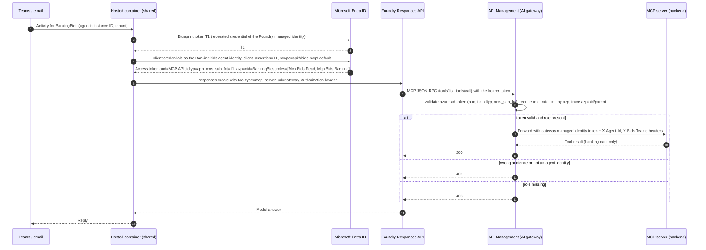

# 15 · A custom MCP server behind an AI gateway: token claims, app roles and who gets them

A customer publishes its own MCP server behind **Azure API Management (the AI gateway)**, and the gateway **validates claims** in the bearer token: audience, `roles`, `scp`, `azp`, `xms_sub_fct`. Can an autopilot instance (Foundry hosted agent with an Entra Agent ID) call it? With which token, assigned to which Entra object, and where are the limits?

> **Status:** research and design, **not deployed** in the Zava tenant. Markers: ✅ documented on Microsoft Learn · 🧪 verified live in this repository (Zava, 2026-11-01) · ⚠️ inferred or not verified · 🅿️ preview. The optional samples in [`samples/mcp-behind-ai-gateway/`](../samples/mcp-behind-ai-gateway/) are **not wired into azd** and change nothing until you run them.

## TL;DR

**Yes.** The cleanest pattern is the one this repository already uses for Azure AI Search: the container gets an **app-only token for the instance's own agent identity** (`SEARCH_TOKEN_FLOW=agent_identity`, 🧪), this time for the MCP API's audience. You put an **app role** on that agent identity, so the token carries `roles`. The gateway checks it, so Entra and the gateway decide, not the prompt.

| # | Pattern | Possible? | Token sent to the gateway | Claim the gateway checks | Assign to |
|---|---|---|---|---|---|
| 1 | **Per-instance app role** (recommended) | ✅ Yes | Agent identity, app-only (`idtyp=app`, `xms_sub_fct` 11) | `roles` (+ `aud`, `tid`, `idtyp`, `xms_sub_fct`) | **That instance's agent identity**: `appRoleAssignment` |
| 2 | **Fleet-wide app role** (every instance of the autopilot) | ✅ Yes, if the MCP API is listed as **inheritable** on the blueprint | Same as 1 | `roles` | **Blueprint principal** + `inheritablePermissions` (roles) |
| 3 | **Agent user, delegated** | ✅ Yes, **no code change** (manifest `tokenScope`) | Agent user token (`idtyp=user`, `xms_sub_fct` 13) | `scp`, optionally `roles` of the agent user | Delegated grant on the **agent identity** (or inherited from the blueprint); user app role on the **agent user** |
| 4 | **On behalf of a human user** (OBO) | ✅ For interactive agents · ❌ not for autopilot turns | Human user token, actor = agent identity (`xms_act_fct` 11) | `scp`, the user's `roles` | Delegated grant on the agent identity; app role on the user |
| 5 | Group-based app role for an agent identity | ❌ No `roles` claim for service principals via groups (⚠️ inferred for agent identities) | — | — | Assign directly instead |
| 6 | Authorize on the parent blueprint (`xms_par_app_azp`) | ❌ Learn: don't use it for authorization | — | Log it; at most an extra narrowing check | — |
| 7 | Foundry project connection `agentic-identity` | ✅ Works, but **per agent, not per instance** (⚠️) | Default instance identity | `roles` of the shared identity | Default instance identity |
| 8 | Agent 365 BYO MCP server via the Tooling Gateway 🅿️ | ⚠️ Foundry isn't a supported client in the preview | Gateway token | Not per instance at your server (⚠️) | Blueprint-wide `Tools.ListInvoke.All` |

**Recommended for this repository:** pattern 1 for team data (`Mcp.Bids.Banking`, `Mcp.Bids.PublicSector`), pattern 2 for the right to call the gateway at all (`Mcp.Bids.Read`), APIM `validate-azure-ad-token` on `aud`, `tid`, `idtyp=app`, `xms_sub_fct` 11 and `roles`, rate limiting and logging keyed by `azp`, and the MCP backend trusting only the gateway.

## 1. Where the call goes

The container never calls the MCP server itself. It mints the token and passes it in the tool definition to the Foundry **Responses API**, which runs the MCP call server-side (see `tool_loop.py`). So the gateway sees traffic from **Foundry Agent Service**, not from the container, and must be reachable from it.



Steps 2 to 5 are exactly what `InstanceTokenProvider._agent_identity_token` does today for `https://search.azure.com` (🧪 200 on the own index, 403 on the other). Only the resource changes. Entra recommends this autonomous app flow for agents acting as themselves ([autonomous app flow](https://learn.microsoft.com/entra/agent-id/agent-autonomous-app-oauth-flow)).

## 2. Which token carries which claims

| Claim | Agent identity, app-only (pattern 1, 2) | Agent user (pattern 3) | Human user via OBO (pattern 4) | Container default identity |
|---|---|---|---|---|
| `idtyp` | `app` | `user` | `user` | `app` |
| `xms_sub_fct` | contains `11` | contains `13` | no `11`/`13` | contains `11` |
| `oid` / `sub` | agent identity | agent user | human user | default instance identity |
| `azp` (v2) / `appid` (v1) | agent identity | agent identity | agent identity | default instance identity |
| `xms_par_app_azp` | blueprint | blueprint (⚠️) | blueprint (⚠️) | blueprint |
| `scp` | empty or `/` | delegated scopes granted to the agent identity | delegated scopes | — |
| `roles` | app roles of the agent identity (direct + inherited) | app roles of the **agent user** | app roles of the **human user** | app roles of the default identity |
| How this repo gets it | `agent_identity` flow 🧪 | `auth.exchange_token` (MCP tokens today) 🧪 | not used (autopilot turns carry no user token for your API) | `container` flow 🧪 |

Notes ✅ ([token claims for agents](https://learn.microsoft.com/entra/agent-id/agent-token-claims), [agent identities](https://learn.microsoft.com/entra/agent-id/agent-identities)):

* For an agent identity, **`appId` and object ID are the same value**, so `azp` = `oid` in app-only tokens. Allowlisting one instance by `azp` is stable.
* `idtyp=user` alone doesn't tell an agent user from a human. Check `xms_sub_fct` 13.
* `xms_par_app_azp` identifies the blueprint. Learn: *log it, but don't use it for authorization*, "as it would result in widespread access by many agents". Requiring it **in addition to** a role only narrows access, so it's acceptable as defense in depth.
* `aud` is the MCP API's **client ID** with v2 tokens; with v1 tokens it can be any Application ID URI unless the `aud` optional claim uses `use_guid` ([secure an MCP server with Entra ID](https://learn.microsoft.com/entra/agent-id/secure-mcp-server-with-entra-id)). Set `requestedAccessTokenVersion: 2`.
* Custom security attributes on agent identities are **not token claims**. They drive **Conditional Access** at token issuance ("only agents with attribute X get tokens for resource Y"), a second, Entra-side gate ([CA for agents](https://learn.microsoft.com/entra/identity/conditional-access/agent-id)). ⚠️ Claims mapping policies for agent identities aren't documented; use app roles.

### One instance, every instance, or any agent?

| You want to allow | Do this | Gateway check |
|---|---|---|
| **Only BankingBids** | App role on BankingBids' agent identity | `roles` contains `Mcp.Bids.Banking` (or `client-application-ids` = BankingBids' app ID, an allowlist kept in APIM instead of Entra) |
| **Every instance of the Bid Desk**, current and future | App role on the blueprint principal + MCP API listed as inheritable for roles | `roles` contains `Mcp.Bids.Read` |
| Any agent identity in the tenant with the role | Same as above; never "any token from the tenant" | `idtyp=app` + `xms_sub_fct` 11 + `roles` |
| Not the shared container | Assign nothing to the default instance identity | It has no role, so 403 (like Search today 🧪) |

## 3. Where to assign what

| Assign on | Mechanism | Resulting claim | Who can do it | Notes |
|---|---|---|---|---|
| **Agent identity** (one instance) | App role assignment: `POST /servicePrincipals/{mcpApiSpId}/appRoleAssignedTo` (or `/servicePrincipals/{agentIdentityId}/appRoleAssignments`) | `roles` in its app-only token | Cloud Application Administrator, Application Administrator ✅ | Role needs `allowedMemberTypes` `Application`. [Assign agent identities to app roles](https://learn.microsoft.com/entra/identity/enterprise-apps/assign-agent-identities-to-applications) |
| **Blueprint principal** (all instances) | App role assignment to the blueprint principal **and** an `inheritablePermissions` entry for the MCP API (`inheritableRoles: allAllowed`) | `roles` in **every** agent identity's app-only token | Assignment: as above. Inheritable list: Agent ID Developer (own blueprints) or Agent ID Administrator ✅ | Both conditions required. Inherited roles are **not visible** in Graph or the admin center, only in tokens ✅. Declare the role in the blueprint's `requiredResourceAccess` too (⚠️ see §7) |
| **Agent identity** (delegated) | `oauth2PermissionGrant` (`clientId` = agent identity, `resourceId` = MCP API SP, `scope` = `Mcp.Bids.Access`) | `scp` in agent-user tokens | Cloud Application Administrator, Application Administrator, Agent ID Administrator | Same as `create-instance-entra.ps1` / `grant-bid-team-access.ps1` do today. Or once on the blueprint with inheritable scopes |
| **Agent user** | User app role assignment: `POST /users/{agentUserId}/appRoleAssignments` | `roles` in the agent-user token | Cloud Application Administrator, Application Administrator, User Administrator, **Agent ID Administrator (agent users only)** ✅ | Role needs `allowedMemberTypes` `User` ([agentUser appRoleAssignments](https://learn.microsoft.com/graph/api/agentuser-post-approleassignments)) |
| **Human user** | User or group app role assignment | `roles` in OBO tokens | same | Interactive agents only |
| **Group** containing agent identities | Group app role assignment | ❌ no `roles` for service principals ([Learn](https://learn.microsoft.com/entra/identity-platform/howto-add-app-roles-in-apps)) | — | Agent identities can be group members but not of role-assignable groups ✅. ⚠️ Groups of **agent users** should work like users (needs Entra ID P1), not verified |
| **Default instance identity** | Nothing | — | — | Business data never goes here ([doc 13 §4](13-identity-analogy-and-hiring.md#4-where-to-put-a-new-permission)) |

Privileged Role Administrator is only the least-privileged role for **Microsoft Graph and Azure AD Graph** app roles, not for your own API ✅ ([appRoleAssignedTo](https://learn.microsoft.com/graph/api/serviceprincipal-post-approleassignedto)).

## 4. Step by step

### 4.1 Register the MCP API in Entra

Follow [Secure an MCP server with Microsoft Entra ID](https://learn.microsoft.com/entra/agent-id/secure-mcp-server-with-entra-id):

1. App registration *Zava Bids MCP*, single tenant. Set `api.requestedAccessTokenVersion` = **2 first**, then the Application ID URIs: `api://<client-id>` and, for MCP clients that discover the server through protected resource metadata, the gateway URL (for example `https://<apim>.azure-api.net/bids-mcp`, exact match, no trailing slash).
2. Delegated scope `Mcp.Bids.Access` (admins only), for pattern 3.
3. App roles:

   | Value | Allowed member types | Purpose |
   |---|---|---|
   | `Mcp.Bids.Read` | Application, User | May call the gateway (fleet-wide) |
   | `Mcp.Bids.Banking` | Application, User | May read banking bids |
   | `Mcp.Bids.PublicSector` | Application, User | May read public sector bids |

4. Create the service principal and set **`appRoleAssignmentRequired = true`**, so Entra refuses tokens to clients without an assignment (⚠️ interaction with *inherited* roles not verified; test it).

[`register-and-assign-mcp-roles.ps1`](../samples/mcp-behind-ai-gateway/register-and-assign-mcp-roles.ps1) does 1 to 4 and 4.2 (plan only unless `-Apply`).

### 4.2 Assign the roles

Per instance (pattern 1), with the agent identity IDs from `/whoami` or Entra > Agent ID:

```powershell
# $mcpSp = MCP API service principal; $identityId = BankingBids' agent identity (object ID = app ID)
$role = $mcpSp.appRoles | Where-Object value -eq "Mcp.Bids.Banking"
Invoke-MgGraphRequest POST "https://graph.microsoft.com/v1.0/servicePrincipals/$($mcpSp.id)/appRoleAssignedTo" -Body (@{
    principalId = $identityId; resourceId = $mcpSp.id; appRoleId = $role.id } | ConvertTo-Json)
```

Fleet-wide (pattern 2): assign `Mcp.Bids.Read` to the **blueprint principal** the same way, then make the MCP API inheritable for roles only ([configure inheritable permissions](https://learn.microsoft.com/entra/agent-id/configure-inheritable-permissions-blueprints)):

```http
POST https://graph.microsoft.com/v1.0/applications/microsoft.graph.agentIdentityBlueprint/{blueprint-object-id}/inheritablePermissions
OData-Version: 4.0

{ "resourceAppId": "<mcp-api-client-id>",
  "inheritableScopes": { "@odata.type": "#microsoft.graph.noScopes", "kind": "none" },
  "inheritableRoles":  { "@odata.type": "#microsoft.graph.allAllowedRoles", "kind": "allAllowed" } }
```

Agent user path (pattern 3, optional): `POST /oauth2PermissionGrants` (`clientId` = agent identity, `consentType` = `AllPrincipals`, `scope` = `Mcp.Bids.Access`), and `POST /users/{agentUserId}/appRoleAssignments` for the team role.

### 4.3 Put the MCP server behind API Management

* **Existing MCP server** (streamable HTTP, MCP 2025-06-18 or later) or a **REST API exposed as an MCP server** ([MCP in APIM](https://learn.microsoft.com/azure/api-management/mcp-server-overview)). Developer, Basic, Standard, Premium and all v2 tiers; not in workspaces ✅.
* Apply [`apim-mcp-policy.xml`](../samples/mcp-behind-ai-gateway/apim-mcp-policy.xml). It:
  1. validates the token with [`validate-azure-ad-token`](https://learn.microsoft.com/azure/api-management/validate-azure-ad-token-policy): tenant, both audience forms, `idtyp=app`, `xms_sub_fct` contains 11 (split on spaces) → **401** otherwise;
  2. requires `Mcp.Bids.Read` in `roles` → **403** with `insufficient_scope` otherwise (it never authorizes on `xms_par_app_azp`);
  3. derives the allowed teams from `Mcp.Bids.Banking` / `Mcp.Bids.PublicSector`;
  4. `rate-limit-by-key` keyed by `azp` (one budget per instance), `trace` and `emit-metric` with `azp`, `oid`, parent and roles (APIM gateway logs don't contain claims by default);
  5. calls the backend with the **gateway's managed identity** (`authentication-managed-identity`) and forwards the caller as `X-Agent-Id`, `X-Agent-Parent`, `X-Bids-Teams`, overriding any value the caller sent.
* Policies on an APIM MCP server apply to **all tools** of that server ✅. Per-tool rules need either one APIM MCP server per tool group, or the backend checking `X-Bids-Teams` per tool. Never read `context.Response.Body` in MCP policies (it breaks streaming) ✅.
* If you enable Application Insights diagnostics at the *All APIs* scope, set frontend response payload bytes to 0 ✅.

### 4.4 Code change in this repository (proposed, not applied)

Today `_build_mcp_tools` gets every MCP token with `auth.exchange_token` (agent-user flow) for `tokenScope`, defaulting to Agent Tools. Two options:

* **Pattern 3, no code change:** add a manifest entry with `"tokenScope": "api://<mcp-api-client-id>/.default"` and the delegated grant from §4.2. The token is the **agent user's**.
* **Pattern 1, small change:** add `tokenFlow` and `tokenResource` to the manifest entry and route them through `InstanceTokenProvider`, which already caches per instance and refreshes 5 minutes before expiry:

```json
{
  "mcpServerName": "bids_library",
  "url": "https://<apim>.azure-api.net/bids-mcp/mcp",
  "tokenFlow": "agent_identity",
  "tokenResource": "api://<mcp-api-client-id>",
  "allowedTools": ["search_past_answers", "get_answer"]
}
```

```python
# agent.py, _build_mcp_tools: before the existing exchange_token branch
if server.get("tokenFlow"):
    result = await self._token_provider.get(
        server["tokenFlow"], server["tokenResource"], context=context,
        identity=TurnIdentity.from_context(context), auth=auth,
        auth_handler_name=auth_handler_name, label=f"mcp:{name}")
    bearer = result.token
    if trail is not None:
        trail.add(result.summary)
```

Never fall back to the container credential for this server: the shared identity must get 403.

### 4.5 Verify

| Check | Expected |
|---|---|
| `/whoami` (with `TOKEN_DEBUG=true`) on BankingBids | line `token[mcp:bids_library] kind=agent-identity instance=BankingBids … roles=Mcp.Bids.Read,Mcp.Bids.Banking aud=<mcp-api-client-id>` |
| Same on PublicSectorBids | `roles=Mcp.Bids.Read,Mcp.Bids.PublicSector` |
| Ask PublicSectorBids for banking answers | backend refuses (no `banking` in `X-Bids-Teams`), the model says so |
| Container credential or a token for another audience | 401 from the gateway |
| Agent identity without `Mcp.Bids.Read` | Entra refuses the token (`appRoleAssignmentRequired`) or 403 from the gateway |
| APIM traces / custom metric `McpCalls` by `AgentId` | one series per instance |

Inherited roles only show up in tokens, so the `/whoami` claim line is the proof for pattern 2. The token can't be minted from a laptop (T1 needs the Foundry managed identity's federated credential), so test through the instance.

## 5. Per-instance isolation, end to end

| Instance | Agent identity gets | Token `roles` | Gateway | Backend sees `X-Bids-Teams` | Banking data | Public sector data |
|---|---|---|---|---|---|---|
| BankingBids | `Mcp.Bids.Banking` (+ inherited `Mcp.Bids.Read`) | `Mcp.Bids.Read`, `Mcp.Bids.Banking` | 200 | `banking` | ✅ | ❌ refused |
| PublicSectorBids | `Mcp.Bids.PublicSector` (+ inherited `Mcp.Bids.Read`) | `Mcp.Bids.Read`, `Mcp.Bids.PublicSector` | 200 | `publicsector` | ❌ refused | ✅ |
| Container default identity | nothing | none | **403** | — | ❌ | ❌ |
| A FinCrime instance (other blueprint) | nothing | none | **403** (or no token) | — | ❌ | ❌ |

Two designs, both enforced by a signed token, not by the prompt:

* **A, one endpoint (sample):** the gateway maps roles to `X-Bids-Teams`; the backend filters by it and accepts calls **only** from the gateway's managed identity, so the header can't be forged.
* **B, one APIM MCP server per team:** `/bids-banking-mcp` requires `Mcp.Bids.Banking`, `/bids-publicsector-mcp` requires `Mcp.Bids.PublicSector`; the backend stays team-agnostic. The container then picks the URL per instance (same mapping as `BID_TEAM_RULES`).

To keep **end-to-end** identity at the backend, skip `authentication-managed-identity`, forward the original `Authorization` header and validate it again in the MCP server (Learn's [downstream validation](https://learn.microsoft.com/entra/agent-id/how-to-validate-agent-tokens-downstream-api)).

## 6. When the gateway expects an audience you can't get

| Situation | Option | Per-instance identity kept? |
|---|---|---|
| Backend needs its own audience | Gateway validates the agent token, then calls the backend with **`authentication-managed-identity`** and forwards the caller in headers (sample) | ✅ via headers |
| Backend needs a *user* token for another API | **OBO at the gateway**: no built-in policy; `send-request` to the token endpoint with a confidential client of the gateway (certificate or federated credential), using the **agent-user** token as assertion | ⚠️ not verified; app-only tokens can't be used for OBO |
| Third-party OAuth backend | APIM **credential manager** (`get-authorization-context`) | ❌ one shared connection; forward the caller in headers |
| No code in the container | **Foundry project connection** for the MCP tool: key, `agentic-identity`, `project-managed-identity`, user delegation, or OAuth identity passthrough ([MCP authentication](https://learn.microsoft.com/azure/foundry/agents/how-to/mcp-authentication)) | ⚠️ `agentic-identity` uses the **agent's default instance** identity, shared by all instances of a hosted agent. OAuth passthrough is per *human* user and needs sign-in, not for autopilots |
| Route Foundry tools through the gateway automatically | **Foundry AI gateway governance** 🅿️ ([govern MCP tools](https://learn.microsoft.com/azure/foundry/agents/how-to/tools/governance)) | ❌ for this repo: only MCP tools **created in the Foundry portal**; code-first MCP tools aren't routed |
| Central Microsoft 365 governance and Defender visibility | **Agent 365 BYO MCP server** 🅿️ ([BYO MCP](https://learn.microsoft.com/microsoft-agent-365/admin/manage-byo-mcp-server)): register with `EntraOAuth`, admin approves, `a365 develop-mcp grant-agents-access` grants `Tools.ListInvoke.All` (`AllPrincipals`, all instances of a blueprint) | ❌ per instance at your server (⚠️); Foundry isn't a supported client in the preview |
| The gateway insists on a Microsoft audience (for example Agent Tools `ea9ffc3e-…`) | Not possible: register your own API. Foundry also blocks managed-OAuth Microsoft tokens to custom endpoints (`Cannot pass Microsoft token to untrusted MCP endpoint`) ✅ | — |
| The API must stay on v1 tokens | `aud` optional claim with `use_guid`, then validate the client-ID audience ✅ | ✅ |

## 7. Limitations, preview caveats and open questions

* **Preview:** Foundry autopilots, hosted agents, Agent 365, BYO MCP servers and Foundry AI gateway governance are preview. Entra Agent ID APIs used here are on Graph v1.0 (agent identity listing still uses beta in this repo's scripts).
* **The gateway must be reachable from Foundry Agent Service**, which executes MCP calls for the Responses API. An APIM IP filter needs Foundry's egress addresses; a private-only gateway needs Foundry network isolation (⚠️ not tested). The bearer token travels in the tool `headers` through Foundry.
* **Inheritable roles** require both the inheritable entry and a grant on the blueprint principal; the concept page says the grant must come from static consent (`requiredResourceAccess`) or explicitly requested dynamic consent. ⚠️ Whether a direct `appRoleAssignment` to the blueprint principal counts is not verified: declare the role in `requiredResourceAccess` too and check the token. Limits differ between pages (50 resource apps per blueprint vs 10 apps / 40 scopes): check before scaling.
* ⚠️ The blueprint is created and updated by Foundry and the publish script: confirm that re-publishing keeps your `inheritablePermissions` entry.
* ⚠️ `appRoleAssignmentRequired` with inherited roles: test that inherited assignments satisfy it.
* Group-based app roles don't produce `roles` for service principals: assign each agent identity (or use the blueprint).
* App-role changes reach the agent only with a new token; the container caches per instance until 5 minutes before expiry (about an hour).
* Inherited permissions are invisible in Graph and the admin center: audit through tokens (`/whoami`, gateway traces).
* Agent identities can't hold high-privilege directory roles or blocked Graph permissions; your own API's app roles are not restricted ✅ ([authorization in Agent ID](https://learn.microsoft.com/entra/agent-id/authorization-agent-id)).
* Instances hired with the Entra API path (BankingBids, PublicSectorBids) behave the same as admin-center hires for token issuance (🧪 for Search).

Open questions to test in Zava before production: the four ⚠️ items above, APIM `validate-azure-ad-token` with v1 agent tokens (issuer `sts.windows.net`), and whether Agent 365 BYO MCP can be called by a custom-container autopilot with the agent-user token.

## Sources

* [Secure an MCP server with Microsoft Entra ID](https://learn.microsoft.com/entra/agent-id/secure-mcp-server-with-entra-id) (registration, v2 tokens, app roles for agent identities, PRM)
* [Token claims reference for agents](https://learn.microsoft.com/entra/agent-id/agent-token-claims) · [Tokens in the agent identity platform](https://learn.microsoft.com/entra/agent-id/agent-tokens) · [Validate agent identity tokens in a downstream API](https://learn.microsoft.com/entra/agent-id/how-to-validate-agent-tokens-downstream-api)
* [Inheritable permissions](https://learn.microsoft.com/entra/agent-id/concept-inheritable-permissions) · [Configure inheritable permissions](https://learn.microsoft.com/entra/agent-id/configure-inheritable-permissions-blueprints)
* [Assign agent identities to app roles](https://learn.microsoft.com/entra/identity/enterprise-apps/assign-agent-identities-to-applications) · [Control user access to agents](https://learn.microsoft.com/entra/agent-id/control-user-access-agents) · [Autonomous agent permissions](https://learn.microsoft.com/entra/agent-id/autonomous-agent-authentication-authorization-flow)
* [Graph: appRoleAssignedTo](https://learn.microsoft.com/graph/api/serviceprincipal-post-approleassignedto) · [Graph: agentUser appRoleAssignments](https://learn.microsoft.com/graph/api/agentuser-post-approleassignments) · [Add app roles and receive them in the token](https://learn.microsoft.com/entra/identity-platform/howto-add-app-roles-in-apps)
* [Authorization in Microsoft Entra Agent ID](https://learn.microsoft.com/entra/agent-id/authorization-agent-id) · [Conditional Access for agents](https://learn.microsoft.com/entra/identity/conditional-access/agent-id)
* [MCP servers in API Management](https://learn.microsoft.com/azure/api-management/mcp-server-overview) · [Expose an existing MCP server](https://learn.microsoft.com/azure/api-management/expose-existing-mcp-server) · [Secure access to MCP servers](https://learn.microsoft.com/azure/api-management/secure-mcp-servers) · [validate-azure-ad-token](https://learn.microsoft.com/azure/api-management/validate-azure-ad-token-policy)
* [Foundry: MCP authentication](https://learn.microsoft.com/azure/foundry/agents/how-to/mcp-authentication) · [Foundry: govern MCP tools with an AI gateway](https://learn.microsoft.com/azure/foundry/agents/how-to/tools/governance)
* [Agent 365: BYO MCP server](https://learn.microsoft.com/microsoft-agent-365/admin/manage-byo-mcp-server) · [Agent 365 CLI develop-mcp](https://learn.microsoft.com/microsoft-agent-365/developer/reference/cli/develop-mcp)
* In this repository: [doc 12 §4](12-rfp-bid-desk.md#4-per-instance-tokens-three-routes-to-the-same-goal) (per-instance token flows), [doc 13](13-identity-analogy-and-hiring.md) (where permissions live), `src/fincrime_autopilot/instance_tokens.py`, `token_debug.py`, `agent.py` (`_build_mcp_tools`)
