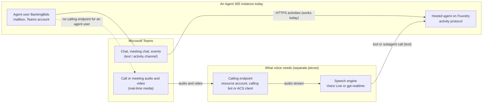
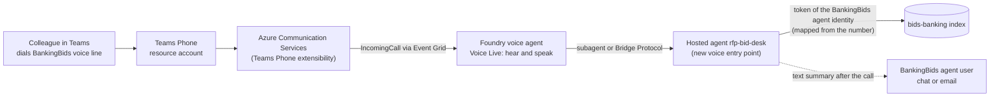

# 16 · Voice, meetings and avatars: can an autopilot join the call?

> **The question:** *"Could I have voice capability as well, like a meeting with my agents and a colleague where it's listening and performing some actions or helping with retrieval? And it would be cool to give that person an avatar."*

> **Status:** research, re-checked independently on **2026-11-02** (second version of this page; see [Changes](#9-changes-vs-the-previous-version-of-this-page)). Nothing here is deployed or tested in the Zava tenant. Markers: ✅ supported (documented, GA or documented without a preview label) · 🧪 preview (documented, preview / developer preview / gated) · 🗺️ roadmap (announced, not usable yet) · ❌ not available (no documented way) · ❓ unclear (plausible, not stated by a primary source, or sources disagree: **test before you promise it**) · ⚠️ possible, but enforced by our own design or configuration rather than by the platform. Every source, with its page date, is in [Sources](#sources).

Related: [01 · What is an autopilot](01-what-is-foundry-autopilot.md) · [04 · Architecture](04-architecture-and-components.md) · [12 · RFP Bid Desk](12-rfp-bid-desk.md) · [13 · Identity and hiring](13-identity-analogy-and-hiring.md) · demo run of show: [16a](16a-voice-meeting-demo-script.md).

## 0. In plain words: text channel versus live audio

Teams carries **two different kinds of traffic**, and they reach software in different ways.

| | **Text / activity channel** | **Real-time media** |
|---|---|---|
| What travels | Chat messages, @mentions, meeting-chat posts, meeting start/end events, emails, document comments, transcripts after the meeting | Live audio and video (and screen share), dozens of packets per second, for as long as the call lasts |
| How software takes part | Teams, Outlook or Word sends an **HTTPS "activity"** to the agent's endpoint; the agent answers with another activity | A **calling endpoint** holds a live connection to the Teams media servers for the whole call and sends and receives the audio itself |
| Who can be there | Any bot or agent, including an Agent 365 instance | Only what Teams knows as a calling endpoint: a person's Teams client, a phone, a Graph **calling bot**, an **Azure Communication Services (ACS)** client, a Teams Phone **resource account** wired to ACS |
| Our autopilot today | ✅ The hosted agent serves the activity protocol (`/activity/messages`) for its agent users | ❌ No component holds a call for the agent user |

**What the earlier sentence meant.** *"Agent 365 gives an instance only text channels in Teams"* means: the agent user is a full Teams "person" on the **left** side of the table (it is invited, chats, gets events, reads transcripts), but there is **no software that answers a call or carries meeting audio for it**. Its hosted agent receives HTTPS activities, never audio packets. The Agent 365 SDK has no audio or call notification type ([S3](#sources)), and the Microsoft 365 Agents SDK and Teams SDK have no audio activity type ([S33](#sources), [S34](#sources)).

**What "the agent user joins the call" would technically require.** Three pieces:

1. **A calling endpoint that signs in to Teams as the agent user** and keeps the call's media connection (in effect a headless Teams client). This is the missing piece: agent identities **can't sign in through Entra sign-in pages** ([S6](#sources)), and no Microsoft SDK or page documents a calling endpoint for an agent user.
2. **A speech engine** that hears (speech to text), lets the agent think, and speaks (text to speech): Voice Live or `gpt-realtime`. ✅ exists ([S15](#sources)).
3. **A low-latency bridge** between the two, with turn-taking, barge-in and echo handling. ✅ exists in pieces (Foundry voice agents, ACS, Graph media bots).

Every architecture that works today **replaces piece 1 with a different identity**: a Teams Phone resource account, a Graph calling bot, or an ACS external user. So "BankingBids can talk" is possible, but the voice in Teams isn't `bankingbids@…`.

## 1. Short answers

| Question | Verdict | In one line | Source |
|---|---|---|---|
| Can an instance be invited to a meeting, use the meeting chat and read the transcript afterwards? | ✅ 🧪 | Yes, as the agent user; Microsoft's `meeting-assistant` autopilot sample does it (preview) | [S1](#sources), [S5](#sources) |
| Can it follow the meeting **live as text**? | 🗺️ | Real-time transcripts through Work IQ for meetings **and calls**; tenant switch takes effect **14 Nov 2026**; consumption API not yet documented (❓) | [S2](#sources), [S43](#sources) |
| Can the **agent user** join a call's audio or video, be called 1:1, or speak? | ❌ | No documented way; nothing in Agent 365, the Agents SDK or Teams SDK carries audio | [S1](#sources), [S3](#sources), [S6](#sources) |
| Can a colleague **phone the autopilot from Teams** and talk to it? | 🧪 | Yes, through a **Foundry voice agent on a Teams Phone number** (resource account, Teams Phone extensibility). Our hosted agent can be its subagent or conversation engine. Not the agent user. The docs describe dialling the number; calling the resource account by name from a Teams client isn't stated (❓ test T10) | [S9](#sources), [S10](#sources), [S11](#sources), [S12](#sources) |
| Does any Foundry voice product have a **Teams meeting** channel? | ❌ | Voice agents publish to a browser preview and phone numbers only; the Teams publishing card is "intentionally hidden" | [S8](#sources) |
| Can an AI voice **speak inside a Teams meeting**? | 🧪 DIY | Only through a separate media participant: an ACS external user or a Graph app-hosted media bot (C#, developer preview), bridged to Voice Live. **No Microsoft sample** combines them | [S22](#sources), [S27](#sources), [S40](#sources) |
| Can it show an **avatar** in the meeting? | ❓ DIY | Only as that participant's outgoing video (no sample), or by screen-sharing a browser avatar. Teams "Avatars" are for humans and **retire 2 Apr 2027** | [S16](#sources), [S38](#sources) |
| Has Microsoft announced voice for agent users? | ❌ | Nothing found in public announcements or the roadmap as of 2026-11-02; see [§6](#6-announcements-and-roadmap) | [§6](#6-announcements-and-roadmap) |

## 2. Foundry-native voice (question 1)

| Building block | What it is | Status | Teams channel out of the box? | Source |
|---|---|---|---|---|
| **Foundry voice-based prompt agent** (`kind: voice`) | Agent definition (model, instructions, voice, tools) run by the Voice Live runtime; speech-to-speech (`gpt-realtime`) or cascaded; tools via MCP, toolbox, Foundry IQ | 🧪 Preview (voice agents, avatar, WebRTC, telephony) | **Browser** (playground, preview web app with transcript and avatar) and **phone numbers**. "Standard Teams and Microsoft 365 Copilot publishing … intentionally hidden"; "*Publish to Teams* and *connect a Teams phone number* are different integrations" | [S7](#sources), [S8](#sources) |
| Voice agent **phone channel** | Inbound: Teams number → resource account → ACS → Event Grid → Foundry answers and streams audio. Outbound call-job API to an E.164 number | 🧪 Preview | ✅ **Teams Phone** (calls), ❌ meetings. Audio only (no avatar on the phone) | [S9](#sources), [S10](#sources) |
| Voice agent **subagent** | Voice agent delegates to a **prompt or hosted agent** in the same project (`subagent_config`); not in VNet-isolated projects | 🧪 Preview | Inherits the voice agent's channels | [S11](#sources) |
| **Hosted agent as conversation engine** | Our container exposes `invocations_ws` and Voice Live **Bridge Protocol 1.0**; Voice Live does speech, the hosted agent does every turn | 🧪 Preview | Inherits the voice agent's channels | [S12](#sources) |
| **Hosted agent with its own voice pipeline** (`invocations_ws`) | Full-duplex WebSocket to the container (1 MB frames, ~30 min per connection); Voice Live, Pipecat or LiveKit inside; WebRTC only as your own stack | 🧪 (hosted-agent voice samples Oct 2026) | ❌ You bring the telephony or client (for example ACS or Twilio) | [S13](#sources), [S40](#sources) |
| Voice Live **connected to a Foundry text agent** (the earlier integration) | Voice Live wraps an existing text agent | ✅ / 🧪 by feature; **migration guide to voice agents published 2026-10-25** | ❌ | [S14](#sources), [S15](#sources) |
| **Voice Live API** direct | Managed speech-to-speech over WebSocket, function calling, avatar output (`video-avatar`, `photo-avatar`) | ✅ (GA API version `2026-07-15`; some features preview) | ❌ Needs an audio source and sink | [S15](#sources), [S16](#sources) |
| **Azure OpenAI Realtime** (WebRTC, WebSocket, **SIP**) | `gpt-realtime` speech in/out; SIP from a SIP trunk provider (examples: Twilio), regions Sweden Central and East US 2 | ✅ / 🧪 by feature | ❌ No Teams guidance; routing Teams Direct Routing through an SBC to the Realtime SIP endpoint isn't documented (❓) | [S18](#sources) |
| Call Center Voice Agent Accelerator (ACS Call Automation + Voice Live) | Phone call center sample | ✅ sample, but the page now says **migrate to Foundry voice agents** for telephony | ❌ | [S17](#sources) |
| **Text-to-speech avatar / Voice Live avatar** | Photorealistic or photo avatar over WebRTC; custom photo avatars now self-service in Foundry, including from an AI-generated character | ✅ (real-time avatar in Sweden Central) | ❌ Browser only | [S35](#sources), [S36](#sources), [S37](#sources) |

**Verdict:** Foundry voice reaches Teams only as a **phone call** (🧪). No Foundry voice product joins a Teams meeting or appears as a Teams chat/meeting participant.

## 3. Agent 365, Teams meetings and calls (question 2)

### 3a. The agent user in a meeting (text side, mostly verified)

| Capability | Status | Notes | Source |
|---|---|---|---|
| Invite the agent user to a scheduled meeting; it joins the **meeting chat** and gets `conversationUpdate`, `meetingStart`, `meetingEnd` and a **transcript-ready** message on the activity endpoint | ✅ 🧪 Preview sample (2026-10-15) | Same endpoint our container serves | [S1](#sources) |
| Read the **transcript after the meeting** as the agent user via **Work IQ MCP** | ✅ 🧪 Preview sample | Agent-user token, only meetings it was invited to. The sample "**does not join audio/video**" | [S1](#sources) |
| Tenant gates: **Microsoft Graph access** for transcripts (off by default); Work IQ enabled; Copilot Credits spending policy; consent to `WorkIQAgent.Ask` | ✅ | Unchanged from the previous version | [S2](#sources), [S1](#sources) |
| **@mention the agent in the meeting chat** | ❓ Expected to work with today's code (meeting chat is a group chat); not tested | Test T3 | [S1](#sources) |
| **Live transcript** through Work IQ, for meetings **and calls** | 🗺️ Switch *Work IQ access* takes effect **14 Nov 2026**; needs *Allow AI in meetings*, running transcription, an app acting for a signed-in user; the **organizer's** tenant decides | Whether an agent-user token counts as "signed-in user" ❓; consumption API ❓ | [S2](#sources), [S43](#sources) |
| Teams **policies apply to agent users** like to new users (meeting policies, joining external meetings, lobby) | ✅ | Policies mention meetings, not audio | [S4](#sources) |
| Agent 365 **notification types**: email, Word, Excel, PowerPoint comments, lifecycle; **no meeting or call type** | ✅ | Meeting events come from the Teams channel | [S3](#sources) |
| Teams extension of the Agents SDK / Teams SDK: meeting start/end and participant events | ✅ | Text and events only; no calling or media package | [S33](#sources), [S34](#sources) |

### 3b. Every documented way to get voice into a Teams call or meeting

| Path | Status | What it does | Identity in Teams | Source |
|---|---|---|---|---|
| Agent user answers a 1:1 Teams call / is on the call roster with audio | ❌ | Not documented anywhere checked | — | [S3](#sources), [S5](#sources), [S6](#sources) |
| **Foundry voice agent on a Teams Phone number** (Teams Phone extensibility) | 🧪 (Teams admin setup page 2026-10-21) | Caller dials the number; Foundry answers, Voice Live talks; transfer to a human or queue | **Resource account** (for example "BankingBids voice") | [S9](#sources), [S10](#sources), [S19](#sources) |
| **Teams Phone Agent** (Microsoft's AI front desk for auto attendants and call queues) | ✅ GA | Microsoft's own voice agent; routes to Copilot Studio voice agents. Auto attendants and call queues can also transfer to a resource account bound to a Foundry voice agent | Resource account | [S29](#sources), [S19](#sources) |
| **Copilot Studio voice agent** via Teams Phone Agent | 🧪 Preview, tenant must be enabled by support; basic (not real-time) voice agents, classic orchestration | Low-code IVR | Resource account | [S30](#sources) |
| Dynamics 365 Contact Center real-time voice agents | ✅ / 🧪 by feature | Customer service calls, authored in Copilot Studio | Contact center | [S44](#sources) |
| **ACS Teams Meeting Interop**: an ACS client joins with the meeting link | ✅ GA SDK; **breaking change**: new major SDK needed before **30 Sep 2028**, Teams Meeting Interop stays supported | Receives **mixed** incoming audio, sends custom audio and video; must be admitted from the lobby after a Teams user joins | **External** ACS user, display name you choose | [S21](#sources), [S22](#sources), [S23](#sources) |
| ACS **Teams-identity** calling (Teams user via ACS SDK) | ✅ for people · ❓ for agent users | Joins as the Teams user; needs an Entra **user** token exchanged for an ACS token. Not documented or tested for agent users; agent identities can't do interactive sign-in | Would be the agent user, **if** it worked | [S24](#sources), [S6](#sources) |
| **Graph calling bot, service-hosted media** | ✅ | Join, play prompts, record; **no live audio for AI** | Bot app | [S25](#sources) |
| **Graph calling bot, application-hosted media** (Real-time Media Platform) | 🧪 **Developer preview** (page from 2018, concepts updated 2026-02-03); **C#/.NET only**, Windows Server in Azure, instance-level public IP | Raw **per-participant** audio and video in and out | Bot app | [S26](#sources), [S27](#sources), [S28](#sources) |
| Microsoft's own meeting AI: **Interpreter** (speech-to-speech in meetings and 1:1 calls), **Facilitator**, Copilot | ✅ | Proves the platform can do live meeting speech, but only for Microsoft's agents; no extensibility | — | [S31](#sources), [S32](#sources) |
| Teams Direct Routing → SBC → Realtime SIP | ❓ | Composition, not documented | Phone number | [S18](#sources) |

> **Where sources disagree.** The ACS docs say the web SDK can read raw incoming (mixed) audio and send custom audio ([S23](#sources)); a Microsoft Q&A answer says ACS Teams interop isn't suitable for low-latency interactive voice bots in meetings and recommends a Graph media bot ([S42](#sources)). They agree on the facts (mixed audio only, no unmixed streams); the Q&A is guidance, not documentation.

## 4. Options matrix

Effort is our estimate for one autopilot with existing code; cost drivers are what scales with usage.

| # | Architecture | Hear | Speak | Avatar | Tools (our code) | Identity in Teams | Per-instance data boundary | Maturity | Effort | Cost drivers | Sources |
|---|---|---|---|---|---|---|---|---|---|---|---|
| **A** | Meeting chat, @mention | Chat text | Chat text | Profile photo | ✅ existing tool loop | Agent user | ✅ as today (activity carries the instance) | ❓ test | ½ day test | None new | [S1](#sources) |
| **B** | Post-meeting transcript (Work IQ) | Transcript after the meeting | Chat, email, Word | Profile photo | ✅ + Work IQ MCP | Agent user | ✅ agent-user token + instance identity for Search | 🧪 sample | 3–5 days | Copilot Credits | [S1](#sources), [S2](#sources) |
| **C** | Live transcript (Work IQ) | Live text | Chat text | Profile photo | ✅ wake phrase → tool loop | Agent user | ✅ if agent-user tokens qualify (❓) | 🗺️ from 14 Nov 2026, API ❓ | 1–2 weeks | Copilot Credits | [S2](#sources), [S43](#sources) |
| **D** | **"Call BankingBids"**: Foundry voice agent on a Teams Phone number, our hosted agent as subagent or conversation engine | ✅ caller's voice | ✅ | ❌ phone is audio-only | ✅ via subagent (Responses) or Bridge Protocol (`invocations_ws`) | **Resource account** per number | ⚠️ **By configuration**: one voice agent + number per instance; the call has no Agent 365 activity, so the container must map the call to the instance's agent identity itself | 🧪 voice agents, telephony | 1–2 days (prompt voice agent, ACS, bot, resource account, number) · 2–4 weeks (hosted engine, per-instance mapping) | Voice Live / model minutes, Teams service number (+ pay-as-you-go plan for outbound), ACS usage | [S9](#sources)–[S12](#sources), [S20](#sources) |
| **D′** | D brought **into a meeting** by dialling its number from the meeting | Mixed meeting audio | ✅ to everyone | ❌ | As D | Phone participant | As D | ❓ composition, not documented; needs dial-out rights; multi-speaker turn-taking untested | ½ day test | As D + dial-out | [S9](#sources) |
| **E** | Browser voice + avatar (voice agent preview web app or Voice Live avatar), **screen-shared** into the meeting | Presenter's microphone only | Via shared computer sound | ✅ | ✅ as D | Presenter (human) | As D | 🧪 | ½–1 day | Voice Live + avatar minutes | [S8](#sources), [S16](#sources) |
| **F** | **ACS Teams Meeting Interop** participant + Voice Live (headless web client) | Mixed meeting audio | ✅ | ❓ as custom outgoing video, no sample | Via our bridge → hosted agent | **External** ACS user, lobby | ⚠️ By design: one bridge identity per instance | ✅ SDK (breaking change by 2028), 🧪 as a whole: no sample | 4–8 weeks | ACS VoIP minutes, Voice Live, bridge host | [S21](#sources)–[S23](#sources) |
| **G** | **Graph app-hosted media bot** + Voice Live | ✅ per participant | ✅ | ❓ video socket, no sample | Via bridge | Bot app | ⚠️ By design | 🧪 developer preview, C# + Windows VMs | 6–10 weeks | Windows VMs with public IPs, Voice Live | [S26](#sources)–[S28](#sources) |
| **H** | Agent user on the call via ACS Teams identity | — | — | — | — | Agent user | ✅ would be ideal | ❌ / ❓ undocumented, likely blocked by sign-in rules | Research spike only | — | [S6](#sources), [S24](#sources) |

## 5. Identity and the per-instance data boundary (question 3)

| Architecture | Who appears in Teams | How tools authenticate | Per-instance boundary (doc 12 style) |
|---|---|---|---|
| A, B, C | `bankingbids@…` (agent user) | Activity carries the agentic instance ID → `instance_tokens.py` mints the **instance's agent identity** token (Search) or the agent-user token (Work IQ) | ✅ Unchanged: Azure RBAC enforces it |
| D, D′, E | A resource account or a browser session; never the agent user | Voice agent → hosted agent. No Agent 365 activity, so `TurnIdentity` is empty and today's `agent_identity` flow refuses ("not an agentic request"). The blueprint *can* mint T1 for any of its agent identities, so the container could map **number or voice agent → instance ID** and reuse the same exchange | ⚠️ Possible, but enforced by **our mapping**, not by who the caller addressed. Caller identity on a phone call is a number; whether Foundry passes a Teams caller ID to the agent is ❓. Which identity the voice agent uses to call a hosted subagent is ❓ |
| F | External ACS user ("BankingBids voice (AI)") | Bridge with its **own per-instance** managed identity, read-only roles | ⚠️ By design; second identity to govern |
| G | Calling bot app | Bot app identity + per-instance identity in the bridge | ⚠️ By design; one bot app is shared unless you register one per instance |
| H | Agent user | Agent-user token | ✅ in theory; ❌ not available |

**Rule we keep:** write actions (email, Word, Planner) stay with the agent user through the activity channel. Any voice path is **read-only** and hands a text summary to the autopilot.

## 6. Announcements and roadmap

Checked on 2026-11-02 against the public [Microsoft 365 roadmap](https://www.microsoft.com/microsoft-365/roadmap) (all items updated since Nov 2025, filtered for voice, audio, meetings, agents, avatars, Work IQ), Microsoft Learn and public blogs. **Microsoft Ignite 2026 is on 17–20 Nov 2026** ([S47](#sources)), so it hasn't happened yet. Re-check after it.

| Item | What it is | Status and date | Source |
|---|---|---|---|
| Voice for **Agent 365 agent users** (join calls, be called, speak) | — | ❌ **Nothing announced**: no roadmap item, no Learn page, no public sample. Entra describes agent users as team members "with mailboxes, chat access, and inclusion in HR systems"; calling isn't mentioned | [S48](#sources), roadmap search |
| **Work IQ: Real Time Transcripts** (roadmap ID 570651) | Apps and agents read Teams meeting transcripts live | 🗺️ Preview Sept CY2026, **GA Nov CY2026**; tenant switch effective **14 Nov 2026** | [S43](#sources), [S2](#sources) |
| Work IQ: Custom agents + third-party calls (roadmap ID 570853) | Work IQ invokes custom agents and agents calling third-party tools ("calls" = tool calls, not phone calls) | 🗺️ Preview Oct, GA **Nov CY2026** | [S49](#sources) |
| **Identify bots joining your Teams meetings** (roadmap ID 558107) | External bots wait in the lobby, shown as bots, and must be admitted separately | Rolling out, GA **May CY2026**. Affects options F and G | [S50](#sources) |
| Third-party synthetic audio and video detection (roadmap ID 573451) | Certified providers flag synthetic media in meetings | 🗺️ GA **Nov CY2026**. An AI voice or avatar participant may be flagged: disclose it | [S51](#sources) |
| Audio announcement for recording and transcription (559609); explicit consent in 1:1 PSTN calls (577543) | Consent prompts | 🗺️ GA **Dec CY2026** | [S52](#sources) |
| Interpreter: in Teams calls (526777, launched Jan CY2026), Teams Events (576711, GA Dec CY2026) | Microsoft's speech-to-speech agent | ✅ / 🗺️, not extensible | [S31](#sources), [S52](#sources) |
| Facilitator: answers questions (558341, Dec CY2026), joins channel meetings (568936, Feb CY2027) | Microsoft's meeting agent | 🗺️, not extensible | [S52](#sources) |
| Foundry **voice-based agents**, telephony (Teams Phone extensibility, Twilio), hosted-agent voice (`invocations_ws`, Bridge Protocol) | See §2 | 🧪 Preview; Learn pages dated Sept–Oct 2026. We found no announcement blog with a GA date | [S7](#sources)–[S13](#sources) |
| Teams Phone extensibility for Dynamics 365 Contact Center | Teams numbers routed through ACS | ✅ GA, announced **3 Sep 2025** | [S53](#sources) |
| Teams Phone Agent | Microsoft's AI front desk for Teams Phone | ✅ "now generally available" (Learn page dated 2026-08-31); no separate GA blog found | [S29](#sources) |
| ACS retirement | Standalone ACS retires **30 Sep 2028**; onboarding limits from **23 Oct 2026**; Teams Meeting Interop and Teams Phone extensibility continue with new major SDKs | Announced **23 Sep 2026** | [S21](#sources) |
| Teams Avatars app (human avatars) | — | Retires **2 Apr 2027** | [S38](#sources) |

## 7. Avatar (question 4)

| Layer | How | Status | Source |
|---|---|---|---|
| **Teams "Avatars" app** | Cartoon avatars that **people** use instead of their camera; not AI participants | ✅ today, **retires 2 Apr 2027** | [S38](#sources) |
| **Profile photo of the agent user** | `PUT /users/{id}/photo/$value`; the `agentUser` resource lists no photo relationship | ✅ for users · ❓ for agent users (test T8) | [S45](#sources), [S46](#sources) |
| **Talking avatar** (Speech avatar, Voice Live `avatar`) | WebRTC video in a browser; standard, custom (Limited Access) or **custom photo avatar** (self-service, also from an AI-generated character) | ✅ real-time avatar in Sweden Central | [S16](#sources), [S35](#sources)–[S37](#sources), sample [S41](#sources) |
| **Avatar inside a Teams meeting** | As outgoing video of option F (ACS) or G (media bot) | ❓ feasible by composition, **no sample**; a Microsoft Q&A answer says there's no direct integration | [S23](#sources), [S42](#sources) |
| Fallback | Run the avatar web app and **share the screen** (option E) | ✅ | [S8](#sources) |
| Phone channel (option D) | Audio only | ❌ avatar | [S8](#sources) |

Disclosure: Microsoft requires synthetic voices and avatars to be disclosed; use a visibly synthetic avatar, "(AI)" in names and a spoken "I'm an AI assistant" ([S39](#sources)).

## 8. Recommendation

| When | What | Why | Gate |
|---|---|---|---|
| **Demo now** | **A** (meeting chat) and the **profile photo**; **E** (browser voice + avatar with a Foundry voice agent that calls our tools), shown honestly as "outside Teams" | No new identity in Teams; E shows voice and a face in a day | T1–T4, T8, T9 |
| **Demo now, if the tenant has a Teams Phone service number** | **D** with a *prompt* voice agent: colleagues **call "BankingBids voice"** from Teams | Only supported way to talk to a Foundry agent from Teams today | T10–T11 |
| **Pilot (4–6 weeks)** | **B** then **C** for the agent user; **D** with our hosted agent as conversation engine (Bridge Protocol) and a number-to-instance map, read-only tools | Voice that keeps the per-instance data boundary, without a meeting bot | Voice agents still preview; legal review of recording and AI disclosure |
| **Spike only** | **F** (ACS external participant, optional avatar video) or **G** (C# media bot) for "speaks in the meeting" | No Microsoft sample, external or bot identity, 4–10 weeks | Customer demand; ACS new SDK plan |
| **Wait for** | Agent users with a calling endpoint (H); a documented Work IQ live-transcript API; Foundry voice agents GA; ACS new major SDKs | Not announced / not documented as of 2026-11-02 | Re-check after **14 Nov 2026** (Work IQ switch) and Microsoft Ignite 2026 |

**FinCrime:** keep voice out. Speaking about a suspicion aloud raises tipping-off and recording risk; text in an internal chat, human decides.

### Guardrails (all options)

| Risk | Guardrail |
|---|---|
| Recording and consent | Humans start transcription; Teams shows the notice; voice greeting says it's an AI and whether it records (voice-agent recording is off by default, [S14](#sources)) |
| AI disclosure, no impersonation | "(AI)" in names, synthetic avatar, never a real employee's face or voice ([S39](#sources)) |
| Data isolation | Agent user reads only meetings it's invited to; Search always with the **instance's** identity; voice paths get their own per-instance identity or mapping, never the shared container identity ([doc 12](12-rfp-bid-desk.md)) |
| Prompt injection via speech | Treat transcripts and speech as untrusted; wake phrase + explicit request; no write actions from live speech without a chat confirmation |
| Tipping-off (FinCrime) | Internal attendees only, `NO_REPLY` otherwise; existing detector runs on transcript-derived requests |
| Logs | No raw tokens or audio in logs; keep `CAPTURE_MESSAGE_CONTENT=false`; the sample's `MEETING_LOG_*` off |
| Cost | Copilot Credits cap; Azure budgets on Voice Live, avatar and ACS minutes |

### Verify in the tenant

| # | Check | Expected | Verifies |
|---|---|---|---|
| T1 | Invite `bankingbids@…` to a scheduled meeting | Appears as attendee, joins meeting chat | 3a |
| T2 | Log `activity.type`/`name` (or deploy `meeting-assistant`) | `meetingStart` / `meetingEnd` arrive with our blueprint's `canRespondWithoutMention=false` (❓) | 3a |
| T3 | `@BankingBids /whoami` in the meeting chat | Answer as the agent user | A |
| T4 | End a transcribed meeting | Transcript-ready message arrives; agent doesn't answer it | B |
| T5 | `EnableGraphTranscriptAccess`, Work IQ consent, spending policy | All present | B |
| T6 | After 14 Nov 2026: `EnableWorkIQTranscriptAccess $true` | Live text with an agent-user token (❓) | C |
| T7 | Press **Call** on the agent user in Teams | Documents today's behaviour (expected: not reachable) | H |
| T8 | Photo on the agent user | Shown in Teams, or a documented error | 7 |
| T9 | Voice agent playground with avatar in Sweden Central | Talks with avatar | E |
| T10 | Bind a Teams number to a voice agent ([S10](#sources)), call it **from a Teams client** and from a phone | Greeting, two-way audio, barge-in, trace in Foundry | D |
| T11 | Hosted subagent call from the voice agent | Which identity reaches Search (`/whoami`-style log) | D, §5 |
| T12 | From a meeting, dial out to the voice agent's number | Joins as a phone participant (❓) | D′ |

## 9. Changes vs the previous version of this page

| Previous claim | Now | Why |
|---|---|---|
| Agent user can't join audio/video; voice needs a separate media participant with another identity | ✅ **Confirmed** | Re-checked Agent 365, Agents SDK, Teams SDK, Entra Agent ID and samples ([S1](#sources), [S3](#sources), [S6](#sources), [S33](#sources), [S34](#sources)) |
| Post-meeting transcript via Work IQ, live transcripts from 14 Nov 2026, Graph transcript switch | ✅ Confirmed; live transcripts also cover **calls** | [S2](#sources) |
| Graph app-hosted media: developer preview, C#/Windows only | ✅ Confirmed; samples still C#, still maintained | [S27](#sources), [S28](#sources) |
| "Foundry voice agents: **No**, phone calls / IVR, not meetings" | **Incomplete.** True for meetings, but it hid that a colleague **can call a Foundry voice agent from Teams** today (🧪), now with a Teams admin setup page | [S9](#sources), [S10](#sources) |
| Voice needs our own bridge service (option d) | **Outdated.** Foundry now hosts the voice runtime and telephony, and a **hosted agent can be the subagent or the conversation engine** of a voice agent, so our container's logic can be reused for voice without a meeting bot | [S11](#sources)–[S13](#sources) |
| ACS: "standalone ACS retires 30 Sep 2028; Teams Meeting Interop stays" | ✅ Confirmed, plus: **onboarding limits from 23 Oct 2026**, ACS PSTN and Direct Routing retire, **Call Automation** stays only with Teams Phone extensibility; the ACS + Voice Live call-center accelerator page now points to Foundry voice agents | [S17](#sources), [S21](#sources) |
| Copilot Studio voice / Teams Phone Agent: preview, "no meeting join" | Partly updated: **Teams Phone Agent is GA**; the Copilot Studio integration is still preview and gated | [S29](#sources), [S30](#sources) |
| Avatar: Speech avatar, composition in the meeting ❓ | ✅ Still ❓ in the meeting; **new**: custom photo avatars self-service, Teams Avatars app (human) **retires 2 Apr 2027** | [S37](#sources), [S38](#sources) |
| Microsoft's meeting AI: Facilitator, Copilot | **Missed** Interpreter: Microsoft already speaks in meetings, but nothing is extensible | [S31](#sources) |
| Five options (a)–(e) | Now nine (A–H, D′), with the phone path (D) as the only supported voice route to a Foundry agent from Teams | §4 |
| Title link "demo run of show: 14a" | Fixed to 16a | — |
| Work IQ live-transcript roadmap cited through a third-party mirror | Now cites the official **Microsoft 365 roadmap ID 570651** (dates confirmed: created 2026-10-19, preview Sept, GA Nov CY2026) | [S43](#sources) |
| Not covered before | Plain-language text vs media explainer; identity per architecture; Teams policies for agent users; ACS Teams-identity hypothesis (H) marked ❌/❓ | §0, §5 |

## Sources

All checked on **2026-11-02**. "Page date" is the page's `ms.date` or the last commit date.

| # | Source | Page date |
|---|---|---|
| S1 | [foundry-samples · `autopilot-agents/meeting-assistant`](https://github.com/microsoft-foundry/foundry-samples/tree/main/samples/python/autopilot-agents/meeting-assistant) ("does not join audio/video") | commits 2026-10-09, 2026-10-15 |
| S2 | [Manage transcript API access for Teams meetings](https://learn.microsoft.com/microsoftteams/meeting-transcript-api-access) (Graph access, Work IQ real-time, 14 Nov 2026) | 2026-10-20 |
| S3 | [Agent 365 · Notify agents](https://learn.microsoft.com/microsoft-agent-365/developer/notification) | 2026-10-01 |
| S4 | [Manage Teams policies for Microsoft Agent 365 agents](https://learn.microsoft.com/microsoftteams/manage-policies-for-agents) | 2025-11-14 |
| S5 | [Agent 365 · Create agent instances](https://learn.microsoft.com/microsoft-agent-365/developer/create-instance) ("Teams for chats, channels, and meetings") | 2026-07-07 |
| S6 | [Microsoft Entra Agent ID FAQ](https://learn.microsoft.com/entra/agent-id/faq) (agent identities can't sign in to Entra sign-in pages) | 2026-04-13 |
| S7 | [Foundry Agent Service overview · voice-based agents](https://learn.microsoft.com/azure/foundry/agents/overview#how-voice-based-agents-work) | 2026-10-26 |
| S8 | [Publish and share a voice-based agent](https://learn.microsoft.com/azure/foundry/agents/how-to/voice-agent-channels-publish) | 2026-09-25 |
| S9 | [Integrate telephony channels with a voice agent](https://learn.microsoft.com/azure/foundry/agents/how-to/voice-agent-telephony-channels) | 2026-09-25 |
| S10 | [Teams · Voice enable Microsoft Foundry agents](https://learn.microsoft.com/microsoftteams/aa-cq-direct-foundry) | 2026-10-21 |
| S11 | [Use a subagent in a voice-based agent](https://learn.microsoft.com/azure/foundry/agents/how-to/use-subagent-voice-first-agent) | 2026-09-22 |
| S12 | [Use a hosted agent as the conversation engine in a voice-based agent](https://learn.microsoft.com/azure/foundry/how-to/voice-first-with-hosted-agent) | 2026-09-28 |
| S13 | [Build a voice agent with hosted agents (`invocations_ws`)](https://learn.microsoft.com/azure/foundry/agents/how-to/build-voice-agent) | 2026-10-19 |
| S14 | [Migrate from Voice Live with Foundry Agent Service to voice agents](https://learn.microsoft.com/azure/foundry/agents/how-to/migrate-from-voice-live) | 2026-10-25 |
| S15 | [Voice Live API overview](https://learn.microsoft.com/azure/ai-services/speech-service/voice-live) | 2026-10-26 |
| S16 | [How to use the Voice Live API · avatar](https://learn.microsoft.com/azure/ai-services/speech-service/voice-live-how-to#azure-text-to-speech-avatar) | 2026-10-27 |
| S17 | [Call Center Voice Agent Accelerator](https://learn.microsoft.com/azure/ai-services/speech-service/voice-live-telephony) | 2026-10-08 |
| S18 | [Use the GPT Realtime API via SIP](https://learn.microsoft.com/azure/foundry/openai/how-to/realtime-audio-sip) | 2026-09-21 |
| S19 | [Teams Phone extensibility overview](https://learn.microsoft.com/azure/communication-services/concepts/interop/tpe/teams-phone-extensibility-overview) | 2026-06-11 |
| S20 | [Cost and connectivity options for Teams Phone extensibility](https://learn.microsoft.com/azure/communication-services/concepts/interop/tpe/teams-phone-extensibility-connectivity-cost) | 2025-09-01 |
| S21 | [ACS retirement and breaking changes guide](https://learn.microsoft.com/azure/communication-services/acs-retirement-and-breaking-changes-guide) (announced 23 Sep 2026; onboarding limits 23 Oct 2026; effective 30 Sep 2028) | 2026-08-18 |
| S22 | [ACS · Teams meeting interoperability](https://learn.microsoft.com/azure/communication-services/concepts/join-teams-meeting) | 2021-10-15 |
| S23 | [ACS · Access raw audio and video](https://learn.microsoft.com/azure/communication-services/quickstarts/voice-video-calling/get-started-raw-media-access) | 2025-06-24 |
| S24 | [ACS · Access tokens for Teams users](https://learn.microsoft.com/azure/communication-services/quickstarts/manage-teams-identity) | 2021-06-30 |
| S25 | [Calls and online meetings bots](https://learn.microsoft.com/microsoftteams/platform/bots/calls-and-meetings/calls-meetings-bots-overview) | 2022-05-16 |
| S26 | [Real-time media calls and meetings](https://learn.microsoft.com/microsoftteams/platform/bots/calls-and-meetings/real-time-media-concepts) | 2026-02-03 |
| S27 | [Requirements for application-hosted media bots](https://learn.microsoft.com/microsoftteams/platform/bots/calls-and-meetings/requirements-considerations-application-hosted-media-bots) (developer preview, C#) | 2018-11-27 |
| S28 | [microsoft-graph-comms-samples](https://github.com/microsoftgraph/microsoft-graph-comms-samples) (C# media bots, EchoBot, PsiBot) | commit 2026-10-28 |
| S29 | [Planning · Agents and Queues for Teams Phone Agent](https://learn.microsoft.com/microsoftteams/aa-cq-plan-teams-phone-agent-agents-queues) ("now generally available") | 2026-08-31 |
| S30 | [Copilot Studio · Integrate voice agents with Teams Phone Agent (preview)](https://learn.microsoft.com/microsoft-copilot-studio/voice-teams-phone-agent) | 2026-06-17 |
| S31 | [Manage Interpreter agent](https://learn.microsoft.com/microsoftteams/interpreter-agent-teams) | 2026-09-21 |
| S32 | [Set up Facilitator in Microsoft Teams](https://learn.microsoft.com/microsoftteams/facilitator-teams) | 2026-08-13 |
| S33 | [Teams extension for the Agents SDK](https://learn.microsoft.com/microsoft-365/agents-sdk/teams/teams-extension) | 2026-08-17 |
| S34 | [microsoft/teams.ts packages](https://github.com/microsoft/teams.ts/tree/main/packages) (no calling or media package) | checked |
| S35 | [What is text to speech avatar?](https://learn.microsoft.com/azure/ai-services/speech-service/text-to-speech-avatar/what-is-text-to-speech-avatar) | 2026-05-21 |
| S36 | [Speech regions · avatar](https://learn.microsoft.com/azure/ai-services/speech-service/regions) | 2026-10-28 |
| S37 | [Create a custom photo avatar](https://learn.microsoft.com/azure/ai-services/speech-service/text-to-speech-avatar/custom-photo-avatar-create) | 2026-09-18 |
| S38 | [Manage the Avatars app in Microsoft Teams](https://learn.microsoft.com/microsoftteams/meeting-avatars) (retires 2 Apr 2027) | 2026-10-09 |
| S39 | [Disclosure design guidelines for synthetic voices](https://learn.microsoft.com/azure/foundry/responsible-ai/speech-service/text-to-speech/concepts-disclosure-guidelines) | 2025-11-21 |
| S40 | [foundry-samples · hosted-agent voice samples](https://github.com/microsoft-foundry/foundry-samples/tree/main/samples/python/hosted-agents/bring-your-own) (`invocations_ws`, `voicelive`, `voice-agent-target-agent`) | commits 2026-10-23 |
| S41 | [microsoft-foundry/voicelive-samples](https://github.com/microsoft-foundry/voicelive-samples) (including `voice-live-avatar`) | commit 2026-10-22 |
| S42 | [Microsoft Q&A · real-time voice bot in Teams meetings](https://learn.microsoft.com/answers/questions/5589626/can-i-build-a-real-time-voice-interview-bot-for-te) (community answer, not documentation) | checked |
| S43 | [Microsoft 365 roadmap ID 570651 · Work IQ: Real Time Transcripts](https://www.microsoft.com/microsoft-365/roadmap?id=570651) (preview Sept CY2026, GA Nov CY2026) | created 2026-10-19 |
| S44 | [Transparency note: real-time agents in Dynamics 365 Contact Center](https://learn.microsoft.com/dynamics365/contact-center/implement/transparency-note-real-time-voice-agents) | 2026-07-17 |
| S45 | [Update profilePhoto](https://learn.microsoft.com/graph/api/profilephoto-update) | 2024-09-23 |
| S46 | [agentUser resource type](https://learn.microsoft.com/graph/api/resources/agentuser) | 2026-04-27 |
| S47 | [Get ready for Microsoft Ignite 2026](https://techcommunity.microsoft.com/blog/partnernews/get-ready-for-microsoft-ignite-2026/4568837) (17–20 Nov 2026) | modified 2026-10-29 |
| S48 | [Microsoft Entra Agent ID · agent users](https://learn.microsoft.com/entra/agent-id/agent-users) | 2025-11-04 |
| S49 | [Microsoft 365 roadmap ID 570853 · Work IQ: Custom agents + 3P calls](https://www.microsoft.com/microsoft-365/roadmap?id=570853) | created 2026-09-29 |
| S50 | [Microsoft 365 roadmap ID 558107 · Identify bots joining your Teams meetings](https://www.microsoft.com/microsoft-365/roadmap?id=558107) | created 2026-03-06 |
| S51 | [Microsoft 365 roadmap ID 573451 · Third-party synthetic audio and video detection](https://www.microsoft.com/microsoft-365/roadmap?id=573451) | created 2026-10-02 |
| S52 | Microsoft 365 roadmap IDs [559609](https://www.microsoft.com/microsoft-365/roadmap?id=559609), [577543](https://www.microsoft.com/microsoft-365/roadmap?id=577543), [526777](https://www.microsoft.com/microsoft-365/roadmap?id=526777), [576711](https://www.microsoft.com/microsoft-365/roadmap?id=576711), [558341](https://www.microsoft.com/microsoft-365/roadmap?id=558341), [568936](https://www.microsoft.com/microsoft-365/roadmap?id=568936) | modified Oct 2026 |
| S53 | [Teams Phone extensibility for Dynamics 365 Contact Center generally available](https://www.microsoft.com/dynamics-365/blog/it-professional/2025/09/03/teams-phone-extensibility-for-dynamics-365-contact-center-generally-available/) | 2025-09-03 |
