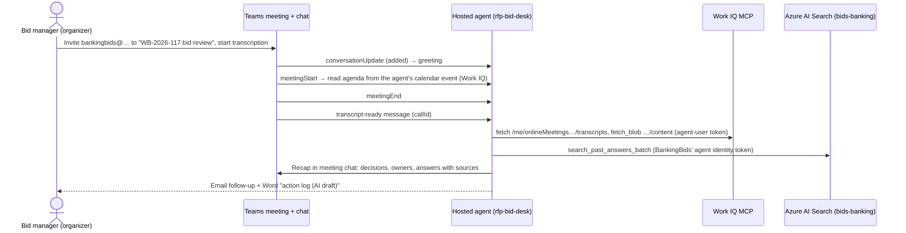
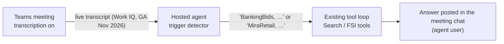
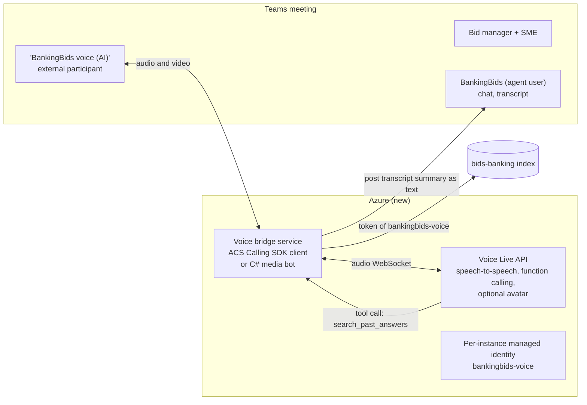

# 16 · Voice, meetings and avatars: can an autopilot join the meeting?

> **The question:** *"Could I have voice capability as well, like a meeting with my agents and a colleague where it's listening and performing some actions or helping with retrieval? And it would be cool to give that person an avatar."*

**Short answer (as of 2026-11-02):** yes, in steps. A hired instance (for example **BankingBids** or **MiraRetail**) can **already be invited to a Teams meeting as an attendee**, post in the meeting chat, receive meeting start/end events and **read the transcript after the meeting** (Microsoft's own `meeting-assistant` autopilot sample does exactly this). **Live transcripts** for agents arrive through **Work IQ** (preview Sept 2026, GA targeted November 2026; tenant switch takes effect **14 November 2026**). **Listening to the audio and speaking in the meeting** isn't available to the agent user itself: it needs a separate media participant (an Azure Communication Services Teams-interop client or a Graph real-time media bot) bridged to the **Voice Live API**, and that participant joins as a *different* identity. A **profile photo** is a quick win; a **talking video avatar** (Azure Speech avatar) is possible only on top of that media participant.

How to read the status labels:

| Label | Meaning |
|---|---|
| ✅ **Verified** | Stated in Microsoft Learn or shown by an official Microsoft sample, checked on 2026-11-02 |
| 🧪 **Preview** | Documented, but preview / developer preview / Frontier, no SLA |
| 🗺️ **Roadmap** | Announced (Microsoft 365 roadmap, Message Center), not yet usable |
| ❓ **Unverified** | Plausible, not stated by a primary source, or not yet tested in the Zava tenant: **test before you promise it** |

Every source was checked on **2026-11-02**; the [Sources](#sources) table lists each page's own date. Nothing here is tested in the Zava tenant yet: see the [test checklist](#7-verify-it-in-the-tenant).

Related: [01 · What is an autopilot](01-what-is-foundry-autopilot.md) · [04 · Architecture](04-architecture-and-components.md) · [12 · RFP Bid Desk](12-rfp-bid-desk.md) · [13 · Identity and hiring](13-identity-analogy-and-hiring.md) · demo run of show: [14a](16a-voice-meeting-demo-script.md).

---

## 1. What exists today

### 1a. The agent user in a Teams meeting

| Capability | Status | What it means for our instances | Source |
|---|---|---|---|
| Invite the **agent user** to a scheduled (non-channel) Teams meeting; it is added to the **meeting chat** and receives `conversationUpdate` (added), `meetingStart` and `meetingEnd` events and a **transcript-ready** message on `/activity/messages` | ✅ 🧪 Official preview sample (Oct 2026) | BankingBids can be invited like a colleague. Events arrive on the same activity endpoint our container already serves | [S1](#sources), [S2](#sources) |
| Read the **transcript after the meeting** as the agent user, through **Work IQ MCP** (`fetch` on `/me/onlineMeetings…`, `fetch_blob` on `/me/onlineMeetings/{id}/transcripts/{id}/content?$format=text/vtt`) | ✅ 🧪 Preview sample | No new identity: the agent-user token is used, so the agent reads only meetings it was invited to | [S1](#sources), [S2](#sources) |
| Tenant gate: **Teams admin center > Meetings > Meeting settings > Transcript API access > Microsoft Graph access** (off by default; `Set-CsTeamsMeetingConfiguration -EnableGraphTranscriptAccess $true`). Inviting the agent doesn't override it (`403 GraphAccessToTranscriptsDisabled`) | ✅ | One switch for the Zava tenant admin | [S3](#sources), [S1](#sources) |
| Work IQ prerequisites: blueprint consent to **`WorkIQAgent.Ask`** (resource app `fdcc1f02-fc51-4226-8753-f668596af7f7`, scope `api://workiq.svc.cloud.microsoft/WorkIQAgent.Ask`), Work IQ enabled for the tenant, and an active **Copilot Credits spending policy** covering the Work IQ API and the agent user | ✅ 🧪 Preview sample | Adds a pay-as-you-go cost line and one admin consent. Work IQ is delegated only: app-only isn't supported | [S1](#sources), [S4](#sources), [S5](#sources) |
| **@mention the agent in the meeting chat** during the meeting (the meeting chat is a Teams group chat) | ❓ Expected to work with **today's code**; not tested | Our host already handles `msteams` group chats with `NO_REPLY` | [S1](#sources) (agent added to meeting chat), this repo `host_agent_server.py` |
| **Live transcript while the meeting runs**, delivered by **Work IQ** | 🗺️ 🧪 Roadmap RM570651: preview Sept 2026, GA Nov 2026. Admin switch **Work IQ access** (off by default) takes effect **14 Nov 2026** | The building block for "listening" without audio. Conditions: *Allow AI in meetings* on, transcription running (Work IQ doesn't start it), the app acts for a signed-in user, the **organizer's** tenant setting applies, speaker names included | [S3](#sources), [S6](#sources) |
| The exact call shape for consuming the live transcript via Work IQ (MCP tool, REST, push vs poll) | ❓ Not found in the fetched docs | A typed Graph **beta** path `/copilot/communications/realtimeActivityFeed/meetings/{id}/transcripts` appears in the Teams SDK endpoint listings, but has no conceptual page: don't build on it until documented | [S7](#sources) |
| Whether an **agent-user** token counts as "a signed-in user" for live Work IQ transcripts | ❓ | Likely (agent-user tokens are delegated user tokens, `idtyp=user`), but untested | [S3](#sources), [doc 13](13-identity-analogy-and-hiring.md) |
| **Agent 365 notifications** have no meeting type: only email, Word/Excel/PowerPoint comments and three lifecycle events | ✅ | Meeting events come from the Teams channel, not the Agent 365 notification router | [S8](#sources) |
| The agent user **joins the meeting audio/video** or **speaks** | ❌ No documented API for the agent user to join media | Voice needs a separate media participant (§1c) | [S9](#sources), [S1](#sources) ("does not join audio/video") |

### 1b. Microsoft Graph meeting APIs (for reference)

| API | Status | Permissions and licence | Notes | Source |
|---|---|---|---|---|
| Transcripts: `GET …/onlineMeetings/{id}/transcripts`, `/content` (VTT) | ✅ GA | Delegated `OnlineMeetingTranscript.Read.All`; app-only `OnlineMeetingTranscript.Read.All` + **application access policy** (`New-CsApplicationAccessPolicy` / `Grant-CsApplicationAccessPolicy`), or RSC `OnlineMeetingTranscript.Read.Chat` (scheduled private-chat meetings only) | Plus the tenant **Microsoft Graph access** switch above | [S10](#sources), [S11](#sources), [S12](#sources) |
| Change notifications for new transcripts/recordings (`getAllTranscripts`, per-meeting) | ✅ GA | Same | Our sample-based design uses the Teams transcript-ready message instead | [S13](#sources) |
| **Meeting AI insights** (`/copilot/users/{id}/onlineMeetings/{id}/aiInsights`): notes, action items, mentions | ✅ | **Microsoft 365 Copilot licence** for each user; no pay-as-you-go | After the meeting (up to 4 h), no channel meetings. ❓ an agent user can't obviously hold a Copilot licence, so prefer reading the transcript | [S14](#sources) |
| Workload MCP servers (Mail, Teams, Calendar, Word, …) we use today | ✅ "**backward compatibility only**, not for production or new projects; use **Work IQ MCP**" | — | Side finding: meeting work pushes us to Work IQ MCP anyway | [S15](#sources) |

### 1c. Voice: listening to and speaking in the meeting

| Building block | Status | Can it join a Teams meeting? | Identity it joins as | Language / hosting | Source |
|---|---|---|---|---|---|
| **Graph calling bot, service-hosted media** | ✅ GA | Yes (join, play prompts, record), **no raw audio** | Bot app (Azure Bot with calling) | Any | [S9](#sources) |
| **Graph calling bot, application-hosted media** (Real-time Media Platform) | 🧪 **Developer preview** | Yes, with raw audio/video in and out | Bot app; `Calls.JoinGroupCall.All`, `Calls.AccessMedia.All` | **C#/.NET only, Windows Server VMs**, instance-level public IP; no Python | [S16](#sources), [S17](#sources) |
| **Azure Communication Services (ACS) Calling SDK, Teams meeting interop** | ✅ GA, now **"breaking change"**: standalone ACS retires **30 Sep 2028**; Teams Meeting Interoperability stays supported with a new major SDK | Yes, as an **external** participant (labelled *external*, waits in the lobby until a Teams user is present). Web SDK can send **custom audio and video** (`MediaStream`) and read raw incoming audio | ACS identity (BYOI), **not** the agent user | JS (browser/headless), .NET, iOS, Android | [S18](#sources), [S19](#sources), [S20](#sources) |
| ACS **Call Automation** + bidirectional audio streaming | ✅ (Teams **users** can be added to calls) | **Joining a Teams meeting isn't documented** | ACS | Python supported | [S20](#sources), [S21](#sources) |
| **Voice Live API**: managed speech-to-speech (STT + model + TTS) over WebSocket, `gpt-realtime` and GPT models, function calling, **avatar** output | ✅ (some models/features preview) | Not by itself: it needs an audio source and sink (ACS or a media bot) | Your Foundry resource | Any (WebSocket) | [S22](#sources), [S23](#sources) |
| **Foundry voice agents** (voice interaction mode, telephony via **Teams Phone Extensibility** or Twilio) | 🧪 Preview | **No**: phone calls / IVR, not meetings | Teams resource account | Python, JS | [S24](#sources), [S25](#sources) |
| Azure OpenAI **Realtime API** (WebRTC, WebSocket, function calling) | ✅ GA (WebRTC) | Not by itself | — | Any | [S26](#sources) |
| **Copilot Studio** voice / Teams Phone Agent | 🧪 Preview | No meeting join found | — | — | [S27](#sources) |
| Microsoft's own meeting AI: **Facilitator**, Microsoft 365 Copilot in meetings, intelligent recap | ✅ (Facilitator in Teams Rooms: preview) | Yes, but they are **Microsoft's** agents, not our autopilot. Facilitator: only the organizer needs a Copilot licence | — | — | [S28](#sources), [S3](#sources) |

**Bottom line:** no Microsoft product lets a Foundry autopilot's **agent user** speak in a Teams meeting today. Voice is a do-it-yourself bridge, and the voice participant is a second identity that must be governed like one.

## 2. Is the agent user a real attendee?

| Question | Answer | Status |
|---|---|---|
| Can it be **invited**? | Yes: add `bankingbids@…` to the invite like a person (it has a mailbox and calendar from its Frontier seat) | ✅ [S1](#sources) |
| Does it **see** the meeting? | Through its calendar event (agenda), the meeting chat and, after the meeting, the transcript | ✅ [S1](#sources), [S2](#sources) |
| Can it **listen live**? | Only as **text**: the live transcript through Work IQ (Nov 2026). Not the audio | 🗺️ [S3](#sources), [S6](#sources) |
| Can it **speak**? | Not as the agent user. A separate media participant can, as an *external* or bot identity | ❌ / DIY [S16](#sources), [S18](#sources) |
| Can it **act during** the meeting? | In the meeting chat: answer @mentions, post reminders. With the live transcript: react to trigger phrases | ❓ (b), 🗺️ (c) |
| Can it **act after** the meeting? | Yes: recap, action items, email follow-ups, Word documents, all as itself | ✅ [S1](#sources) |
| Licence | Its Frontier seat (Teams, Exchange, OneDrive), Copilot Credits for Work IQ. Teams Premium isn't named as a requirement by the pages checked | ✅ / ❓ |

## 3. Design options, lightest to richest

| | (a) Post-meeting | (b) In-meeting chat | (c) Live transcript | (d) Voice participant | (e) Avatar |
|---|---|---|---|---|---|
| What participants see | Recap and actions in the meeting chat and by email after the call | Ask `@BankingBids …` in the meeting chat, answer in the chat | Agent reacts to what is said ("BankingBids, what did we commit…") with a chat post | A participant that **listens and answers aloud** | Profile photo everywhere; optionally a talking face in the meeting |
| Identity | Agent user | Agent user | Agent user | **Separate**: ACS identity or bot app, plus a per-instance Azure identity for data | Agent user (photo); media participant (video) |
| Code change | Yes (meeting handlers, Work IQ MCP) | None expected | Yes | New service | Photo: none; video: on top of (d) |
| New Azure services | None | None | None | ACS resource, Voice Live (Foundry), a host for the bridge | Speech avatar (via Voice Live or Speech) |
| New Microsoft 365 settings | Graph transcript access, Work IQ, Copilot Credits policy, `WorkIQAgent.Ask` consent | None | Same as (a) + **Work IQ access** + *Allow AI in meetings* | External access / lobby policy; recording notice | Photo update right |
| Effort | 3–5 days | 0.5 day test | 1–2 weeks once the Work IQ API is documented | 4–8 weeks spike to pilot | 0.5 day (photo); +1–2 weeks on top of (d) |
| Maturity | 🧪 sample-proven | ❓ | 🗺️ GA Nov 2026 | 🧪 / DIY, ACS retirement path | ✅ photo (❓ agent user), ✅ Speech avatar |
| Demo in Zava now? | After two admin switches and a spending policy | **Yes**, test today | After 14 Nov 2026 | No (spike) | Photo: yes |

### (a) Post-meeting: read the transcript, post actions

* **Identity and tokens:** the Work IQ call uses the **agent-user** token (`AgenticUserAuthorization`, scope `api://workiq.svc.cloud.microsoft/WorkIQAgent.Ask`), obtained through the same T1 → agent-user exchange as today's MCP tools ([doc 13](13-identity-analogy-and-hiring.md)). Search keeps using the **instance's agent identity** token, so Azure RBAC still isolates the banking library. No new secret.
* **Permissions and licences:** add `WorkIQAgent.Ask` to the blueprint's `optionalPermissionScopes` and re-consent; Teams **Microsoft Graph access** switch on; Work IQ enabled; Copilot Credits spending policy for the agent users. Transcription must be started in the meeting.
* **Code (later PR, not this one):** Teams meeting handlers (`TeamsAgentExtension` start/end in the sample), a Work IQ MCP entry in the tooling manifests, an "is transcript-ready XML" guard in `on_message` so the `<URIObject …>` message never reaches the model, and recap prompts per scenario. Reuse the sample's correlation logic (join URL → `onlineMeeting` → `callId`).
* **Risks:** preview sample ("not a production meeting service": no durable polling, one transcript page); our blueprint uses `canRespondWithoutMention=false` while the sample uses `true` (❓ whether meeting events still arrive); Work IQ cost; the sample **logs raw payloads by default**, keep `MEETING_LOG_*` off.

### (b) In-meeting chat: @mention during the meeting

The meeting chat is a Teams group chat. Once the agent user is invited, `@BankingBids what did we commit on data residency?` should arrive as a normal `message` activity with a mention, and our existing group-chat path answers in the thread (typing indicator, `NO_REPLY` for messages not meant for it). **Nothing to build; test it** (checklist T3). Known side effects: the `membersAdded` handler posts the help text when the agent joins the chat; the transcript-ready XML message may reach `on_message` (check T4). Works for both autopilots today, including `/whoami`.

### (c) Near real-time: live transcript

* Same identity and permissions as (a), plus the Teams **Work IQ access** switch (effective 14 Nov 2026) and *Allow AI in meetings*. The **organizer's** tenant setting decides.
* Design: start a live session on `meetingStart`, stop on `meetingEnd`; act only on an explicit wake phrase with the instance's name; answer **in the chat** (text), never silently act on overheard content.
* **Unverified:** the consumption API and whether an agent-user token qualifies. Hosted-agent sessions are per conversation; a long-lived stream may need a different host pattern. Re-check docs after 14 Nov 2026.

### (d) Full voice participant

| Route | How | Pros | Cons |
|---|---|---|---|
| **d1 · ACS Teams interop** | A headless client (JS or .NET Calling SDK) joins with the meeting link, pipes raw audio to Voice Live, plays the reply as its outgoing audio | GA SDK, Teams Meeting Interop survives the ACS retirement, can send video (avatar) | Shows as **external**, lobby admission, new major SDK required before Sept 2028, browser-grade runtime to host |
| **d2 · Graph app-hosted media bot** | C# bot on Windows VMs with `Calls.AccessMedia.All` joins the meeting and streams audio/video | Joins as a Teams bot, full media control | **Developer preview**, C#/.NET + Windows only, heavy infrastructure |

* **Identity:** the voice participant is **not** the agent user, so it can't reuse the agent-user token or the agent identity's Search role. Keep isolation with **one identity per hired instance** (for example a user-assigned managed identity `bankingbids-voice` with *Search Index Data Reader* on `bids-banking` only), and give it read-only tools. Write actions (email, Word) stay with the agent user: the bridge hands a text summary to the autopilot instead of acting itself.
* **Effort:** 4–8 weeks for a pilot (bridge hosting, audio plumbing, barge-in, latency, reconnects). **Risks:** preview/retirement churn, recording and consent law, latency, cost per minute (Voice Live + ACS), two identities for one "colleague".

### (e) Avatar: a face for the colleague

| Layer | How | Status | Notes | Source |
|---|---|---|---|---|
| **Profile photo of the agent user** (Teams, Outlook, org chart, people cards) | `PUT /users/{agent-user-id}/photo/$value` (≤ 4 MB) with `ProfilePhoto.ReadWrite.All`, or a User / People / Global admin in delegated mode | ✅ API for users · ❓ for agent users: the `agentUser` resource doesn't list a photo relationship, test it (T9) | Use a clearly synthetic illustration, not a real person | [S29](#sources), [S30](#sources) |
| **Teams app icons** of the blueprint (store, Agents for your team) | `colorIconBase64` (192×192 PNG) and `outlineIconBase64` (32×32 PNG) in the Microsoft 365 publish call | ✅ | Our publish script doesn't set them yet (later change) | [S31](#sources) |
| **Talking video avatar** | Azure Speech **text-to-speech avatar**: real-time (WebRTC, H.264, 1080p video avatars; 512×512 photo avatars) or batch; standard (prebuilt) or **custom** avatars; also the `avatar` session option in **Voice Live** | ✅ Real-time avatar available in **Sweden Central** (our region); 5-min idle / 30-min connection limit (auto-reconnect in the samples) | You pay for the avatar and the text to speech separately | [S32](#sources), [S33](#sources), [S34](#sources), [S23](#sources) |
| **Custom avatar or custom voice** (look/sound like a real person) | Limited Access registration; **managed customers only**; written consent of the talent and a recorded consent statement | Gated | Not needed for a demo: use a standard avatar | [S35](#sources) |
| **Avatar inside the Teams meeting** | The avatar is a WebRTC `MediaStream`: send it as the outgoing video of the (d1) ACS participant, or as the video socket of a (d2) media bot | ❓ Feasible by composition, no Microsoft sample combines them | Zero-integration fallback: show the avatar in a browser and share the screen | [S19](#sources), [S33](#sources) |

## 4. Demo scenarios

| | RFP Bid Desk: bid review with **BankingBids** | FinCrime: case huddle with **MiraRetail** |
|---|---|---|
| Set-up | Bid manager invites `bankingbids@…` and an SME to "WB-2026-117 bid review"; agenda lists 4.2 *data residency*, 6.1 *ISO 27001*, pricing (human only) | Retail L1 lead invites `miraretail@…` and an L2 analyst to "ALR-2026-1043 huddle"; internal attendees only |
| (b) during, chat | `@BankingBids what did we commit on data residency to banks last year?` → exact past wording with source | `@MiraRetail summarise ALR-2026-1043 indicators` → the memo's indicators, ESCALATE TO L2 recommendation |
| (a) after | Recap: decisions, open items with owners, reusable answers found, **"Needs SME"** for claims the library lacks, email to the bid manager | Huddle note: who decided what, next steps; **the decision stays human**; no customer-facing text |
| (c) live, from Nov 2026 | "BankingBids, check 6.1" spoken → answer posted in the chat within seconds | "MiraRetail, screen Northwind" spoken → screening result posted in the chat |
| (d)/(e) voice + avatar, spike | Avatar answers aloud with the source sentence | **Not recommended**: speaking about a suspicion aloud raises tipping-off and recording risks |
| Isolation proof | Ask PublicSectorBids in the same meeting → 403 from Search, as in [doc 12](12-rfp-bid-desk.md) | MiraRetail refuses corporate alerts (segment entitlement) |

## 5. Guardrails

| Risk | Guardrail | Where |
|---|---|---|
| Recording and transcription consent | Transcription is started by a human; Teams shows the transcription notice; the agent's greeting states that it reads the transcript after the meeting. Tenant policy decides who may transcribe | Teams policy, greeting text |
| **AI disclosure, no human impersonation** | Display names end in "(AI)" or state the role; the voice participant says "I'm an AI assistant" at join; avatars are visibly synthetic; never a real employee's face or voice. Microsoft requires disclosure of synthetic voices and avatars | Prompts, display names, [S35](#sources), [S36](#sources) |
| **Tipping-off (FinCrime)** | Act only in meetings whose attendees are all internal (check attendee domains against `ALLOWED_SENDER_DOMAINS`, else `NO_REPLY`); never speak case content aloud; the existing tipping-off detector also runs on transcript-derived requests | `guardrails.py` (reuse), prompts |
| **Data isolation per instance** | Agent user reads only meetings it is invited to (delegated); Search still uses the **instance's** token and Azure RBAC; a voice bridge gets **its own per-instance identity** with index-scoped roles, never the shared container identity | [doc 12](12-rfp-bid-desk.md), [doc 13](13-identity-analogy-and-hiring.md) |
| Prompt injection via speech | Treat transcript text as untrusted content (same rules as email bodies); act only on wake phrase + explicit request; no write actions from live speech without a chat confirmation | Prompts, `guardrails.py` |
| Secrets and personal data in logs | Never log raw tokens (`token_debug.py` decodes payloads only); keep `CAPTURE_MESSAGE_CONTENT=false`; don't enable the sample's raw `MEETING_LOG_*` capture outside synthetic meetings; set retention | Configuration |
| Unbounded cost | Copilot Credits spending policy cap; Voice Live and ACS minutes only in the spike; close avatar sessions | Admin center, Azure budgets |

## 6. Recommendation and phased plan

**Build first: (b) then (a), and give the instances a face.** They use the agent user we already have, need no new Azure service, and Microsoft's own sample proves the pattern. Treat live transcripts as the next step after 14 Nov 2026, and voice + talking avatar as a separate spike only if a customer asks for it.

| Phase | Scope | Gate to pass | Effort |
|---|---|---|---|
| **0 · Now** | Test (b) in Zava; set **profile photos** for BankingBids, PublicSectorBids, MiraRetail, TheoCorporate; add app icons at the next publish | T1–T4, T9 | ½–1 day |
| **1 · Post-meeting** | Port the `meeting-assistant` pattern: Work IQ MCP, meeting handlers, transcript-ready guard, recap prompts for both scenarios | Admin switches + spending policy; T5–T7 | 3–5 days |
| **2 · Live (after 14 Nov 2026)** | Wake-phrase answers in the chat from the live transcript | Work IQ live API documented; T8 | 1–2 weeks |
| **3 · Voice + avatar spike** | d1 (ACS Teams interop) + Voice Live + Speech avatar, Bid Desk only, read-only tools, per-instance identity | Customer demand; legal review of recording/AI disclosure; ACS new-SDK plan | 4–8 weeks |

**Open questions**

1. Do meeting events arrive for our blueprint with `canRespondWithoutMention=false`, or must we republish with `true` (and keep `NO_REPLY` discipline)?
2. Does the transcript-ready XML message reach `on_message` today, and what does the model do with it?
3. Can Work IQ be used by an agent user with a Copilot Credits spending policy alone (the Foundry Work IQ quickstart lists a Copilot licence per calling user; the autopilot sample uses a spending policy)?
4. What is the documented API for live transcripts through Work IQ, and does it accept agent-user tokens?
5. Does `PUT /users/{id}/photo/$value` work for `agentUser` objects?
6. Should we migrate from the workload MCP servers (now "backward compatibility") to Work IQ MCP for all tools?

## 7. Verify it in the tenant

| # | Check | How | Expected | Verifies |
|---|---|---|---|---|
| T1 | Invite works | Add `bankingbids@…` to a scheduled Teams meeting | Accepted / appears as attendee; agent joins meeting chat, help text posted | §2 invite |
| T2 | Meeting events | Our host has no route for `event` activities yet, so deploy the `meeting-assistant` sample (or a temporary log of `activity.type`/`activity.name`) and watch for `application/vnd.microsoft.meetingStart` / `meetingEnd` | Events arrive for the instance | §1a events, open question 1 |
| T3 | Chat @mention (b) | In the meeting chat: `@BankingBids /whoami`, then a recall question | Answer in the thread with source; `/whoami` shows the agent user | (b) |
| T4 | Transcript-ready message | Start transcription, end the meeting, watch logs | Message with `<URIObject type="Video.2/CallRecording.1">` arrives; note whether the agent replied | open question 2 |
| T5 | Graph transcript switch | `Get-CsTeamsMeetingConfiguration` → `EnableGraphTranscriptAccess` | `True` after the change | §1a gate |
| T6 | Work IQ consent and billing | Entra: `WorkIQAgent.Ask` granted on the blueprint; admin center spending policy covers the agent users | Both present | (a) prerequisites |
| T7 | Post-meeting read (a) | Run the phase-1 build or the `meeting-assistant` sample | Recap with quotes from the VTT | (a) |
| T8 | Live transcript (c) | After 14 Nov 2026: `EnableWorkIQTranscriptAccess $true`, *Allow AI in meetings* on, transcription running | Agent receives text while the meeting runs | §1a live, open question 4 |
| T9 | Photo | `PUT /users/{agent-user-id}/photo/$value` as a User Administrator; check Teams after propagation | Photo shown in Teams and the org chart, or a documented error | (e), open question 5 |
| T10 | Avatar in Sweden Central | Foundry portal > Text to speech avatar playground with the existing account | Real-time avatar speaks | (e) |

## Sources

All checked on **2026-11-02**. "Page date" is the page's own `ms.date` or commit date.

| # | Source | Page date |
|---|---|---|
| S1 | [foundry-samples · `autopilot-agents/meeting-assistant` README](https://github.com/microsoft-foundry/foundry-samples/tree/main/samples/python/autopilot-agents/meeting-assistant) (preview sample; `azure.yaml` shows `WorkIQAgent.Ask`, `canRespondWithoutMention: true`) | commits 2026-10-09, 2026-10-15 |
| S2 | [meeting-assistant · MEETING_OBJECTS.md](https://github.com/microsoft-foundry/foundry-samples/blob/main/samples/python/autopilot-agents/meeting-assistant/MEETING_OBJECTS.md) and `agent/workiq.py` | 2026-10-15 |
| S3 | [Manage transcript API access for Teams meetings](https://learn.microsoft.com/microsoftteams/meeting-transcript-api-access) (Graph access, Work IQ real-time access, 14 Nov 2026) | 2026-10-20 |
| S4 | [Work IQ API overview](https://learn.microsoft.com/microsoft-365/copilot/extensibility/work-iq/api-overview) (delegated only, Copilot Credits) | 2026-08-20 |
| S5 | [Connect a Foundry project to Work IQ](https://learn.microsoft.com/microsoft-365/copilot/extensibility/work-iq/mcp/quickstart/foundry) (Copilot licence per calling user, `WorkIQAgent.Ask`) | 2026-06-23 |
| S6 | [Microsoft 365 roadmap RM570651 · Work IQ: Real Time Transcripts](https://mc.merill.net/message/RM570651) (mirror; preview Sept 2026, GA Nov 2026) | published 2026-10-19 |
| S7 | [Teams SDK typed endpoints · `copilot/communications/realtimeActivityFeed/meetings`](https://learn.microsoft.com/javascript/api/teams-sdk-typescript/@microsoft/teams.graph-endpoints-beta/copilot.communications.realtimeactivityfeed.meetings?view=msteams-sdk-ts-latest) (beta, no conceptual doc) | n/a |
| S8 | [Agent 365 · Notifications](https://learn.microsoft.com/microsoft-agent-365/developer/notification) | 2026-10-01 |
| S9 | [Calls and online meetings bots overview](https://learn.microsoft.com/microsoftteams/platform/bots/calls-and-meetings/calls-meetings-bots-overview) | 2022-05-16 |
| S10 | [Get callTranscript](https://learn.microsoft.com/graph/api/calltranscript-get) | checked |
| S11 | [Configure an application access policy](https://learn.microsoft.com/graph/cloud-communication-online-meeting-application-access-policy) | checked |
| S12 | [Resource-specific consent (RSC)](https://learn.microsoft.com/microsoftteams/platform/graph-api/rsc/resource-specific-consent) | checked |
| S13 | [Change notifications for recordings and transcripts](https://learn.microsoft.com/graph/teams-changenotifications-callrecording-and-calltranscript) | checked |
| S14 | [Meeting AI insights API](https://learn.microsoft.com/microsoftteams/platform/graph-api/meeting-transcripts/meeting-insights) | checked |
| S15 | [Agent 365 · Understand MCP server options](https://learn.microsoft.com/microsoft-agent-365/tooling-servers-overview) | 2026-10-08 |
| S16 | [Requirements for application-hosted media bots](https://learn.microsoft.com/microsoftteams/platform/bots/calls-and-meetings/requirements-considerations-application-hosted-media-bots) (developer preview, C#/Windows) | 2018-11-27 |
| S17 | [Register a calls and meetings bot](https://learn.microsoft.com/microsoftteams/platform/bots/calls-and-meetings/registering-calling-bot) | checked |
| S18 | [ACS · Join a Teams meeting](https://learn.microsoft.com/azure/communication-services/concepts/join-teams-meeting) | 2021-10-15 |
| S19 | [ACS · Access raw audio and video (web)](https://learn.microsoft.com/azure/communication-services/quickstarts/voice-video-calling/get-started-raw-media-access) | 2025-06-24 |
| S20 | [ACS · Retirement and breaking changes guide](https://learn.microsoft.com/azure/communication-services/acs-retirement-and-breaking-changes-guide) (announced 23 Sep 2026, effective 30 Sep 2028) | 2026-08-18, updated 2026-10-29 |
| S21 | [ACS · Teams users in Call Automation](https://learn.microsoft.com/azure/communication-services/concepts/call-automation/call-automation-teams-interop) and [Audio streaming](https://learn.microsoft.com/azure/communication-services/concepts/call-automation/audio-streaming-concept) | checked |
| S22 | [Voice Live API overview](https://learn.microsoft.com/azure/ai-services/speech-service/voice-live) | 2026-10-26 |
| S23 | [How to use the Voice Live API · avatar](https://learn.microsoft.com/azure/ai-services/speech-service/voice-live-how-to#azure-text-to-speech-avatar) | 2026-10-27 |
| S24 | [Foundry · voice-based prompt agent quickstart](https://learn.microsoft.com/azure/foundry/agents/quickstarts/prompt-voice-agent) (preview) | 2026-10-06 |
| S25 | [Foundry · voice agent telephony channels](https://learn.microsoft.com/azure/foundry/agents/how-to/voice-agent-telephony-channels) (preview) | 2026-09-25 |
| S26 | [Azure OpenAI Realtime API via WebRTC](https://learn.microsoft.com/azure/ai-services/openai/how-to/realtime-audio-webrtc) | checked |
| S27 | [Copilot Studio · voice agents with Teams Phone Agent](https://learn.microsoft.com/microsoft-copilot-studio/voice-teams-phone-agent) (preview) | 2026-06-17 |
| S28 | [Facilitator in Teams Rooms](https://learn.microsoft.com/microsoftteams/rooms/facilitator-teams-rooms) | checked |
| S29 | [Update profilePhoto](https://learn.microsoft.com/graph/api/profilephoto-update) (`ProfilePhoto.ReadWrite.All`, 4 MB) | 2024-09-23 |
| S30 | [agentUser resource type](https://learn.microsoft.com/graph/api/resources/agentuser) (no photo relationship listed) | 2026-04-27 |
| S31 | [Publish agents to Copilot and Teams (REST)](https://learn.microsoft.com/azure/foundry/agents/how-to/publish-copilot-virtual-network#step-4-publish-the-agent-to-microsoft-365) (`colorIconBase64`, `outlineIconBase64`) | checked |
| S32 | [What is text to speech avatar?](https://learn.microsoft.com/azure/ai-services/speech-service/text-to-speech-avatar/what-is-text-to-speech-avatar) | 2026-05-21 |
| S33 | [Real-time synthesis for text to speech avatar](https://learn.microsoft.com/azure/ai-services/speech-service/text-to-speech-avatar/real-time-synthesis-avatar) | 2026-03-31 |
| S34 | [Speech regions · Text to speech avatar](https://learn.microsoft.com/azure/ai-services/speech-service/regions?tabs=ttsavatar) (Sweden Central: real-time, batch, custom avatar) | 2026-10-28 |
| S35 | [Limited Access · custom neural voice and custom avatar](https://learn.microsoft.com/azure/foundry/responsible-ai/speech-service/text-to-speech/limited-access) | 2026-03-31 |
| S36 | [Disclosure design guidelines for synthetic voice and avatar](https://learn.microsoft.com/azure/foundry/responsible-ai/speech-service/text-to-speech/concepts-disclosure-guidelines) | 2025-11-21 |
