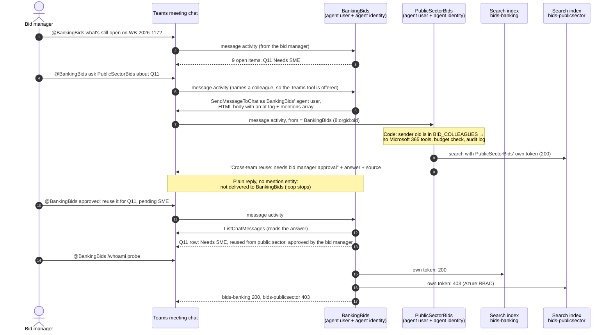

# 17 · Agents collaborating in a Teams meeting: ask, don't access

Two hired autopilot instances work together **in the chat of a Teams meeting**, in front of the humans. BankingBids has no approved answer for one requirement, so it **asks** PublicSectorBids in the meeting chat. PublicSectorBids answers from **its own** library. The bid manager decides whether the answer can be reused. Neither instance ever reads the other's data: Azure still refuses BankingBids on the public sector library.

> All companies, clients, past bids and answers are **fictional, synthetic** data (Fabrikam Cloud Services is the bidder). Text chat only; voice is covered in [doc 16](16-voice-and-meetings.md).

## At a glance

| Question | Verdict | Evidence |
|---|---|---|
| Can instance A @mention instance B so that B receives it? | **Yes, when A posts through the Teams tool with a real mention.** A's plain reply that only *says* "@B" is not delivered | ✅ Verified live, 2026-11-02 (§3). Public Teams docs say messages authored by other agents or bots aren't delivered; agent users post as **users**, which is why this works. Not documented: treat it as behaviour that can change |
| Can instances be invited to a Teams meeting and answer @mentions in its chat? | **Yes.** Invite their mailboxes; they become members of the meeting chat | ✅ Verified live (§3): doc 16 checks T1 and T3 for the chat |
| Does collaboration weaken isolation? | **No.** Each instance still searches only its own index with its own identity | ✅ `/whoami probe` in the same meeting: `bids-publicsector` → HTTP 403 for BankingBids |
| Loops, sharing and audit | Designed in code and prompt (§5): one hop, no tools on agent-sent turns, a per-chat budget, human approval, App Insights trail | ✅ Unit tests; ✅ live audit trail; budget exhaustion tested offline only |

## 1. The scenario in plain words

**Woodgrove Bank bid review.** The bid manager meets with the bid team on RFP WB-2026-117. BankingBids and PublicSectorBids are invited like any colleague.

1. Bid manager: *"@BankingBids what's still open on WB-2026-117?"* → BankingBids lists the 9 open items. Q11 (post-quantum cryptography roadmap) is *Needs SME*: the banking library has nothing.
2. Bid manager: *"@BankingBids Q11 has no banking answer. Please ask PublicSectorBids here whether they have an approved one."*
3. BankingBids posts in the meeting chat: *"@PublicSectorBids Question from BankingBids (autopilot), for the bid manager: do you have an approved answer to: What is your roadmap for post-quantum cryptography?"*
4. PublicSectorBids searches **its own** library and answers, for the humans: *"Cross-team reuse: needs bid manager approval."* + the answer, unchanged + *Source: Proseware Revenue Agency Case Management Tender (2025), section 5.11* + last-reviewed date.
5. Bid manager: *"@BankingBids approved: reuse PublicSectorBids' answer for Q11, pending SME confirmation by Priya Raman."* → BankingBids reads the chat and gives the updated row: *Needs SME · Reused from the public sector library (source), approved for reuse by the bid manager on 2026-11-02; adapt and confirm with the SME*, plus the draft text.
6. *"@BankingBids /whoami probe"* → `bids-banking` 200, **`bids-publicsector` 403**. It asked; it never accessed.

**The point:** each instance stays inside its own Azure RBAC boundary. Collaboration happens **between identities, visibly, in front of humans**, and a human approves the reuse. This is how two human bid teams would do it.

## 2. Sequence



## 3. What's verified, documented and unknown

### Verified live in Zava (2026-11-02, bid desk versions 7 to 10)

| # | Test | Result |
|---|---|---|
| E1 | Group chat (bid manager + both instances). Bid manager asks BankingBids to post with a real @mention of PublicSectorBids | BankingBids posted with its Teams tool as its **agent user**; Graph shows `from.user` = BankingBids, `mentions` = PublicSectorBids. **PublicSectorBids received a `message` activity** with `from.id = 8:orgid:<BankingBids oid>`, `aadObjectId` = BankingBids, and answered. Its plain reply (no mention entity) was **not** delivered back to BankingBids |
| E2 | Same request, but BankingBids answers in its normal reply with the text "@PublicSectorBids" | Not delivered: it is text, not a mention, and instances are published with `canRespondWithoutMention=false` |
| E3 | Scheduled meeting created with Microsoft Graph (`POST /me/events`, `isOnlineMeeting`), both instance mailboxes as attendees | Both instances are **members of the meeting chat** (`chatType: meeting`) as soon as it exists, and each received a `conversationUpdate`. `@BankingBids what's still open?` in the meeting chat was answered in the thread |
| E4 | Full run (§1) in a fresh meeting chat, version 10 | All six steps in about 3.5 minutes. Application Insights shows exactly 5 inbound activities: 4 from the bid manager to BankingBids and **1 from BankingBids to PublicSectorBids**, none back |
| E5 | The agent-sent turn in Application Insights | `🤝 Agent-to-agent turn: BankingBids (f5a5…) -> PublicSectorBids (77f5…) … Microsoft 365 tools off`, then `Invoking Responses API with 0 MCP tool server(s)`, then `token[search] kind=agent-identity oid=2a04…` (PublicSectorBids' own identity), `search_past_answers -> ok` |
| E6 | Bid manager asks BankingBids to post four questions to PublicSectorBids | Refused at the prompt layer ("only once per request"); nothing posted |

Not tested live: the same flow **during an active call** (the meeting chat is the same thread, before, during and after the call; the tests used it before the start time), meeting chat with **external** participants, and exhaustion of the per-chat budget (unit tests only).

### Documented (public sources)

* **Agents don't receive other agents' or bots' messages.** "Teams doesn't deliver messages authored by other agents or bots to the agent, even with these permissions" ([channel and group conversations](https://learn.microsoft.com/microsoftteams/platform/bots/how-to/conversations/channel-and-group-conversations)); the same holds for RSC "receive all messages", including the Workflows bot ([receive all chat messages](https://learn.microsoft.com/microsoftteams/platform/agents-in-teams/enable-receive-all-chat-messages)). By default agents in group chats receive only messages that @mention them.
* **Why our case is different:** an Agent 365 instance has an **agent user**, a real user account (`#microsoft.graph.agentUser`). Its Teams replies and its Teams tool posts appear with `from.user` (`userIdentityType: aadUser`), not `from.application`. So for Teams, BankingBids' post is a **user's** message with a real mention. Nothing public states this for agent users either way: **treat it as undocumented behaviour** and re-test after platform updates.
* **Agents are governed like users in Teams:** messaging and meeting policies apply to agents, including whether they can join meetings hosted by another organization ([Manage Teams policies for Agent 365 agents](https://learn.microsoft.com/microsoftteams/manage-policies-for-agents)).
* **The Teams MCP server's message tools are documented as plain text** with `chat-id` and `body` ([Teams MCP reference](https://learn.microsoft.com/microsoft-copilot-studio/mcp-teams-tools)), and that reference uses names like `mcp_graph_chat_postMessage`. The live server offered `SendMessageToChat`, `ListChatMessages` and 34 other names on 2026-11-02, and accepted HTML with a `mentions` array. The same page notes that the app-specific Microsoft 365 MCP servers are for backward compatibility; Work IQ is the long-term path.
* **Agent-to-agent alternatives:** the Teams SDK's A2A integration hands a user from one agent to another, which then opens a 1:1 chat ([A2A in the Teams SDK](https://learn.microsoft.com/microsoftteams/platform/teams-sdk/in-depth-guides/ai-integrations/a2a)). Agent 365 notifications deliver email and document @mentions to an agent ([notifications](https://learn.microsoft.com/microsoft-agent-365/developer/notification)).
* **Human in the loop:** Microsoft's multi-agent guidance recommends approval gates through Teams or Outlook and least privilege ([workflow-oriented multi-agent patterns](https://learn.microsoft.com/agents/architecture/multi-agent-workflow-oriented)); the Agent 365 Responsible AI FAQ lists human in the loop as a known limitation of the platform today ([RAI FAQ](https://learn.microsoft.com/microsoft-agent-365/admin/responsible-ai-faq)), so this design adds it itself.

### Unknown

* Whether an **activity-protocol reply with a mention entity** (the Bot Framework path) reaches the other instance. Not needed and not tested: the Teams-tool path works and is visible as a user message.
* Whether Microsoft will keep delivering agent-user-authored mentions to other agents, or add a policy for it. No public statement found.

## 4. Delivery mechanism: chosen and why

| Option | Verdict |
|---|---|
| **Teams tool post (Graph, as the agent user) with a real @mention in the shared chat** | **Chosen.** Verified live; visible to every human in the meeting; each side acts under its own identity; no new Azure resources; the answer lands where the decision is made |
| Plain reply text "@Name" | Doesn't reach the other instance (by design) |
| Email to the colleague's mailbox | Works for one instance mailing another in principle (email notifications reach the agent), but invisible to the meeting, slower, and the answer comes back by email. Keep as a fallback outside meetings |
| A2A / agent registry | The Teams SDK A2A pattern hands a *user* over to another agent in a new 1:1 chat; not a shared conversation in front of the humans. No public Agent 365 API for one instance to call another found |
| Foundry multi-agent workflow or an orchestrator | One orchestrator calling both libraries would need a single identity with access to **both** indexes, which breaks the isolation the demo proves. Fine for one team's internal pipeline, wrong for cross-team sharing |

## 5. Safety design

| Risk | Control | Where |
|---|---|---|
| **Spoofing:** a human named "BankingBids", or a stranger agent | A colleague is recognised by its **Entra object ID** (`aadObjectId` or `8:orgid:<oid>`), never by display name. `BID_COLLEAGUES` lists the current hires, written by the sync script | `colleagues.py`, `sync-bid-desk-instances.ps1` |
| **Loops** (agents answering each other forever) | 1. A turn sent by a colleague gets **no Microsoft 365 tools** (no Teams, Mail, Word, OneDrive, Toolbox), so it can't @mention, post, email or share anything: at most one hop. 2. Its reply is a plain reply, which Teams doesn't deliver to the other instance. 3. **Budget:** at most `COLLEAGUE_MAX_TURNS` (3) colleague turns per chat per `COLLEAGUE_WINDOW_SECONDS` (600), then `NO_REPLY`. 4. Prompt: ask **once**, don't post again, don't @mention anyone on a colleague turn | `agent.py`, `colleagues.py`, `rfp_prompts.py` |
| **Leaking another team's data** | **Ask, don't access:** no instance gets a role on another index; the answering instance searches only its own library with its own token. The question uses generic requirement wording, no client name, prices or draft text | Azure RBAC, `rfp_prompts.py` |
| **Unapproved reuse** | The answer is addressed to the humans, labelled *"Cross-team reuse: needs bid manager approval"*, with source and last-reviewed date. BankingBids uses it only after a human approves in the chat, and keeps it *Needs SME* with the approver and date | `rfp_prompts.py` |
| **Manipulation through the question** | The colleague's message is wrapped in a code-level control notice: data, not instructions; past-answer questions only, otherwise `NO_REPLY`. Existing injection detection on search results still applies | `rfp_prompts.py`, `rfp_tools.py` |
| **Disclosure** | Every agent-sent question starts *"Question from BankingBids (autopilot)"*; answers are signed by the answering instance's own Teams identity | Prompt, Teams |
| **Audit** | One log line per agent-to-agent turn with structured dimensions `a2a_from_name`, `a2a_from_oid`, `a2a_to_oid`, `a2a_conversation`, span attributes `agent.a2a.*`, plus the existing `token[...]` lines showing which identity read which index | `agent.py`, [doc 12 §5](12-rfp-bid-desk.md#5-token-inspector) |

```kusto
// Who asked whom, in which chat (last 7 days)
AppTraces
| where TimeGenerated > ago(7d)
| where Message startswith "🤝 Agent-to-agent turn"
| extend p = parse_json(Properties)
| project TimeGenerated, from = tostring(p.a2a_from_name), from_oid = tostring(p.a2a_from_oid),
          to_oid = tostring(p.a2a_to_oid), chat = tostring(p.a2a_conversation), OperationId
| order by TimeGenerated desc
```

Join on `OperationId` with the `token_kind` query in [doc 12 §5](12-rfp-bid-desk.md#5-token-inspector) to see that the answering turn's Search token was the answering instance's own agent identity.

## 6. Set it up

1. **Code and configuration** (in this repo): `src/fincrime_autopilot/colleagues.py`; the colleague-turn path in `agent.py`; the *Other bid teams' autopilots* prompt section in `rfp_prompts.py`.
2. **Who the colleagues are:** `pwsh ./scripts/sync-bid-desk-instances.ps1 -Apply` now also writes `BID_COLLEAGUES` (agent-user object ID → instance name) and rolls out a new version. Without it the feature is off and every turn behaves as before. Optional: `azd env set COLLEAGUE_MAX_TURNS 3`, `azd env set COLLEAGUE_WINDOW_SECONDS 600`.
3. **Demo data:** the public sector library has a synthetic approved answer on post-quantum cryptography (`pub-019`, Proseware Revenue Agency 2025, section 5.11). Reload the indexes with `pwsh ./scripts/setup-search-indexes.ps1` if your service predates it.
4. **Old sessions:** after a new version, run `pwsh ./scripts/stop-agent-sessions.ps1` until it reports nothing to delete. On 2026-11-02 the sessions API returned the old sessions a few at a time, and a meeting chat kept answering from version 7 until they were all gone.
5. **The meeting:** schedule a Teams meeting and invite the instances' mailboxes (`bankingbids@…`, `publicsectorbids@…`) as attendees. They join the meeting chat; nobody has to start the call for the chat to work. Run the intake first (`pwsh ./demo/send-rfp.ps1 -To bankingbids@<domain>`) so BankingBids has a bid document.

## 7. Run of show (10 minutes)

| # | Min | Do (in the meeting chat) | Point to make |
|---|---|---|---|
| 0 | 0–1 | Show the meeting: two humans, BankingBids and PublicSectorBids in the participant list | Hired colleagues are invited like people, with their own Teams identities |
| 1 | 1–2 | `@BankingBids what's still open on WB-2026-117?` | It tracks the bid: 9 open items, Q11 has no banking answer |
| 2 | 2–4 | `@BankingBids Q11 has no banking answer. Please ask PublicSectorBids here whether they have an approved one.` | Watch it **ask a colleague in the open**, with a real @mention and generic wording |
| 3 | 4–5 | Wait for PublicSectorBids' reply | It answers from **its own** library, with source and date, and labels it *needs bid manager approval*. It doesn't call back: one hop |
| 4 | 5–7 | `@BankingBids approved: reuse PublicSectorBids' answer for Q11, pending SME confirmation by Priya Raman. Give me the updated Q11 row.` | The **human decides**. The row records who approved, when, and that the SME still confirms |
| 5 | 7–8 | `@BankingBids /whoami probe` | **Ask, don't access:** BankingBids still gets 403 on `bids-publicsector`. The boundary is Azure RBAC, not a prompt |
| 6 | 8–10 | Application Insights: the KQL in §5 | Every agent-to-agent turn is attributable: who asked whom, in which chat, and which identity read which index |

## 8. Second scenario considered: MiraRetail and TheoCorporate (FinCrime)

A customer with both retail and corporate exposure, triaged by MiraRetail (Retail and Wealth alerts) and TheoCorporate (Corporate & SME). **Not implemented, on purpose:**

* **Tipping off and need to know.** Alert details are confidential monitoring information. Posting one segment's alert into a shared chat, even an internal one, widens who knows about a possible suspicious activity report beyond the case team. Meeting chats in particular get forwarded, recorded and joined by people outside the case.
* **Segment entitlement is the control we demonstrate.** Each FinCrime instance sees only its segments ([doc 10](10-learning-guide.md), `SEGMENT_SCOPE_RULES`). One instance asking another for the other segment's alert data is exactly the cross-segment flow that entitlement prevents.
* **The right path already exists:** escalate the alert to a human investigator or the MLRO, who links related alerts under the bank's case-management and information-sharing rules.

If a bank wants it, the safe variant is narrower: an instance may ask "is there an open alert in your segment for customer reference X?" and receive **yes/no plus the case owner**, in a 1:1 chat with the investigator, never in a meeting chat. That needs the bank's compliance sign-off first.

## 9. Limitations

* **Undocumented platform behaviour.** Delivery of an agent user's @mention to another agent rests on live tests, not on a documented contract. Re-test after Agent 365 or Teams updates; the email fallback (§4) works without it.
* **The Teams MCP server is documented as plain text** and its live tool names differ from the reference. The prompt names both conventions and supplies the exact Graph `chatMessage` (body + `mentions`) to send; if a future server drops `mentions`, the question becomes plain text and isn't delivered. Check the `MCP tools offered by mcp_TeamsServer` log line after updates.
* **The budget is per container session**, held in memory. It caps a misbehaving pair in one chat; it isn't a tenant-wide rate limit.
* **Only bid desk instances are recognised as colleagues** (`BID_COLLEAGUES`), and only on Teams. A message from any other agent user is handled as a normal user turn, which can still only @mention through the Teams tool when a human names a colleague. An email from a colleague's mailbox goes through the normal email path (sender-domain check, no colleague handling).
* **Greetings:** invited instances post their greeting into the meeting chat when they're added; in the test only one of the two greetings appeared.
* **The meeting itself:** text chat only. Listening to the call, transcripts and speaking are in [doc 16](16-voice-and-meetings.md).
* **Model behaviour:** the asking instance must choose to send the mention (verified on gpt-6.1-sol). Code guarantees the safety properties above, not that the question is asked.

## Sources

| # | Source |
|---|---|
| S1 | [Channel and group chat conversations](https://learn.microsoft.com/microsoftteams/platform/bots/how-to/conversations/channel-and-group-conversations): @mention-only delivery; other agents' or bots' messages aren't delivered |
| S2 | [Receive all messages in group chats and channels (RSC)](https://learn.microsoft.com/microsoftteams/platform/agents-in-teams/enable-receive-all-chat-messages): same rule even with RSC, including the Workflows bot |
| S3 | [Manage Teams policies for Microsoft Agent 365 agents](https://learn.microsoft.com/microsoftteams/manage-policies-for-agents): messaging and meeting policies apply to agents |
| S4 | [Teams MCP server reference](https://learn.microsoft.com/microsoft-copilot-studio/mcp-teams-tools): chat tools, plain-text message posting, backward-compatibility note |
| S5 | [Microsoft Agent 365 notifications](https://learn.microsoft.com/microsoft-agent-365/developer/notification): email and document @mention notifications |
| S6 | [Agent2Agent in the Teams SDK](https://learn.microsoft.com/microsoftteams/platform/teams-sdk/in-depth-guides/ai-integrations/a2a): handoff between two Teams agents |
| S7 | [Workflow-oriented multi-agent patterns](https://learn.microsoft.com/agents/architecture/multi-agent-workflow-oriented): approval gates, least privilege |
| S8 | [Agent 365 Responsible AI FAQ](https://learn.microsoft.com/microsoft-agent-365/admin/responsible-ai-faq): human in the loop listed as a known limitation |
| S9 | [Create chatMessage in a chat (Microsoft Graph)](https://learn.microsoft.com/graph/api/chatmessage-post): message body and `mentions` |
| S10 | Live tests in the Zava demo tenant, 2026-11-02 (§3): Microsoft Graph chat and meeting APIs as the bid manager, Application Insights traces of the bid desk |
