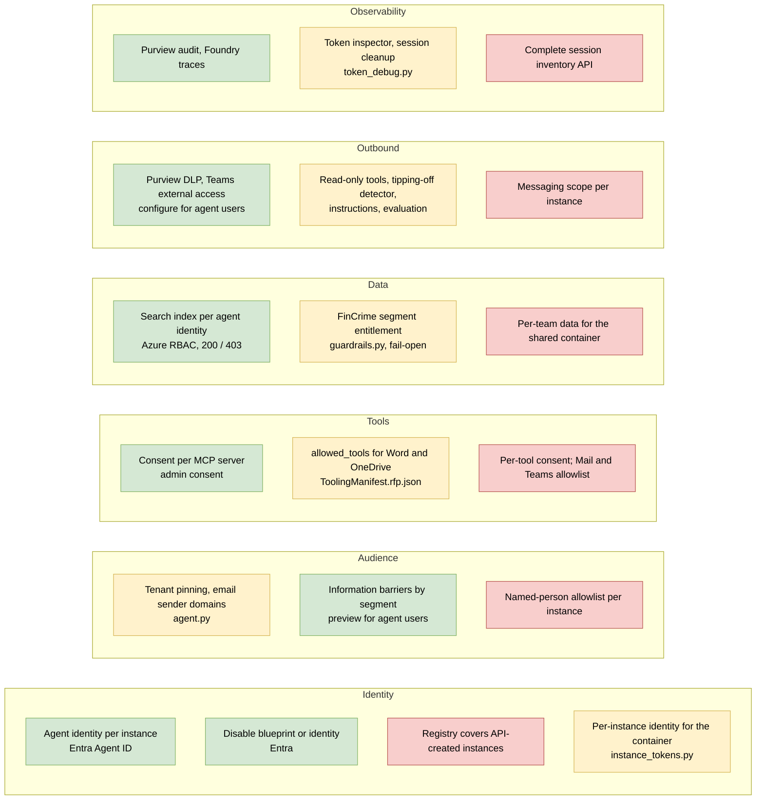

# 18 · Governance gaps: what the platform enforces, what code enforces, what's missing

This page is a gap analysis of **governance for Microsoft Agent 365 autopilots built on Microsoft Foundry**. It is based on what we saw while deploying and testing this repo's two autopilots (*FinCrime Alert Triage* and *RFP Bid Desk*) in the Zava demo tenant between October and November 2026. For each gap it gives the evidence, what this repo does today, what to do instead, a severity for a **regulated bank**, and the role that owns the fix.

> **Status labels.** **Observed** means seen in the Zava tenant, with the date. **Documented** means stated on Microsoft Learn or in a public Microsoft sample, re-checked on **2026-11-02**. **[unverified]** means our inference. Most of the features involved are **preview**: Foundry autopilots and Agent 365 policy templates for agents with their own identity are Frontier-only previews. Not legal or compliance advice.

Related: [03 · Identity and governance](03-identity-and-governance.md) · [10 · Learning guide](10-learning-guide.md) · [12 · RFP Bid Desk](12-rfp-bid-desk.md) · [13 · Identity and hiring](13-identity-analogy-and-hiring.md) · [14 · Policy templates](14-agent-policy-templates.md) · [15 · MCP behind an AI gateway](15-mcp-behind-ai-gateway.md) · [16 · Voice and meetings](16-voice-and-meetings.md)

## Executive summary

An autopilot instance is a colleague with its own identity, mailbox and Teams account. The platform governs **what that identity can sign in to** well: Entra Agent ID, Conditional Access, admin consent and Azure RBAC all work per instance. It governs **who may talk to the instance** and **where the instance may send things** much less. Those two gaps, plus the hiring path and the kill switch, matter most for a bank:

| # | Gap | Why a bank cares | Do now |
|---|---|---|---|
| **1** | **No per-person audience control for a hired instance.** Learn describes an *Audience* setting, but no page says where to configure it. We found no such setting for our instances. The Foundry endpoint lets any signed-in user in the tenant reach it | Anyone in the tenant can ask *MiraRetail* about Retail AML alerts | Port the `/access` allowlist from Microsoft's workstream-manager sample (§ [Restricting who can use an instance](#restricting-who-can-use-an-agent-instance-out-of-the-box-options)). Use information barriers for whole segments |
| **2** | **Instances can be created outside approval.** Entra Agent ID API hires work but are invisible in the Agent 365 registry and probably outside the policy template | Shadow colleagues with mailboxes, outside inventory and the hiring scope | Hire only in the admin center or Teams. Reconcile Entra agent identities against registry instances weekly |
| **5** | **"Block" in the admin center isn't a dependable kill switch for Foundry agents.** Learn contradicts itself; the documented hard stop is disabling the blueprint in Entra | Incident response (DORA) needs one tested switch | Write and rehearse a runbook: Entra disable, then Foundry stop, then a Conditional Access block |
| **7** | **Outbound actions aren't restricted by the platform by default.** The agent can email, post and share wherever its agent user can | Tipping-off and data leakage are offences, not just incidents | Purview DLP for agent users, an Exchange rule that keeps the agent's mail internal, and Teams external access off for agent users |

## Gap table

Severity for a regulated bank: **Critical** (block a pilot until mitigated), **High** (mitigate before production), **Medium** (mitigate or accept with a named owner), **Low** (watch).

| # | Gap | Area | Evidence | Repo mitigation today | Severity | Owner |
|---|---|---|---|---|---|---|
| 1 | No per-person audience control for a hired instance | Audience | Observed + documented | Tenant pinning, email sender-domain allowlist, silence unless @mentioned. Nothing per person in Teams | **Critical** | Developer, manager; compliance for information barriers |
| 2 | Instances created outside approval | Identity, inventory | Observed (4 instances) | Runbook prefers hires through the admin center or Teams; all 4 instances rehired | **High** | Identity administrator, tenant administrator |
| 3 | Fragile approval UX; consent can bypass the wizard | Approval | Observed | Documented workaround, audit-log check | **High** | Tenant administrator |
| 4 | Policy templates apply only at activation | Policy | Documented | Pick the template before approval ([doc 14](14-agent-policy-templates.md)) | **Medium** | Tenant administrator, security architect |
| 5 | Admin center **Block** isn't a dependable kill switch for Foundry agents | Containment | Documented (conflicting pages) | Kill-switch table points to Entra disable (not yet rehearsed) | **Critical** | Tenant administrator, security operations |
| 6 | Coarse tool consent: one scope per MCP server | Tools | Documented + observed | `allowed_tools` for Word and OneDrive/SharePoint only; `require_approval: never` everywhere | **High** | Developer, tenant administrator |
| 7 | Outbound actions not restricted by the platform | Outbound | Observed + documented | Instructions, read-only FinCrime tools, evaluation | **Critical** | Compliance (Purview), Exchange administrator, developer |
| 8 | Per-team data separation often only in code | Data | Observed | Bid Desk: Azure RBAC per index (verified). FinCrime: code-only, unmatched instances see everything | **High** | Developer, data owner |
| 9 | One container and one default identity serve every instance | Identity | Observed + documented | Per-instance token flows in code; default identity has no business data | **Medium** | Developer, architect |
| 10 | The blueprint is a single point of compromise | Identity | Documented | Federated credential, no secrets | **High** | Security architect |
| 11 | Observability gaps: attribution, trace access, session inventory | Observability | Observed + documented | Token inspector, Log Analytics Reader in Bicep, session cleanup script | **Medium** | Developer, security operations |
| 12 | Rollout lag: sessions stay on their starting version | Change management | Observed + documented | `stop-agent-sessions.ps1` in the post-provision hook | **Medium** | Developer, release manager |
| 13 | Voice and meetings bypass the instance identity | Identity | Documented | Not built; design notes only | **Medium** | Architect |
| 14 | Agent-to-agent: no documented loop or sharing policy | Outbound, audit | Documented (absence) | Silence unless @mentioned in group chats. Tests under way | **Medium** | Architect, compliance |
| 15 | Privileged roles and preview dependency | Operating model | Observed + documented | PIM for Owner; least-privilege notes | **Medium** | Tenant administrator, CISO |

## Restricting who can use an agent instance: out-of-the-box options

**The question:** a bank hires *MiraRetail* for the Retail AML team. Can it be limited to named people, so that nobody else in the tenant can chat with it, email it or @mention it in a document?

**Short answer: not with a documented per-instance setting today.** Learn's [autopilot lifecycle](https://learn.microsoft.com/azure/foundry/agents/concepts/autopilot-lifecycle#onboard--manager) lists **Audience** ("Who can use the instance") as an onboarding setting and says people outside it "are blocked by default". It doesn't say where to set it. Its own example, the workstream manager, implements that rule in code ("declines group chats that include unapproved participants"). Microsoft's guidance treats audience as a separate decision from data reach ("Audience and access are separate decisions", [data reach](https://learn.microsoft.com/microsoft-agent-365/guidance/data-reach#audience-and-access-are-separate-decisions)), but names no control for it.

| Control | What it restricts | Where to configure | Licence | Status | Per instance? | Source |
|---|---|---|---|---|---|---|
| **Purview information barriers** | Two-way **Teams and SharePoint/OneDrive** communication between segments: users "can't find, select, chat, or call" blocked segments. **Not email.** | Purview portal > Information barriers; put agent users in segments by attribute | Purview information barriers licence for users in segments | Information barriers GA. Agent users being governed like users is described as part of the Frontier preview. No Learn page shows how to put an agent user in a segment | ⚠️ Segment-wide, not per person | [Content sharing principles](https://learn.microsoft.com/microsoft-agent-365/share#key-principles), [Information barriers](https://learn.microsoft.com/purview/information-barriers) |
| **Hiring scope** (activation wizard > *Publish to users* > Activate) | Who can **create** instances: "None, All users, or Specific users or groups" | Microsoft 365 admin center > Agents > Requests | Agent 365 / Frontier seat per instance | Preview (autopilots) | ❌ Doesn't restrict who can message an existing instance | [Autopilot quickstart](https://learn.microsoft.com/azure/foundry/agents/how-to/agent-365#approve-the-blueprint), [Activate agents](https://learn.microsoft.com/microsoft-agent-365/admin/agent-actions#activate-agents) |
| **Availability** tab in the admin center's *Create instance* wizard | Learn: "Which groups or users have access to this instance". Not explained further | Microsoft 365 admin center > Agents > Registry > Create instance | Agent 365 | Preview | ❓ **[unverified]**: test whether it limits chat, email and comments | [Create agent instances](https://learn.microsoft.com/microsoft-agent-365/admin/create-agentic-user-instances) |
| **Block** an instance or the blueprint | Everything, for everyone. "Blocking an instance stops it and any actions it's performing" | Admin center > Agents > instance > Block; Teams agent settings card | Agent 365 | Preview | ❌ All or nothing (and see gap 5) | [Manage agent instances](https://learn.microsoft.com/microsoft-agent-365/admin/manage-agent-instances) |
| **Exchange message delivery restrictions** ("Accept messages only from") on the agent user's mailbox | Inbound **email** only. Applies to all recipient types; nothing agent-specific is documented | Exchange admin center > mailbox > Message delivery restrictions; `Set-Mailbox -AcceptMessagesOnlyFrom` / `-AcceptMessagesOnlyFromDLMembers` | Exchange Online (included in the Frontier seat) | GA | ✅ Per mailbox, **email only** | [Message delivery restrictions](https://learn.microsoft.com/exchange/recipients-in-exchange-online/manage-user-mailboxes/configure-message-delivery-restrictions) |
| **Conditional Access** for agent identities and agent users | What the **agent** can sign in to: evaluated "whenever Microsoft Entra ID issues or refreshes an access token". Not who talks to it | Entra > Conditional Access > Agents | E7, or Agent 365 + Entra P1 | GA; agent-user targeting **preview** | ❌ Not an audience control | [CA for agents](https://learn.microsoft.com/entra/identity/conditional-access/agent-id#how-conditional-access-evaluates-agent-access), [Agent users](https://learn.microsoft.com/entra/identity/conditional-access/policy-agent-user) |
| **Teams policies for agent users** (external access, messaging) | What the **agent** may do: start chats with external users, start group chats. Learn: "All existing Teams user policies apply to agents" | Teams admin center > Users > Policies | Teams | No preview label | ❌ Limits external contact, not internal users. Learn says nothing about app permission policies or app-centric management limiting who can chat with an agent user | [Teams policies for agents](https://learn.microsoft.com/microsoftteams/manage-policies-for-agents) |
| **Agent settings > User access** (tenant) | "Only the users or groups you select in this setting can use agents and plugins" | Admin center > Agents > Settings | Included | GA | ❌ Tenant-wide; not documented for autopilot instances or agent users | [Agent settings](https://learn.microsoft.com/microsoft-agent-365/admin/agent-settings) |
| **Foundry endpoint authorization** | `BotServiceTenant`: "Any signed-in user in the configured tenant can interact with the agent". Autopilots publish with scope *Tenant*. `BotServiceRbac` (per-user Azure permission) isn't available for this path **[inferred from two pages]** | Agent version, `authorization_schemes` | — | Preview | ❌ Tenant-wide | [Configure an agent](https://learn.microsoft.com/azure/foundry/agents/how-to/configure-agent) |
| **Purview DLP**, communication compliance | **Content**, not people: DLP blocks or audits sensitive content between humans and agents; communication compliance detects | Purview | Agent 365 | GA | ❌ Not an allowlist | [Purview for Agent 365](https://learn.microsoft.com/purview/ai-agent-365#data-loss-prevention-and-ai-interactions) |
| **SharePoint restricted access control** | Who reaches a **site**, not who messages the agent | SharePoint admin center | SharePoint Advanced Management | GA | ❌ Data, not audience | [Restricted access control](https://learn.microsoft.com/sharepoint/restricted-access-control) |

**Observed in Zava (2026-11-02):** for our four instances we found no audience setting in Teams or in the admin center. Before the rehire, the Teams settings card couldn't even find them ([doc 10 §12](10-learning-guide.md#12-known-limitations-of-this-deployment)). We haven't yet tested the *Availability* tab of the admin center's *Create instance* wizard (open question 1).

### The code-level pattern for named users

Microsoft's public sample [foundry-workstream-manager-autopilot-agent](https://github.com/microsoft-foundry/foundry-samples/tree/main/samples/csharp/foundry-workstream-manager-autopilot-agent) (C#) enforces an audience in code. The logic is in [`AccessControlService.cs`](https://github.com/microsoft-foundry/foundry-samples/blob/main/samples/csharp/foundry-workstream-manager-autopilot-agent/src/workstream_manager_agent/AgentLogic/ResponsesApi/Helpers/AccessControlService.cs). Line numbers below were checked on 2026-11-02.

| Element | How the sample does it |
|---|---|
| Who is always allowed | The agent's **manager**, read with the agent user's own token from Graph `GET /me/manager` (line 434) |
| Commands | The manager types `/access list`, `/access add <user>`, `/access remove <user>` in a 1:1 chat (prefix at line 33). Only the manager can change the list |
| Storage | **Azure Table Storage**: table `digitalworkerallowlist` (default, line 1161, configurable), partition key `<tenantId>:<agentUserId>` (line 54), row key `allowlist` (line 36). One row per instance, so instances of the same blueprint have separate lists |
| 1:1 chats | Senders not on the list get a fixed refusal; the model is never called |
| Group chats | Members are read from Graph `/chats/{id}/members`. The agent answers only if **every participant** is allowed (refusal text at line 374). If the lookup fails, the chat is blocked |
| Cross-tenant senders | Refused with a fixed reply (`TryHandleCrossTenantActivityAsync`, line 773) |
| Not covered | Only the `msteams` channel is gated (line 73). **Email and Word/Excel comment @mentions aren't**: comment notifications are only logged in that sample |

**Recommendation for this repo:**

1. **Whole groups that must never talk to an instance** (for example Corporate Banking and Retail AML): **information barriers**, once you've tested that agent users can be put in segments. Add **Exchange delivery restrictions** on the agent user's mailbox, because information barriers don't cover email.
2. **Named people per instance:** **port the allowlist** to the Python host (`agent.py`, next to the tenant pin at line 287). Gate all three channels: Teams, email (alongside the sender-domain check at line 302) and comment notifications. Keep the sample's storage key and the manager-only `/access` commands. Deny by default, and decide before any model or tool call.
3. Keep hiring scope and Conditional Access, but don't present them as audience controls.

## Gaps in detail

### Gap 1 · No per-person audience control

| | |
|---|---|
| **What** | Once an instance exists, anyone in the tenant can chat with it, add it to a group chat, email it or @mention it in a Word or Excel comment. The documented "audience" concept has no documented configuration surface |
| **Evidence** | **Observed** 2026-11-02: no audience setting for our instances. **Documented**: lifecycle page (Audience as a concept), data-reach guidance (a separate decision), `BotServiceTenant` lets any signed-in tenant user in. Full analysis: [section above](#restricting-who-can-use-an-agent-instance-out-of-the-box-options) |
| **Repo today** | Cross-tenant activities return `NO_REPLY` (`src/fincrime_autopilot/agent.py:287`, `guardrails.py:60`). Email is accepted only from `ALLOWED_SENDER_DOMAINS` (`agent.py:302`, `guardrails.py:49`). Silence in group chats unless @mentioned (`canRespondWithoutMention=false`). Inside the tenant, **anyone** can ask MiraRetail for Retail alerts. Doc 03 §3 describes the platform's model, not what this repo enforces |
| **Recommended** | Port the allowlist (all channels). Add information barriers and mailbox delivery restrictions. Log every refusal with the sender's object ID |
| **Severity** | **Critical**: an AML triage agent answers anyone in the bank |
| **Owner** | Developer (allowlist), manager (list owner), compliance (information barriers) |

### Gap 2 · Instances created outside approval

| | |
|---|---|
| **What** | With admin consent on the blueprint, anyone holding Agent ID Administrator or Global Administrator rights can create agent identities and agent users through the Microsoft Entra Agent ID APIs. Those instances work, but Agent 365 doesn't know about them |
| **Evidence** | **Observed** 2026-10-31 to 2026-11-01: MiraRetail, TheoCorporate, BankingBids and PublicSectorBids were hired with `scripts/create-instance-entra.ps1`. Chat and email worked. None appeared under the agent's **Instances** in the admin center, Teams said "This agent can't be found", and there is no API to register them afterwards. All four were rehired through the admin center on 2026-11-01 and 2026-11-02 ([doc 13](13-identity-analogy-and-hiring.md#hiring-paths-compared), [doc 12 §8](12-rfp-bid-desk.md#8-deploy)). **Documented**: a blueprint created through Entra needs "an explicit call to the Agent Registry API" for its agent card ([create a blueprint](https://learn.microsoft.com/entra/agent-id/create-blueprint#register-agents-in-the-agent-365-registry)). Nothing similar is documented for instances. Templates apply at activation, and the bulk *Apply template* rule skips AI teammates ([doc 14 §1](14-agent-policy-templates.md#1-what-a-policy-template-is)), so these instances probably got **no policy template** **[unverified]** |
| **Repo today** | The runbook marks Option C as a fallback and prefers Teams or admin center hires ([08 Step 5](08-deployment-runbook.md#step-5--create-hire-the-instances)). The script needs a Global Administrator and `-Apply` |
| **Recommended** | Ban the API path in production. Restrict Agent ID Administrator through PIM with approval. Every week, compare `servicePrincipals/microsoft.graph.agentIdentity` per blueprint with the registry's instances, and alert on `agentUser` creation in the Entra audit log. A Conditional Access policy that targets the **blueprint** still covers rogue instances, because it applies to every agent identity created from it |
| **Severity** | **High** |
| **Owner** | Identity administrator, tenant administrator |

### Gap 3 · Fragile approval UX

| | |
|---|---|
| **What** | Approval is meant to be one decision: hiring scope, template, consent. In practice the steps can be separated, and consent alone is enough to run instances |
| **Evidence** | **Observed** 2026-10-31: the admin center showed no approve or publish button for the FinCrime blueprint, but *Accept permissions* worked ([08 Step 4](08-deployment-runbook.md#step-4--approve-the-blueprint-global-or-ai-administrator)). For the Bid Desk, admin consent was granted directly with Graph `POST /oauth2PermissionGrants` (`AllPrincipals`), skipping the wizard ([doc 12 §8](12-rfp-bid-desk.md#8-deploy)). Each rollout re-publishes, and the publication shows *pending* again while instances keep working ([README status](../README.md#status-2026-10-31)). **Documented**: approval needs Global Administrator or AI Administrator ([quickstart](https://learn.microsoft.com/azure/foundry/agents/how-to/agent-365#approve-the-blueprint)); "Added permissions re-enter the consent gate" ([lifecycle](https://learn.microsoft.com/azure/foundry/agents/concepts/autopilot-lifecycle)) |
| **Repo today** | The runbook says to check the Registry tab and the audit log. `AGENT_APP_VERSION` is bumped only when publication metadata changes |
| **Recommended** | Treat Graph consent as break-glass, with a change record. Alert on new `oauth2PermissionGrants` and app role assignments whose client is a blueprint principal. After every rollout, check the registry status and that the consented scopes haven't changed |
| **Severity** | **High**: the control point a regulator expects ("who approved this agent, under which policy?") can be bypassed |
| **Owner** | Tenant administrator |

### Gap 4 · Policy templates apply only at activation

| | |
|---|---|
| **What** | A template is applied once, when the agent is activated. Edits don't reach agents that are already approved |
| **Evidence** | **Documented**: "The updated template applies to all new activations. The changes don't affect agents that are already approved" ([edit a template](https://learn.microsoft.com/microsoft-agent-365/admin/policy-template#edit-a-template)). "Scenarios for AI templates are in preview and available only for Frontier tenants. Custom policies aren't yet supported" ([add a template](https://learn.microsoft.com/microsoft-agent-365/admin/policy-template#add-a-new-template)). The Foundry quickstart's *Apply template* step mentions administrators adding custom policies, which conflicts with this. Details: [doc 14 §8](14-agent-policy-templates.md#8-gaps-limitations-and-open-questions) |
| **Repo today** | Doc 14 says to choose before approving and suggests three templates |
| **Recommended** | Apply Entra, Purview and Defender policies **directly** to the agent users, agent identities or blueprint. Then a template becomes a convenience, not the control |
| **Severity** | **Medium** |
| **Owner** | Tenant administrator, security architect |

### Gap 5 · Admin center Block isn't a dependable kill switch for Foundry agents

| | |
|---|---|
| **What** | Learn gives three different answers to "how do I stop every instance now?" |
| **Evidence** | **Documented, conflicting.** (1) Admin center: "blocking an agent that you created by using SharePoint or Microsoft Foundry only impacts its availability in Microsoft Copilot Chat" ([block or unblock](https://learn.microsoft.com/microsoft-agent-365/admin/agent-actions#block-or-unblock-agents)). (2) Foundry: "blocking the blueprint stops every instance at once" ([lifecycle](https://learn.microsoft.com/azure/foundry/agents/concepts/autopilot-lifecycle)). (3) Entra: "Disabling an agent identity blueprint prevents all its agent identities from authenticating" ([blueprints](https://learn.microsoft.com/entra/agent-id/agent-blueprint#key-characteristics-of-agent-identity-blueprints)). Foundry *Stop* deallocates compute and needs **Azure AI Owner** (agent-actions page). Tokens that were already issued stay valid until they expire. **Observed**: none of the switches has been rehearsed in Zava yet ([doc 10 §9](10-learning-guide.md#9-kill-switches)) |
| **Repo today** | [Doc 03 §4](03-identity-and-governance.md#4-who-can-stop-it) and [doc 10 §9](10-learning-guide.md#9-kill-switches) point to the Entra disable as the real switch |
| **Recommended** | One runbook, in this order: **disable the blueprint** (or one agent identity) in Entra; **stop** the Foundry agent; add a **Conditional Access** block on the blueprint and agent users as a second layer; then block in the admin center. Rehearse it each quarter, measure the time until the last action, and keep the evidence for DORA testing |
| **Severity** | **Critical** until rehearsed |
| **Owner** | Tenant administrator, security operations |

### Gap 6 · Coarse tool consent

| | |
|---|---|
| **What** | Consent is granted per MCP **server**, not per tool. Granting Mail or Teams grants every tool on that server, including send, delete and share |
| **Evidence** | **Observed**: the blueprints are consented to `McpServers.Word.All`, `McpServers.Mail.All`, `McpServers.OneDriveSharepoint.All` and `McpServers.Teams.All` ([doc 13 §3](13-identity-analogy-and-hiring.md#what-each-step-grants)). **Documented**: those scopes belong to the legacy shared model. The current model gives "each MCP server … its own app ID with the scope `Tools.ListInvoke.All`" ([per-server permissions](https://learn.microsoft.com/microsoft-agent-365/developer/reference/cli/setup#migrate-to-per-server-mcp-permissions)), which is still one scope per server. The app-specific servers are "only intended for backward compatibility purposes and shouldn't be used in production" (preview); Work IQ MCP is recommended ([tooling servers](https://learn.microsoft.com/microsoft-agent-365/tooling-servers-overview#microsoft-hosted-mcp-server-references)). Blocking single tools in the admin center "is rolling out to tenants and supports only specific types of MCP servers" ([manage tools](https://learn.microsoft.com/microsoft-agent-365/admin/manage-plugins-skills-mcp-servers#manage-individual-tools-within-an-mcp-server)). API Management tool control is preview. **Correction to an earlier assumption:** for **Work IQ MCP**, "By default, mutation operations aren't allowed for safety". A tenant administrator enables writes through a tenant-level policy, and "per-agent … policy templates aren't part of the initial policy control surface" ([Work IQ policy](https://learn.microsoft.com/microsoft-365/copilot/extensibility/work-iq/mcp/policy-governance-mcp)). Write operations are on by default only for Work IQ **in Copilot Studio** (preview) |
| **Repo today** | Every MCP tool and the Toolbox use `require_approval: "never"` (`agent.py:1189`, `agent.py:1209`, `toolbox.yaml`). `allowed_tools` from `ToolingManifest.rfp.json` (`agent.py:1191-1194`) removes delete, move and rename for Word and OneDrive/SharePoint. **Mail and Teams aren't allowlisted**: their live tool names differ from the references, and a wrong list removed every Teams tool (2026-11-02, [doc 12 §6](12-rfp-bid-desk.md#6-microsoft-365-tools-scoped)). `shareFileOrFolder` stays allowed |
| **Recommended** | Allowlist Mail and Teams from the names in the `MCP tools offered by` log line. Move to Work IQ MCP and keep mutations off, apart from the narrow paths you need. Block unused servers in the admin center *Tools* page. Put custom MCP servers behind API Management ([doc 15](15-mcp-behind-ai-gateway.md)) |
| **Severity** | **High** |
| **Owner** | Developer, tenant administrator |

### Gap 7 · Outbound actions not restricted by the platform

| | |
|---|---|
| **What** | By default, an instance can email anyone, post in any chat it belongs to and share files anywhere its agent user can |
| **Evidence** | **Documented**: Learn lists **Messaging scope** ("Who the instance can message") as an onboarding setting ([lifecycle](https://learn.microsoft.com/azure/foundry/agents/concepts/autopilot-lifecycle)), but documents no surface for it. Learn's own example of a systemic defect is an autopilot that "sends email outside the tenant". Platform controls that do exist: **Purview DLP** for agents, "Block or audit agent-to-human and human-to-agent for Microsoft Teams, OneDrive or SharePoint, and emails". The instance "is unaware of the block action", so owners must monitor ([DLP for agents](https://learn.microsoft.com/purview/ai-agent-365#data-loss-prevention-and-ai-interactions), no preview label). Also Teams external access for agent users ([Teams policies](https://learn.microsoft.com/microsoftteams/manage-policies-for-agents)) and Defender real-time protection custom rules (**preview** for Foundry agents, [real-time protection](https://learn.microsoft.com/defender-xdr/security-for-ai/ai-agent-real-time-protection)). **Observed**: "Outbound mail isn't limited in code" ([doc 10 §12](10-learning-guide.md#12-known-limitations-of-this-deployment)) |
| **Repo today** | FinCrime function tools are read-only (`fsi_tools.py`, asserted by a unit test). Tipping-off detection is in `guardrails.py`, plus instructions. Refusals are tested in `eval/scenarios.json` (`tipping_off_refusal`, `close_request_refusal`). These are model and code controls, not platform controls |
| **Recommended** | (1) An Exchange mail-flow rule that rejects external recipients for agent-user mailboxes. (2) Purview DLP with agent users in scope, covering IBANs, card numbers and SAR keywords. (3) Teams external access off for agent users. (4) Defender custom rules for unsafe email domains. (5) Remove `shareFileOrFolder` unless it's needed |
| **Severity** | **Critical**: tipping-off is a criminal offence under AML law |
| **Owner** | Compliance (Purview), Exchange administrator, Teams administrator, developer |

### Gap 8 · Per-team data separation often only in code

| | |
|---|---|
| **What** | One blueprint serves several teams. Unless the data source checks the instance's own identity, separation depends on code that maps IDs to teams |
| **Evidence** | **Observed**: Teams activities carry only the instance's agent-user object ID, not its name ([08 Step 5](08-deployment-runbook.md#step-5--create-hire-the-instances)). Each rehire creates new IDs that must be remapped. Bid Desk: Azure AI Search returned **200 on the instance's own index, 403 on the other team's, 403 for the shared container** (2026-11-01, [doc 12 §11](12-rfp-bid-desk.md#11-known-limitations)) |
| **Repo today** | FinCrime: `resolve_allowed_segments` (`guardrails.py:107`) maps names and IDs from `SEGMENT_SCOPE_RULES` (`guardrails.py:96`). **An unmatched instance sees every segment** (fail-open, demo-grade). Bid Desk: `BID_TEAM_RULES` (`rfp_tools.py:64`) chooses the default library, but **Azure RBAC enforces it**: `Search Index Data Reader` on one index per agent identity (`scripts/grant-bid-team-access.ps1`, `scripts/sync-bid-desk-instances.ps1`) |
| **Recommended** | Put entitlement in the data plane, as the Bid Desk does: RBAC or an app role per agent identity ([doc 15 pattern 1](15-mcp-behind-ai-gateway.md#tldr)). Until then, make the code **deny by default** and fail the rollout if any hired instance is unmapped |
| **Severity** | **High** (FinCrime fail-open); Low for the Bid Desk |
| **Owner** | Developer, data owner |

### Gap 9 · One container and one default identity serve every instance

| | |
|---|---|
| **What** | A hosted agent runs **one** container image for all its instances. The container's own credential is the agent's **default instance** identity |
| **Evidence** | **Documented**: "Agent Service creates a unique identity for the agent's default instance" ([MCP authentication](https://learn.microsoft.com/azure/foundry/agents/how-to/mcp-authentication)). "For autopilot agents, the current instance's identity is distinct from the default instance's identity" ([token service](https://learn.microsoft.com/azure/foundry/agents/concepts/hosted-agent-token-service#identity-selection)). So a Foundry project connection with `agentic-identity` authenticates as the default instance, the same for every hire ([doc 15](15-mcp-behind-ai-gateway.md#tldr), row 7). **Observed**: model calls aren't attributed per instance in Azure ([doc 10 §12](10-learning-guide.md#12-known-limitations-of-this-deployment)) |
| **Repo today** | Per-instance tokens are obtained in code (`instance_tokens.py:122`, `SEARCH_TOKEN_FLOW`). The default identity has **Foundry User only**, and Search refuses it (403) |
| **Recommended** | Never give business data to the default identity or the project managed identity ([doc 13 §4](13-identity-analogy-and-hiring.md#4-where-to-put-a-new-permission)). Use per-instance flows for every data call. Log the instance ID on every model call for attribution |
| **Severity** | **Medium** |
| **Owner** | Developer, architect |

### Gap 10 · The blueprint is a single point of compromise

| | |
|---|---|
| **What** | The blueprint holds the only credential, and its inheritable consent covers every instance |
| **Evidence** | **Documented**: "A compromise of the blueprint's credentials affects all agent identities under it, which is why blueprint count is a security boundary decision" ([agent service principals](https://learn.microsoft.com/entra/agent-id/agent-service-principals#key-differences)). Inheritable permissions reach "all present and future agent identities created from that blueprint" ([inheritable permissions](https://learn.microsoft.com/entra/agent-id/concept-inheritable-permissions)) |
| **Repo today** | The blueprint uses a federated credential from the Foundry managed identity, with no secrets ([doc 13 §1](13-identity-analogy-and-hiring.md#1-the-analogy-a-badge-office-a-badge-and-an-employee-record)). FinCrime and the Bid Desk have **separate** blueprints |
| **Recommended** | One blueprint per business unit or risk tier, not one per bank. Alert on changes to blueprint credentials and consent. Turn on ID Protection risky-agent detection with a Conditional Access response. Protect the Foundry project (Owner through PIM, no standing contributors) |
| **Severity** | **High** |
| **Owner** | Security architect |

### Gap 11 · Observability gaps

| | |
|---|---|
| **What** | Out of the box it's hard to answer "which instance did this, as which identity?", and to see every live session |
| **Evidence** | **Observed**: identity attribution needed a custom token inspector, `/whoami` plus structured log dimensions ([doc 12 §5](12-rfp-bid-desk.md#5-token-inspector)). Foundry portal traces failed with "Log Analytics Reader role or higher" until the role was granted ([08 Troubleshooting](08-deployment-runbook.md#troubleshooting)). The sessions list API missed Teams and email sessions (2026-10-31). **Documented**: trace viewing needs Log Analytics Reader on the connected Application Insights ([Foundry quickstart](https://learn.microsoft.com/azure/foundry/tutorials/quickstart-create-foundry-resources#connect-application-insights-for-agent-tracing)). Purview audits agent-to-human, human-to-agent, agent-to-tool and agent-to-agent interactions ([audit](https://learn.microsoft.com/purview/ai-agent-365#auditing-and-ai-interactions)) |
| **Repo today** | `token_debug.py` (inspector, payload only, never raw tokens). Log Analytics Reader for the deployer in `infra/modules/monitoring.bicep`. `scripts/stop-agent-sessions.ps1` also reads session IDs from Application Insights |
| **Recommended** | Send Application Insights, Entra sign-in and audit logs, and the Purview audit log to the SIEM, joined on agent identity and agent user IDs. Grant trace access through a group, not to individuals. Keep the inspector off in production replies (`TOKEN_FOOTER=false`) but keep the log dimensions |
| **Severity** | **Medium** |
| **Owner** | Developer, security operations |

### Gap 12 · Rollout lag

| | |
|---|---|
| **What** | A fix doesn't reach conversations that are already running |
| **Evidence** | **Documented**: "Each session is bound to a single version at creation time… later turns keep using that version even if you publish a newer one" ([hosted sessions](https://learn.microsoft.com/azure/foundry/agents/how-to/manage-hosted-sessions#create-a-session-explicitly-advanced)). **Observed**: Teams chats and email threads kept resuming old sessions after a rollout. Stopping a session didn't unpin it (2026-10-31, [08 Troubleshooting](08-deployment-runbook.md#troubleshooting)) |
| **Repo today** | The post-provision hook runs `scripts/stop-agent-sessions.ps1`, which deletes sessions pinned to older versions |
| **Recommended** | Make session cleanup part of every security fix, and verify it from traces (version per turn). Record the deployed version and session cleanup in the change record |
| **Severity** | **Medium** (High when the fix is a security fix) |
| **Owner** | Developer, release manager |

### Gap 13 · Voice and meetings bypass the instance identity

| | |
|---|---|
| **What** | The agent user can't speak in a meeting or take a call. Voice goes through other identities |
| **Evidence** | **Documented**: for Foundry voice agents, "Teams routes the call to your resource account. The resource account routes the call to your Communication Services resource" (**preview**, [telephony channels](https://learn.microsoft.com/azure/foundry/agents/how-to/voice-agent-telephony-channels)). "No Foundry agent ID is written onto the Teams resource account" ([Teams and Foundry](https://learn.microsoft.com/microsoftteams/aa-cq-direct-foundry)). In-meeting media participants join as Azure Communication Services or bot identities ([doc 16 §1c](16-voice-and-meetings.md#1c-voice-listening-to-and-speaking-in-the-meeting)) |
| **Repo today** | Not built. Doc 16 lists the guardrails ([§5](16-voice-and-meetings.md#5-guardrails)) |
| **Recommended** | If you build voice, keep the voice identity as a thin relay with **no data access of its own**. Every data call goes through the instance's agent identity or agent user, mapped explicitly and logged |
| **Severity** | **Medium** |
| **Owner** | Architect |

### Gap 14 · Agent-to-agent

| | |
|---|---|
| **What** | Instances can address each other in chats and email. Nothing in the platform limits which agents may talk or stops loops |
| **Evidence** | **Documented**: Purview audit covers agent-to-agent interactions, but DLP for agents lists only agent-to-human and human-to-agent ([Purview for Agent 365](https://learn.microsoft.com/purview/ai-agent-365)). We found no admin control that restricts which agents an instance may talk to. A dedicated agent-to-agent test is **under test** and not yet on `master` |
| **Repo today** | Group chats: silence unless @mentioned (`canRespondWithoutMention=false`, `NO_REPLY`). In the Bid Desk chat test, PublicSectorBids stayed silent ([doc 12 §11](12-rfp-bid-desk.md#11-known-limitations)) |
| **Recommended** | Treat another agent as an untrusted sender: no tool calls on its say-so, and a hop or turn limit per conversation. Include agent users in the allowlist (gap 1) explicitly, not by default |
| **Severity** | **Medium** |
| **Owner** | Architect, compliance |

### Gap 15 · Privileged roles and preview dependency

| | |
|---|---|
| **What** | Getting one instance working takes several high-privilege roles, and most of the stack is preview |
| **Evidence** | **Documented**: approval needs Global Administrator or AI Administrator. Autopilots need "Enroll your tenant in the Frontier preview program", with a 25-seat preview subscription and one licence per instance ([quickstart](https://learn.microsoft.com/azure/foundry/agents/how-to/agent-365#licensing-and-enrollment)). **Observed**: Owner through PIM for `azd provision` and index-scope role assignments. Global Administrator for Graph consent and API hires. In Zava, licence lifecycle dates are near mid-November 2026 ([doc 13 §2](13-identity-analogy-and-hiring.md#2-prerequisites), [doc 10 §12](10-learning-guide.md#12-known-limitations-of-this-deployment)) |
| **Repo today** | Least-privilege alternatives are listed in [doc 10 §7e](10-learning-guide.md#7e-administrator-roles-you-used-and-least-privilege-alternatives). Owner is PIM-eligible only |
| **Recommended** | Use AI Administrator (not Global Administrator) for approvals, Agent ID Administrator through PIM with approval, and User Access Administrator scoped to the Search service for index roles. Treat preview as "no SLA, may change": record it in the risk register with an exit plan |
| **Severity** | **Medium** |
| **Owner** | Tenant administrator, CISO |

## Control map

Which control is enforced by the **platform**, which only by **this repo's code or instructions**, and which is **missing**.

Green: platform-enforced. Yellow: code or instructions in this repo. Red: missing or undocumented.

## Remediation roadmap

| When | Action | Gaps | Owner |
|---|---|---|---|
| **Now** (before any pilot with real data) | Kill-switch runbook (Entra disable → Foundry stop → Conditional Access), rehearsed and timed | 5 | Tenant administrator, security operations |
| Now | Port the `/access` allowlist to all three channels, deny by default | 1, 14 | Developer |
| Now | Exchange rule: agent-user mailboxes can't send externally; Purview DLP with agent users in scope; Teams external access off for agent users | 7 | Compliance, Exchange and Teams administrators |
| Now | Hire only through the admin center or Teams; weekly reconciliation of Entra agent identities against the registry; alerts on consent grants to blueprint principals | 2, 3 | Identity administrator |
| Now | FinCrime entitlement deny-by-default; fail the rollout when an instance is unmapped | 8 | Developer |
| **Next** (one to three months) | Move entitlement to the data plane: app roles per agent identity behind API Management | 8, 9 | Developer, architect |
| Next | Migrate to Work IQ MCP with mutations off except named paths; allowlist Mail and Teams tools; block unused servers | 6 | Developer, tenant administrator |
| Next | Conditional Access on the blueprint and on agent users; ID Protection for risky agents; Defender custom real-time rules | 5, 10 | Security architect |
| Next | Information barrier segments for agent users, after a tenant test | 1 | Compliance |
| Next | SIEM correlation of traces, Entra logs and Purview audit by agent ID | 11 | Security operations |
| **Watch** (public roadmap and Learn) | A configuration surface for onboarding *Audience* and *Messaging scope* | 1, 7 | Architect |
| Watch | Per-tool consent; general availability of tool-level blocking in the admin center | 6 | Architect |
| Watch | Custom policies in AI teammate templates; re-applying templates to approved agents | 4 | Tenant administrator |
| Watch | Registry support for instances created through APIs | 2 | Identity administrator |
| Watch | Agent-to-agent DLP and policy | 14 | Compliance |
| Watch | General availability of autopilots, policy templates and Defender for Foundry agents | 15 | CISO |

## Open questions

1. Does the **Availability** tab in the admin center's *Create instance* wizard limit who can chat with, email or @mention the instance, or only who sees it in the agent store? Test with two users.
2. Can an agent user be put in an **information barrier segment**, and does that block Teams chats and Word comment @mentions from other segments?
3. Which control actually stops a Foundry autopilot: admin center **Block** on the blueprint, on one instance, or only the Entra disable? Measure each.
4. Do instances created through the Entra APIs get any **policy template** or Purview coverage? Check the Purview audit log for their activity.
5. Does Foundry routing to the latest version end sessions resumed from Teams and email, or is session cleanup always required?
6. When the app-specific MCP servers are retired, which Work IQ paths does each scenario need, and can a mutation policy be scoped to one agent?

## Sources

All checked on **2026-11-02**.

| Topic | Source |
|---|---|
| Audience vs data reach | [Data reach guidance](https://learn.microsoft.com/microsoft-agent-365/guidance/data-reach) |
| Autopilot roles, audience, messaging scope, block | [Autopilot lifecycle](https://learn.microsoft.com/azure/foundry/agents/concepts/autopilot-lifecycle) |
| Approval, hiring scope, licensing | [Quickstart: build your first autopilot](https://learn.microsoft.com/azure/foundry/agents/how-to/agent-365) |
| Activate and block agents | [Governance and lifecycle actions](https://learn.microsoft.com/microsoft-agent-365/admin/agent-actions), [Manage agent instances](https://learn.microsoft.com/microsoft-agent-365/admin/manage-agent-instances), [Create agent instances](https://learn.microsoft.com/microsoft-agent-365/admin/create-agentic-user-instances) |
| Policy templates | [Policy templates](https://learn.microsoft.com/microsoft-agent-365/admin/policy-template), [Agent settings](https://learn.microsoft.com/microsoft-agent-365/admin/agent-settings) |
| Content sharing, information barriers | [How content is shared with agents](https://learn.microsoft.com/microsoft-agent-365/share), [Information barriers](https://learn.microsoft.com/purview/information-barriers) |
| Blueprints and agent identities | [Agent blueprints](https://learn.microsoft.com/entra/agent-id/agent-blueprint), [Agent service principals](https://learn.microsoft.com/entra/agent-id/agent-service-principals), [Inheritable permissions](https://learn.microsoft.com/entra/agent-id/concept-inheritable-permissions), [Create a blueprint](https://learn.microsoft.com/entra/agent-id/create-blueprint), [Disable agent identities](https://learn.microsoft.com/entra/agent-id/disable-agent-identities) |
| Conditional Access | [CA for agents](https://learn.microsoft.com/entra/identity/conditional-access/agent-id), [Agent users](https://learn.microsoft.com/entra/identity/conditional-access/policy-agent-user) |
| MCP tools and consent | [Tooling servers overview](https://learn.microsoft.com/microsoft-agent-365/tooling-servers-overview), [Per-server MCP permissions](https://learn.microsoft.com/microsoft-agent-365/developer/reference/cli/setup), [Manage MCP servers and tools](https://learn.microsoft.com/microsoft-agent-365/admin/manage-plugins-skills-mcp-servers), [Work IQ MCP policy governance](https://learn.microsoft.com/microsoft-365/copilot/extensibility/work-iq/mcp/policy-governance-mcp) |
| Purview and Defender | [Purview for Agent 365](https://learn.microsoft.com/purview/ai-agent-365), [Real-time protection](https://learn.microsoft.com/defender-xdr/security-for-ai/ai-agent-real-time-protection) |
| Exchange and Teams | [Message delivery restrictions](https://learn.microsoft.com/exchange/recipients-in-exchange-online/manage-user-mailboxes/configure-message-delivery-restrictions), [Teams policies for agents](https://learn.microsoft.com/microsoftteams/manage-policies-for-agents) |
| Hosted agents | [Configure an agent](https://learn.microsoft.com/azure/foundry/agents/how-to/configure-agent), [Manage hosted sessions](https://learn.microsoft.com/azure/foundry/agents/how-to/manage-hosted-sessions), [MCP authentication](https://learn.microsoft.com/azure/foundry/agents/how-to/mcp-authentication), [Hosted agent token service](https://learn.microsoft.com/azure/foundry/agents/concepts/hosted-agent-token-service), [Tracing permissions](https://learn.microsoft.com/azure/foundry/tutorials/quickstart-create-foundry-resources) |
| Voice | [Voice agent telephony channels](https://learn.microsoft.com/azure/foundry/agents/how-to/voice-agent-telephony-channels), [Teams and Foundry voice agents](https://learn.microsoft.com/microsoftteams/aa-cq-direct-foundry) |
| Code-level audience pattern | [foundry-workstream-manager-autopilot-agent](https://github.com/microsoft-foundry/foundry-samples/tree/main/samples/csharp/foundry-workstream-manager-autopilot-agent) (public sample, latest sample commit 2026-09-21) |
