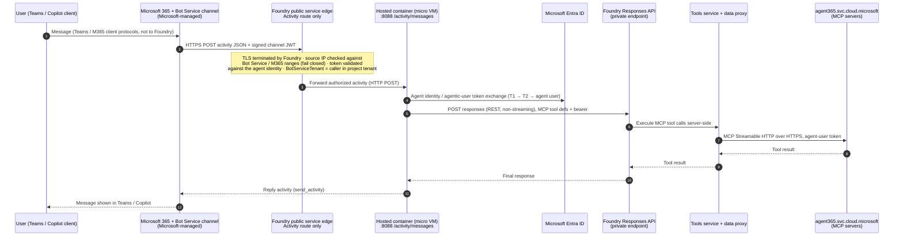
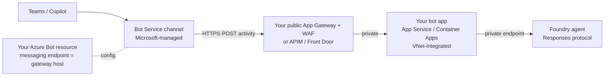
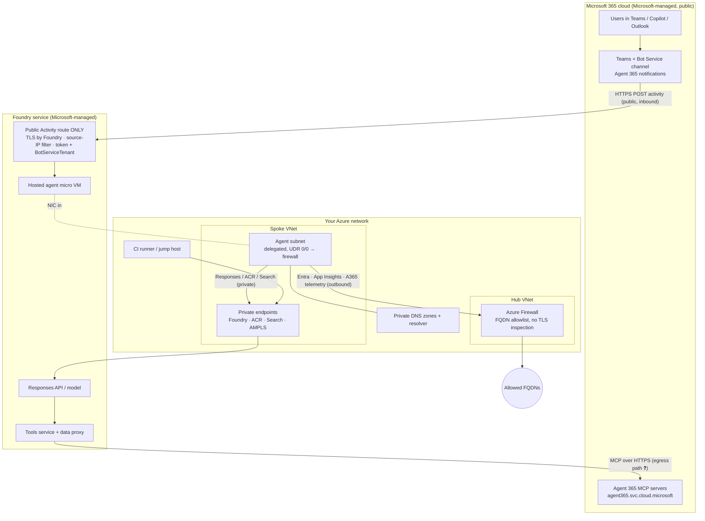

# 19 · Private networking and Teams / Copilot channel security

**The question:** the Foundry account will be private (private endpoint, public network access disabled) and unreachable from outside the corporate network. The autopilot must still work in Teams, Microsoft 365 Copilot and Outlook. Where and how do we secure the hosted agent? Which protocol is used? Is Azure Bot Service involved? Can Application Gateway (or another gateway) sit in front? What must the firewall allow? What else do we need?

> **Status labels.** ✅ **Documented**: stated on Microsoft Learn or another first-party source, linked next to the claim. Sources re-checked on **2026-11-05**; the Bot Service and REST-publish claims were refreshed on **2026-11-16** against *Publish over REST* (page updated 2026-11-06). 📄 **Repo**: seen in this repository's code or Bicep (file and line given). ⚠️ **Inferred**: our reading of the evidence, not stated by Microsoft. ❓ **Unverified**: not documented and not tested; needs confirmation from Microsoft or a packet-level test. 🅿️ **Preview**: preview feature, no SLA. **Nothing on this page was tested live.** The private-network variant in `infra/` has never been deployed in a demo tenant. This page changes no code or infrastructure.

Related: [03 · Identity and governance](03-identity-and-governance.md) · [04 · Architecture](04-architecture-and-components.md) · [10 · Learning guide](10-learning-guide.md) · [15 · MCP behind an AI gateway](15-mcp-behind-ai-gateway.md) · [18 · Governance gaps](18-governance-gaps.md)

Repository evidence was read at commit `9fe886f`. The Bicep, `azure.yaml`, `scripts/agent-creation-script.ps1` and `scripts/publish-digital-worker.ps1` that this page relies on were identical in the other working copy compared.

## Contents

1. [Short answers](#1-short-answers)
2. [Executive verdict: what can be private and what can't](#2-executive-verdict-what-can-be-private-and-what-cant)
3. [As-is vs proposed](#3-as-is-vs-proposed)
4. [Protocol trace, end to end](#4-protocol-trace-end-to-end)
5. [Is Azure Bot Service used?](#5-is-azure-bot-service-used)
6. [Can a gateway sit in between?](#6-can-a-gateway-sit-in-between-application-gateway-api-management-front-door)
7. [Firewall allowlist matrix](#7-firewall-allowlist-matrix)
8. [DNS, private endpoints and routing](#8-dns-private-endpoints-and-routing)
9. [Identity, authorization and agent governance](#9-identity-authorization-and-agent-governance)
10. [Monitoring and operations](#10-monitoring-and-operations)
11. [Recommended architecture](#11-recommended-architecture)
12. [Staged implementation checklist](#12-staged-implementation-checklist)
13. [If strict zero public ingress is mandatory](#13-if-strict-zero-public-ingress-is-mandatory)
14. [Validation plan](#14-validation-plan-not-performed)
15. [Documentation conflicts and open questions](#15-documentation-conflicts-and-open-questions)
16. [Sources](#16-sources)

## 1. Short answers

| Question | Answer | Status |
|---|---|---|
| Can Teams / Copilot reach a Foundry agent **only** through our private endpoint? | **No.** Learn: "Microsoft 365 doesn't support private network connectivity for agents and requires the agent endpoints it invokes to be routable over the public internet." A Teams client on your VPN doesn't change this. The message reaches your agent from Microsoft's channel service, not from the user's device. | ✅ [Publish over REST with private networking](https://learn.microsoft.com/azure/foundry/agents/how-to/publish-copilot-virtual-network) |
| Then how does it work with public network access disabled? | Set `agent_endpoint.protocol_configuration.activity.enable_m365_public_endpoint = true`. Foundry opens a **service-managed, source-IP-filtered public route for the Activity Protocol only**. The account keeps public network access disabled. Responses, Invocations, A2A, MCP and the project APIs stay private. You configure no public IP, DNS, DNAT, load balancer or reverse proxy. This repo already sets the flag. | ✅ same page, Steps 3 and 5 · 📄 `scripts/agent-creation-script.ps1:57-63` |
| Is that supported for an **autopilot** (`publishAsAutopilot`, agent user)? | **Not documented either way.** The private-network publish page covers ordinary store publishing without a separate Azure Bot resource, and its example sets `publishAsAutopilot: false`, pointing to the Agent 365 article for autopilots. The autopilot quickstart doesn't mention private networking. Get Microsoft's confirmation before you rely on it. | ❓ [§5](#5-is-azure-bot-service-used), [§15](#15-documentation-conflicts-and-open-questions) |
| Which protocol? | **Activity Protocol**: Bot Framework-style activity JSON over HTTPS `POST`, TLS 1.2+ on 443, into the container at `/activity/messages`. Not WebSockets, not SSE, no streaming to Teams. Outbound, the container calls the **Responses API** (REST, non-streaming). The Responses API calls the **Agent 365 MCP servers** server-side. | ✅ + 📄 [§4](#4-protocol-trace-end-to-end) |
| Is Bot Service used? | **Microsoft-managed bot and channel infrastructure is always in the path.** Foundry registers the Teams bot and filters on "Azure Bot Service and Microsoft 365 source ranges". The current public autopilot path needs **no customer-owned Azure Bot resource**, and this repo creates none. The documented private-network REST path for non-autopilot publishing doesn't need one either: `performBotRegistration: true` registers the agent directly with Teams Graph (the *Troubleshoot publishing* page still lists older `botServiceArmId` errors; see [§15](#15-documentation-conflicts-and-open-questions)). | ✅ / ❓ [§5](#5-is-azure-bot-service-used) |
| Can Application Gateway / WAF, API Management or Front Door sit in between? | **Not on the native channel route.** Foundry owns the endpoint, TLS certificate and source-IP filter, and Learn documents no custom host name or upstream gateway. A gateway is possible only for a **custom bridge**: your own Azure Bot, your own bot app, and calls to the private Responses endpoint. That loses the autopilot features and still has public ingress at your gateway. API Management for **outbound** MCP governance ([doc 15](15-mcp-behind-ai-gateway.md)) doesn't secure inbound channel traffic. | ✅ / ⚠️ [§6](#6-can-a-gateway-sit-in-between-application-gateway-api-management-front-door) |
| What does the firewall need? | **No inbound rules** for the channel. **Outbound** from the agent subnet: Entra endpoints, Application Insights (if used), `agent365.svc.cloud.microsoft` (A365 observability and the MCP servers), and whatever tools or data the code calls. Use FQDN rules and no TLS inspection. Several paths are undocumented and need a test. | ✅ / ❓ [§7](#7-firewall-allowlist-matrix) |
| What else is necessary? | Choose authorization deliberately (`BotServiceTenant` lets in every user of the tenant). Keep sender, tenant and audience checks in code. Add application-level approval for sensitive MCP writes (`require_approval: never` today). Stop logging full activity bodies. Use private ACR and Application Insights. Use CI inside the VNet. Plan the network at account creation: injection can't be added later. | [§9](#9-identity-authorization-and-agent-governance)–[§12](#12-staged-implementation-checklist) |

## 2. Executive verdict: what can be private and what can't

**Verdict:** "Foundry private and unreachable from outside my network" **and** "native Teams / Copilot / Agent 365 integration" can't both be fully true. The supported design is:

- the **account** stays private;
- the **Activity Protocol route** of the published agent gets a Microsoft-managed public exception that filters on source IP and authenticates every request;
- **egress** goes through your firewall.

That is the best you can get with the native channel. Whether this combination is supported for an **autopilot** blueprint specifically isn't documented yet (open question Q1).

Separate the planes. Each one has a different answer:

| Plane | What it is | Private when PNA is disabled? | Who controls it | Source |
|---|---|---|---|---|
| **Management / authoring** | Project endpoint `https://<account>.services.ai.azure.com/api/projects/<project>`: create agent versions, publish, PATCH the endpoint, portal | ✅ Private: reachable only through the private endpoint, so CI must run inside the VNet | You (private endpoint, DNS, RBAC) | [Private networking (azd)](https://learn.microsoft.com/azure/foundry/agents/how-to/virtual-networks), [Publish over REST](https://learn.microsoft.com/azure/foundry/agents/how-to/publish-copilot-virtual-network) |
| **Agent endpoint: Activity route** | `{project}/agents/{agent}/endpoint/protocols/activityProtocol` | ❌ **Public** with `enable_m365_public_endpoint`, restricted to Bot Service / M365 source ranges plus token validation | Foundry (route, TLS, IP filter); you choose the authorization scheme | ✅ same |
| **Agent endpoint: other protocols** | Responses, Invocations (incl. WebSocket), A2A, MCP | ✅ Private | You | ✅ same, Step 2 |
| **Hosted runtime compute** | Per-session micro VM; outbound through a NIC in your delegated agent subnet | ✅ Inbound isn't exposed to you; outbound follows your UDR and firewall | Microsoft runs it; you control egress | [Networking deep dive](https://learn.microsoft.com/azure/foundry/agents/concepts/agents-networking-deep-dive), [Hosted agents](https://learn.microsoft.com/azure/foundry/agents/concepts/hosted-agents) |
| **Inbound channel service** | Teams, Copilot, Outlook / Agent 365 notifications, Bot Service channel infrastructure | ❌ Microsoft 365 SaaS on the internet. **No Private Link.** | Microsoft | ✅ Publish over REST, Limitations |
| **Model and Foundry tools** | Responses API, model deployment, toolbox | ✅ Private endpoint from the agent subnet | You (DNS, private endpoint) | [Configure network isolation](https://learn.microsoft.com/azure/foundry/how-to/configure-private-link) |
| **Agent 365 MCP servers** (Mail, Teams, Word, …) | `https://agent365.svc.cloud.microsoft/agents/servers/...` | ❌ Public Microsoft 365 service. The call is made server-side by the Responses API through the tools service and data proxy. Its egress path for a **public** MCP host isn't documented | Microsoft; you control token scopes | ❓ [§7](#7-firewall-allowlist-matrix) |
| **Telemetry** | Application Insights, Agent 365 observability | Application Insights can be private through Azure Monitor Private Link Scope (AMPLS). A365 observability is public (`agent365.svc.cloud.microsoft`) | You | ✅ [Configure A365 data collection](https://learn.microsoft.com/azure/foundry/agents/how-to/configure-agent-365-data-collection) |
| **Build and image** | ACR build, image pull | Private ACR is supported **only for projects created after 2026-06-25**, and needs ACR Premium. `az acr build` fails against a private registry unless you use a dedicated agent pool | You | ✅ [Deploy a hosted agent](https://learn.microsoft.com/azure/foundry/agents/how-to/deploy-hosted-agent), [ACR private link](https://learn.microsoft.com/azure/container-registry/container-registry-private-endpoints) |

**Feature and preview status (2026-11-05):**

- Foundry autopilots and Agent 365 agent users: 🅿️ Frontier preview ([autopilot quickstart](https://learn.microsoft.com/azure/foundry/agents/how-to/agent-365)).
- Hosted agents: available in a fixed list of regions ([hosted agents](https://learn.microsoft.com/azure/foundry/agents/concepts/hosted-agents)). [Configure network isolation](https://learn.microsoft.com/azure/foundry/how-to/configure-private-link) still labels them "(preview)", which is inconsistent.
- The private-network region list is separate: [Regional support for private networking](https://learn.microsoft.com/azure/foundry/agents/concepts/limits-quotas-regions#regional-support-for-private-networking).
- Hosted agent network injection must be configured **when the account is created**. Outbound networking "can't be changed or added after creation" ([Configure network isolation](https://learn.microsoft.com/azure/foundry/how-to/configure-private-link)).
- Consequence: the demo's existing public account can't be converted. A private deployment means a **new account and project**, a new agent version, a new publish, new approval and new hires.

## 3. As-is vs proposed

| Area | As-is in this repo | Proposed for a private deployment | Status |
|---|---|---|---|
| Account network | `publicNetworkAccess` parameter, default `Enabled` (`infra/main.bicep:37`). `Disabled` switches to `infra/modules/private-networking.bicep` (never deployed) | Deploy with `Disabled` on a **new** account | 📄 |
| Private variant: account | PNA Disabled, `defaultAction: Deny`, `bypass: AzureServices`, `networkInjections` scenario `agent` on a BYO subnet delegated to `Microsoft.App/environments` (`private-networking.bicep:198-230`) | Keep. Check that the region supports private networking | 📄 / ✅ |
| Private DNS | Three zones: `privatelink.services.ai.azure.com`, `privatelink.openai.azure.com`, `privatelink.cognitiveservices.azure.com` (`private-networking.bicep:28-32`) | Keep. Add `privatelink.search.windows.net` if the RFP Bid Desk Search is made private. Forward on-premises DNS to an Azure DNS Private Resolver | 📄 / ✅ |
| Agent subnet NSG | Allows `VirtualNetwork` (priority 100), and 443 to `AzureActiveDirectory`, `AzureMonitor`, `AzureFrontDoor.Frontend` and the Teams ranges `52.112.0.0/14` and `52.122.0.0/15`; DenyAll at 4096 (`private-networking.bicep:24-26, 56-140`) | ⚠️ With the 0.0.0.0/0 UDR, the `VirtualNetwork` tag can include the default route, so rule 100 may allow everything. Treat the **firewall** as the egress control. See [§8](#8-dns-private-endpoints-and-routing) | 📄 / ⚠️ |
| Egress firewall | Azure Firewall Standard. Application rule `allow-https` to `targetFqdns: ['*']`; DNS 53 and NTP 123 to `*` (`infra/modules/network.bicep:95-160`) | Replace `*` with the FQDN list in [§7](#7-firewall-allowlist-matrix). Restrict DNS to your resolver | 📄 |
| Activity route | `enable_m365_public_endpoint: true` and `protocols: ["activity"]` (`agent-creation-script.ps1:57-63`) | Keep. This is the only supported ingress for Teams / Copilot in a private project | 📄 / ✅ |
| Endpoint authorization | PATCH `authorization_schemes` = `Entra,BotServiceTenant` by default (`agent-creation-script.ps1:196-202`) | Keep `BotServiceTenant` (it matches publish scope *Tenant*). Remove `Entra` if no direct client needs it. Enforce per-user audience in code | 📄 / ✅ |
| Publishing | `publishAsAutopilot: true`, scope *Tenant*, no `botServiceArmId` (`publish-digital-worker.ps1:53`) | Unchanged until Microsoft confirms the private autopilot path (Q1). The Learn REST article now uses `performBotRegistration: true` instead of a customer Azure Bot, but documents it only with `publishAsAutopilot: false` | 📄 / ❓ |
| In-container auth | No `CLIENT_SECRET`, so the Agents SDK host runs **anonymous** and relies on Foundry's endpoint authorization (`host_agent_server.py:562-583`) | Keep: no secrets in the container. Foundry validates tokens before forwarding | 📄 |
| Request logging | Logs the **full inbound activity body** at INFO (`host_agent_server.py:608-620`). Logs go to Application Insights | Redact to IDs, type and size. This is a code change; not made here | 📄 |
| MCP tools | `require_approval: "never"` on every MCP tool. `allowed_tools` only for servers whose manifest entry lists names; `MCP_ENFORCE_ALLOWLIST` is on by default (`agent.py:152, 1272-1283, 1290-1299`) | Application-level approval for sensitive writes; allowlist every server | 📄 |
| Container registry | Basic SKU, public (`infra/main.bicep:73`, `infra/modules/project.bicep:60-65`). Image built with ACR Tasks | Premium with a private endpoint (project created after 2026-06-25), dedicated agent pool for builds | 📄 / ✅ |
| Monitoring | Log Analytics and Application Insights with public ingestion. No AMPLS | AMPLS, or allow the Application Insights FQDNs in the firewall | 📄 / ✅ |
| Azure AI Search (Bid Desk only) | `publicNetworkAccess: 'enabled'`, local auth disabled (`infra/modules/search.bicep:32`) | Private endpoint plus DNS zone. The container calls Search directly with per-instance tokens | 📄 |
| Deployment host | `azd provision` from a workstation | After PNA is disabled: self-hosted runner, or a jump host reached through Bastion, inside the VNet | ✅ |

## 4. Protocol trace, end to end

### 4.1 Inbound message in Teams or Copilot chat

| Step | Protocol and endpoint | TLS | Authentication | Identity | Evidence |
|---|---|---|---|---|---|
| 1 | Teams / M365 client traffic to Microsoft 365 | Microsoft 365 | User sign-in | Human user | [M365 URLs and IP ranges](https://learn.microsoft.com/microsoft-365/enterprise/urls-and-ip-address-ranges) |
| 2 | HTTPS `POST` of a Bot Framework / Activity Protocol JSON activity to `https://<account>.services.ai.azure.com/api/projects/<project>/agents/<agent>/endpoint/protocols/activityProtocol?api-version=v1` | Terminated by **Foundry**; Microsoft certificate | Signed channel JWT in `Authorization`. Foundry "validates the signed channel token against the agent's identity" and rejects it if "token, audience, tenant, or RBAC authorization" fails. Bot Connector tokens are documented with issuer `https://api.botframework.com` and audience = the bot's app ID; Foundry doesn't publish its exact validation rules | Channel service on behalf of the user; user identity is in the activity | ✅ [Publish over REST §4.3](https://learn.microsoft.com/azure/foundry/agents/how-to/publish-copilot-virtual-network#43-authenticate-and-authorize-inbound-requests), [Bot Connector authentication](https://learn.microsoft.com/azure/bot-service/rest-api/bot-framework-rest-connector-authentication) |
| 3 | Foundry → container `POST /activity/messages` on port 8088 | Platform-internal, not documented | None in the container. The host runs anonymous because no client secret is configured | — | 📄 `host_agent_server.py:562-583, 679-684` |
| 4 | Token acquisition for the agent identity and agent user | HTTPS to Entra and the managed identity endpoint | Federated credential / managed identity; no secret | Agent identity → agent user ([doc 10](10-learning-guide.md)) | ✅ [Private networking (azd)](https://learn.microsoft.com/azure/foundry/agents/how-to/virtual-networks) allowlist |
| 5 | `responses.create` on the project endpoint (OpenAI-compatible REST, non-streaming) | HTTPS to the **private endpoint** | Entra token for `https://ai.azure.com` | Container's agent identity | 📄 `tool_loop.py:39-61`, `agent.py:144-148` |
| 6–8 | MCP tool calls run **server-side by the Responses API**. "Tool calls always route through the single-tenant data proxy." MCP Streamable HTTP over HTTPS to `agent365.svc.cloud.microsoft` | HTTPS | Bearer token in the tool's `headers`, audience = Agent 365 Tools resource application. The audience is an app ID, not a host name | Agent user (or OBO) | ✅ [Networking deep dive](https://learn.microsoft.com/azure/foundry/agents/concepts/agents-networking-deep-dive) · 📄 `agent.py:1272-1299`, [doc 15](15-mcp-behind-ai-gateway.md) |
| 9–10 | Reply: `TurnContext.send_activity` in the Agents SDK `CloudAdapter`. Learn says Foundry "returns the response through the channel". **Not documented:** whether a reply is returned in-line or posted to the activity's `serviceUrl` (Teams: `https://smba.trafficmanager.net/...`) from the container's own NIC | HTTPS | ❓ | Agent | ❓ 📄 `host_agent_server.py:348-532`, `request_correlation.py:62`, test fixture `tests/test_agent_rfp.py:203` |

**Protocols that are *not* used here:**

- Only `protocols: ["activity"]` is enabled on the agent endpoint, so the Responses, Invocations, Invocations WebSocket (`/invocations_ws`), A2A and MCP **agent** protocols aren't exposed.
- Published agents don't support streaming or citations ([Publish over REST, Limitations](https://learn.microsoft.com/azure/foundry/agents/how-to/publish-copilot-virtual-network#limitations)), so there are no SSE or WebSockets on the channel route.
- MCP Streamable HTTP is used only on the outbound tool path, and the platform makes those calls.

### 4.2 Email and other Agent 365 notifications

- Emails to the agent user's mailbox, Word comments and Teams notifications arrive as **Agent 365 notifications over the Activity Protocol** ([Agent 365 SDK](https://learn.microsoft.com/microsoft-agent-365/developer/agent-365-sdk)).
- For a Foundry autopilot, the "messaging endpoint" is the Foundry agent endpoint that publishing registers. For a self-hosted Agent 365 agent, you register it yourself with `a365 setup blueprint --endpoint-only` ([Agent messaging endpoint](https://learn.microsoft.com/microsoft-agent-365/developer/agent-messaging-endpoint)).
- ⚠️ We assume notifications use the same public Activity route and source-IP filter as chat. Learn's private-network page mentions only "Microsoft 365 or Teams". The page also says nothing about Outlook or email notifications reaching a private project (Q2).
- Repo design note: `BotServiceRbac` needs a caller object ID that email events may not carry. That's why the repo uses `BotServiceTenant` and filters senders by domain in code (`agent-creation-script.ps1:196-199`).

### 4.3 What `BotServiceTenant` is and isn't

| It is | It isn't |
|---|---|
| An **authorization** rule: the signed-in caller must be in the project's tenant ([Endpoint authorization](https://learn.microsoft.com/azure/foundry/agents/concepts/agent-endpoint-authorization)) | A network control. The source-IP filter is separate and managed by Foundry |
| Fixed: you can't add groups or users to it | A per-user allowlist. Any tenant user can call the agent ([doc 18](18-governance-gaps.md), gap 1) |
| Paired with publish scope *Tenant* | Proof that a request came from **your** bot. Bot Service ranges are shared by many tenants, so token validation does that job |

## 5. Is Azure Bot Service used?

Three different things get called "the bot":

| Component | Exists? | Owner | Where you see it |
|---|---|---|---|
| **Microsoft-managed bot and channel infrastructure** (Teams / Copilot channel adapters, Bot Service connector, source ranges) | **Always**, for any agent in Teams or Copilot | Microsoft | The Teams app manifest Foundry generates has `bots[0].botId`, `webApplicationInfo.id` and `copilotAgents.customEngineAgents[0].id` ([Publish to Copilot and Teams](https://learn.microsoft.com/azure/foundry/agents/how-to/publish-copilot)). Foundry filters on "Azure Bot Service and Microsoft 365 source ranges" |
| **Customer-owned Azure Bot resource** (`Microsoft.BotService/botServices`, kind `azurebot`) | Not needed on any currently documented Foundry publish path (below); only in a custom bridge | You, in your subscription | ARM resource in your resource group |
| **Your own bot application** (Bot Framework / Agents SDK app on App Service or Container Apps) | Only in a custom bridge ([§6](#6-can-a-gateway-sit-in-between-application-gateway-api-management-front-door)) | You | Not in this repo |

**Customer-owned Azure Bot resource, by publish path:**

| Publish path | Customer Azure Bot required? | Evidence |
|---|---|---|
| Portal publish, public project | **No**: "Foundry handles Teams bot registration during direct publishing, so you don't need to create a separate Azure Bot Service resource" | ✅ [Publish to Copilot and Teams](https://learn.microsoft.com/azure/foundry/agents/how-to/publish-copilot) |
| Portal publish, project with PNA disabled | Portal publishing returns 403; use REST from a client that reaches the private endpoint, or download the manifest ZIP and upload it in the Microsoft 365 admin center | ✅ [Troubleshoot publishing](https://learn.microsoft.com/azure/foundry/agents/how-to/troubleshoot-publish-copilot#resolve-virtual-network-issues) |
| REST publish to the store (Shared / Tenant, `publishAsAutopilot: false`), project with PNA disabled | **No.** Step 2 PATCHes the agent endpoint (`activity.enable_m365_public_endpoint: true` plus a `BotServiceRbac` / `BotServiceTenant` scheme). Step 3 POSTs `/agents/<agent-name>/microsoft365/publish` with `performBotRegistration: true`, which registers "the agent's identity and Activity Protocol endpoint directly with Teams Graph, without creating a separate Azure Bot Service resource". No agent GUID or bot ID goes in the body. This needs the service's bot registration feature to be enabled for the project. The package download (`/microsoft365/zip`) endpoint doesn't register | ✅ [Publish over REST, Steps 2 and 3](https://learn.microsoft.com/azure/foundry/agents/how-to/publish-copilot-virtual-network#step-3-publish-the-agent-to-microsoft-365) (page updated 2026-11-06, checked 2026-11-16) |
| **Autopilot** publish (`publishAsAutopilot: true`, Tenant, agentic user template) **with a public project**: this repo today | **No**. Neither the autopilot quickstart nor this repo sends `botServiceArmId`, and the demo works | ✅ [Autopilot quickstart](https://learn.microsoft.com/azure/foundry/agents/how-to/agent-365) · 📄 `publish-digital-worker.ps1` · 🧪 observed in the Zava demo ([doc 04](04-architecture-and-components.md)) |
| **Autopilot** publish **with PNA disabled** | **❓ Not documented.** The autopilot quickstart doesn't mention private networking. The private REST article's example sets `publishAsAutopilot: false` and refers autopilots to the Agent 365 article | Q1. Ask Microsoft before building |

**Package download is not read-only.** The current REST article says package preparation can update the agent endpoint configuration and needs agent write permission, even though it doesn't submit to the catalog or create a publish record. It generates a package from the supplied request and current agent, not a historical export of an already-published version. For a no-cloud local preview, see [Publication request versus generated manifest](04-architecture-and-components.md#publication-request-versus-generated-manifest).

⚠️ **Our reading:** for a private project, `enable_m365_public_endpoint` is what makes the Activity route reachable at all. A customer Bot resource on its own doesn't make a private endpoint reachable. Whether the autopilot path works with PNA disabled, and whether it uses `performBotRegistration`, is a publishing question, not a network question. Don't create a Bot resource "just in case": it adds a second public channel registration you must govern.

## 6. Can a gateway sit in between? (Application Gateway, API Management, Front Door)

### 6.1 Native managed channel route: no supported insertion point

Learn's description of the managed route:

- Foundry "exposes the Activity Protocol route over its public service endpoint".
- Foundry "terminates TLS and presents the certificate".
- Foundry "maintains the Azure Bot Service and Microsoft 365 source ranges".
- You need no "public IP address, public DNS record, DNAT rule, load balancer, or reverse proxy" ([§4.2](https://learn.microsoft.com/azure/foundry/agents/how-to/publish-copilot-virtual-network#42-review-the-inbound-network-requirements)).

Learn documents no custom host name, custom domain or upstream proxy for this route, and none for the autopilot messaging endpoint. Publishing registers the Foundry endpoint itself.

So you **can't** put Application Gateway, API Management or Front Door between Microsoft's channel service and a native Foundry autopilot:

- A gateway in front would need its own public host name. The channel wouldn't call that host name, because the bot registration points at Foundry.
- Gateway → Foundry would arrive from your gateway's IP, not from a Bot Service / M365 range. Foundry fails closed on that.
- Foundry "replaces client-supplied source-IP metadata", so `X-Forwarded-For` doesn't help.

### 6.2 Where a gateway does fit

| Option | Native autopilot channel | Custom bridge (your Azure Bot → your gateway → your bot app → private Responses endpoint) | Internal clients calling the agent's Responses endpoint | Outbound tool governance |
|---|---|---|---|---|
| **Application Gateway v2 + WAF** | ❌ No insertion point | ⚠️ Public listener with WAF in front of a private backend bot app. Hypothetical: not a Foundry pattern | ✅ Private listener in front of the private endpoint is possible; it adds little, because the endpoint is already private and Entra-authenticated | ❌ |
| **API Management** | ❌ | ⚠️ `validate-jwt` for Bot Connector tokens is possible (issuer `https://api.botframework.com`, audience = bot app ID) | ✅ Internal-mode APIM for quotas and logging (Foundry's portal AI Gateway is public and only partly supported with private networking) | ✅ For **your own** MCP servers ([doc 15](15-mcp-behind-ai-gateway.md)); Agent 365 MCP hosts aren't yours to front |
| **Front Door Premium** (Private Link origin) | ❌ | ⚠️ Public edge, WAF, then a private origin | ❌ Not needed | ❌ |
| **Azure Firewall** (egress) | n/a | n/a | n/a | ✅ FQDN allowlist for agent-subnet egress ([§7](#7-firewall-allowlist-matrix)) |

**The custom bridge, if you must have your own WAF in the path:**

| Aspect | What applies |
|---|---|
| Status | ⚠️ Generic Bot Framework pattern, **not** a documented Foundry autopilot pattern |
| Still public? | Yes. The gateway listener is public, because Bot Service has no Private Link to your gateway. "Public gateway + private backend" isn't private end to end |
| Lost features | Your bot is a conventional bot, **not** an autopilot: no blueprint instances hired from the store, no agent user with mailbox, email or Word-comment notifications, Agent 365 registry, agentic-user tokens or autopilot publishing. You'd own the bot app, its secrets or federated credential, token validation, the Teams manifest and scaling |
| Application Gateway notes | Use a public listener with a certificate for your host name. Backend HTTPS with the bot app's host name for SNI and `Host`. The default backend request timeout is **20 s**, so raise it above your worst model plus tool latency. The Activity route is plain request/response, so WebSocket and SSE settings don't apply. If you use SSE elsewhere, disable response buffering ([App Gateway SSE](https://learn.microsoft.com/azure/application-gateway/use-server-sent-events), [502 timeouts](https://learn.microsoft.com/troubleshoot/azure/application-gateway/application-gateway-troubleshooting-502#backend-request-time-out-is-exceeded)). Point health probes at the bot app's health route, not at `/api/messages`. WAF isn't identity: the bot app or APIM must still validate the JWT |
| Origin lockdown | Restrict the gateway listener to the `AzureBotService` service tag (shared by all tenants, so defense in depth only), and validate the JWT. Lock the bot app to the gateway subnet |

**Recommendation:** use the native route and secure it with the controls Foundry provides plus the code-level controls in [§9](#9-identity-authorization-and-agent-governance). Use the bridge only if policy demands an inspection point you own **and** you accept losing the autopilot features.

## 7. Firewall allowlist matrix

### 7.1 How to read this

- **No inbound rules** are needed in your network for the Teams / Copilot channel. The public Activity route is on Foundry's edge, not in your VNet.
- Prefer **FQDN application rules**. Service tags can't be scoped to a tenant ([Configure network isolation](https://learn.microsoft.com/azure/foundry/how-to/configure-private-link)).
- **Don't TLS-inspect** agent-subnet traffic ([Private networking (azd)](https://learn.microsoft.com/azure/foundry/agents/how-to/virtual-networks)).
- This is **not an exhaustive list**. Microsoft doesn't publish one for an autopilot. Treat ❓ rows as test items: deny first, watch the firewall logs, then allow what's proven needed.
- **Token audience isn't a host name.** The Agent 365 Tools resource app ID used as the MCP token audience (`ea9ffc3e-…/.default` in `publish-digital-worker.ps1`) is never a firewall entry. The **URL** in `ToolingManifest*.json` is.

### 7.2 Matrix

| # | Source | Destination (FQDN / tag / private zone) | Port / protocol | Direction | Purpose | Need | Source |
|---|---|---|---|---|---|---|---|
| **Runtime: hosted agent subnet** |||||||
| R1 | Agent subnet (micro VM NIC) | `login.microsoftonline.com`, `*.login.microsoftonline.com`, `*.login.microsoft.com` (or `{region}.login.microsoft.com`), `*.identity.azure.net` (or `control-{region}.identity.azure.net`), or tag `AzureActiveDirectory` | TCP 443 HTTPS | Outbound | Managed identity, agent identity and agentic-user tokens | **Required** | ✅ [Configure network isolation – firewall allowlisting](https://learn.microsoft.com/azure/foundry/how-to/configure-private-link#firewall-allowlisting), [Private networking (azd), limitations](https://learn.microsoft.com/azure/foundry/agents/how-to/virtual-networks#limitations) |
| R2 | Agent subnet | Foundry account `*.services.ai.azure.com`, `*.openai.azure.com`, `*.cognitiveservices.azure.com` → private endpoint (zones `privatelink.services.ai.azure.com`, `privatelink.openai.azure.com`, `privatelink.cognitiveservices.azure.com`) | TCP 443 | Outbound, inside the VNet | Responses API, model, toolbox | **Required** (private, not through the internet) | ✅ [Private networking (azd)](https://learn.microsoft.com/azure/foundry/agents/how-to/virtual-networks) · 📄 `private-networking.bicep:28-32` |
| R3 | Agent subnet | `*.in.applicationinsights.azure.com`, `*.livediagnostics.monitor.azure.com`, `settings.sdk.monitor.azure.com` (or tag `AzureMonitor`), **or** AMPLS private endpoint | TCP 443 | Outbound | `configure_azure_monitor` traces and logs from the container | **Conditional**: this repo connects Application Insights | ✅ [Configure network isolation](https://learn.microsoft.com/azure/foundry/how-to/configure-private-link#firewall-allowlisting) · 📄 `host_agent_server.py:176-215` |
| R4 | Agent subnet | `agent365.svc.cloud.microsoft` (or tag `AzureFrontDoor.Frontend`) | TCP 443 | Outbound | Agent 365 observability export | **Conditional**: blocking it loses only A365 traces. To turn it off, set `a365LoggingEnabled=false` (resource-wide; on by default when A365 is enabled for the tenant) | ✅ [Configure A365 data collection](https://learn.microsoft.com/azure/foundry/agents/how-to/configure-agent-365-data-collection), [Deploy from source – firewall](https://learn.microsoft.com/azure/foundry/agents/how-to/deploy-hosted-agent-code#firewall-requirements-for-private-virtual-networks) |
| R5 | Agent subnet | Reply path: the activity's `serviceUrl` host (Teams public cloud: `smba.trafficmanager.net`) and Teams ranges `52.112.0.0/14`, `52.122.0.0/15` (M365 endpoint ID 12) | TCP 443 | Outbound | Bot Connector reply / proactive messages, **if** the container posts replies itself | ❓ **Unverified**. Learn doesn't list it for hosted agents. The repo NSG already allows the Teams ranges (`private-networking.bicep:24-26`), which suggests this path; we couldn't confirm it. Test with deny + logs | [Agents SDK Teams endpoints](https://learn.microsoft.com/javascript/api/@microsoft/agents-hosting/?view=agents-sdk-js-latest), [M365 URLs and IP ranges](https://learn.microsoft.com/microsoft-365/enterprise/urls-and-ip-address-ranges) |
| R6 | Agent subnet | Azure AI Search `<name>.search.windows.net` → private endpoint (zone `privatelink.search.windows.net`) | TCP 443 | Outbound | RFP Bid Desk retrieval with per-instance tokens (the container calls Search directly) | **Conditional** (Bid Desk only). Not in the private module today | 📄 `agent.py:161`, `search.bicep:32` · ✅ [Private networking (azd)](https://learn.microsoft.com/azure/foundry/agents/how-to/virtual-networks) |
| R7 | Agent subnet | `graph.microsoft.com` | TCP 443 | Outbound | Not called by this repo's code (no Graph host in `src/`). Needed only if you add Graph calls, such as the `/me/manager` audience check in [doc 18](18-governance-gaps.md) | **Conditional / not needed today** | 📄 grep of `src/` |
| R8 | Agent subnet | Your DNS resolver (Azure DNS `168.63.129.16` or a Private Resolver) | UDP/TCP 53 | Outbound | Name resolution | **Required**. The repo allows 53 to `*`; narrow it | ✅ [Private networking (azd)](https://learn.microsoft.com/azure/foundry/agents/how-to/virtual-networks) · 📄 `network.bicep:100-116` |
| **Tool execution: Foundry tools service / data proxy** |||||||
| T1 | Foundry data proxy (single-tenant, attached to your VNet) | `agent365.svc.cloud.microsoft` (`/agents/servers/mcp_*`) | TCP 443, MCP Streamable HTTP | Outbound | Mail, Teams, Word, Excel, Calendar, SharePoint/OneDrive MCP servers | **Required for M365 tools**. ❓ Which egress path the data proxy uses for a **public** MCP host, and so whether your firewall sees it, is undocumented. Learn's tools table covers "private MCP" through the subnet and SharePoint / Bing through "public endpoints" only. Allow the FQDN and test | ✅ [Networking deep dive](https://learn.microsoft.com/azure/foundry/agents/concepts/agents-networking-deep-dive), [Configure network isolation – tools](https://learn.microsoft.com/azure/foundry/how-to/configure-private-link) · 📄 `ToolingManifest.json` |
| T2 | Foundry tools service | Bing grounding / web search (toolbox) | — | Outbound (Microsoft-managed) | Toolbox web search | Uses public endpoints managed by Microsoft. Not a rule in your firewall per Learn; ❓ test | ✅ [Configure network isolation – tools](https://learn.microsoft.com/azure/foundry/how-to/configure-private-link) |
| **Build, image and provisioning** |||||||
| B1 | Foundry runtime | ACR `<registry>.azurecr.io` and `<registry>.<region>.data.azurecr.io` → private endpoint (zone `privatelink.azurecr.io`) | TCP 443 | Outbound | Image pull with the agent identity (AcrPull) | **Required**. A private registry needs a project created after 2026-06-25 and ACR **Premium** | ✅ [Deploy a hosted agent](https://learn.microsoft.com/azure/foundry/agents/how-to/deploy-hosted-agent), [Private ACR for hosted agents](https://learn.microsoft.com/azure/foundry/agents/how-to/deploy-hosted-agent-private-azure-container-registry), [ACR private link](https://learn.microsoft.com/azure/container-registry/container-registry-private-endpoints) |
| B2 | ACR Tasks (`az acr build`) | Private registry; base images and PyPI from the internet | TCP 443 | Outbound from the task agent | `scripts/build-docker-image-acr.ps1` | **Required for this repo's build**. With public access disabled, `az acr build` fails unless you use a **dedicated agent pool** in the VNet, or allow the regional `AzureContainerRegistry` tag on the registry. Or build in CI inside the VNet and push | ✅ [ACR private link – az acr build](https://learn.microsoft.com/azure/container-registry/container-registry-private-endpoints) |
| B3 | Source-code deploys only | `mcr.microsoft.com`, `*.login.microsoft.com` | TCP 443 | Outbound | Remote build of source-code agents | **Not used by this repo** (image deploy) | ✅ [Deploy from source – firewall](https://learn.microsoft.com/azure/foundry/agents/how-to/deploy-hosted-agent-code#firewall-requirements-for-private-virtual-networks) |
| B4 | CI runner / jump host **in the VNet** | `management.azure.com`, `login.microsoftonline.com`, Foundry private endpoint, ACR private endpoint, `graph.microsoft.com` (publish and identity scripts) | TCP 443 | Outbound | `azd provision`, post-provision scripts, publish | **Required** after PNA is disabled: workstation calls get 403 or connection refused | ✅ [Private networking (azd)](https://learn.microsoft.com/azure/foundry/agents/how-to/virtual-networks) |
| **People** |||||||
| P1 | Developers and operators | Foundry portal and APIs through the private endpoint (VPN / ExpressRoute / Bastion), on-premises DNS forwarded to the private zones | TCP 443 | Outbound | Portal, traces, management | **Required** for operations | ✅ same |
| P2 | End-user networks | Microsoft 365 endpoints from the [IP Address and URL web service](https://learn.microsoft.com/microsoft-365/enterprise/microsoft-365-ip-web-service), plus outbound 443 to `*.azureml.ms` for the agent's sign-in card redirect | TCP 443 (+ Teams media UDP) | Outbound | Teams / Copilot / Outlook clients | **Required**, unrelated to the Foundry private endpoint | ✅ [Troubleshoot publishing](https://learn.microsoft.com/azure/foundry/agents/how-to/troubleshoot-publish-copilot) |
| **Inbound** |||||||
| I1 | Microsoft 365 / Bot Service | Foundry public Activity route | TCP 443 | Inbound to **Foundry's** edge, not your VNet | Channel delivery | **No rule on your side.** Foundry manages it | ✅ [Publish over REST §4.2](https://learn.microsoft.com/azure/foundry/agents/how-to/publish-copilot-virtual-network#42-review-the-inbound-network-requirements) |

### 7.3 Keeping the list current

- Microsoft 365 publishes endpoints through the **IP Address and URL web service**: a versioned JSON feed of `endpoints` per instance (Worldwide, GCC High, …), plus a `version` call to detect changes. Automate that instead of hard-coding ranges ([web service](https://learn.microsoft.com/microsoft-365/enterprise/microsoft-365-ip-web-service)).
- Azure service tags are published weekly and change. Use tags in NSGs and Azure Firewall rather than copied CIDRs ([service tags](https://learn.microsoft.com/azure/virtual-network/service-tags-overview)).
- The hard-coded Teams CIDRs in `private-networking.bicep` will drift.
- Re-check this page's ❓ rows after every Foundry or Agent 365 release. The Learn pages used here were updated during the preview.

## 8. DNS, private endpoints and routing

| Topic | Guidance | Source |
|---|---|---|
| Zones | Foundry: `privatelink.cognitiveservices.azure.com`, `privatelink.openai.azure.com`, `privatelink.services.ai.azure.com`. Add `privatelink.search.windows.net`, `privatelink.azurecr.io`, AMPLS zones (`privatelink.monitor.azure.com`, `privatelink.oms.opinsights.azure.com`, `privatelink.ods.opinsights.azure.com`, `privatelink.agentsvc.azure-automation.net`, `privatelink.blob.core.windows.net`) only if you use them | ✅ [Private networking (azd)](https://learn.microsoft.com/azure/foundry/agents/how-to/virtual-networks), [AMPLS DNS](https://learn.microsoft.com/azure/azure-monitor/logs/private-link-configure) |
| Split DNS | Inside the VNet and from on-premises, names resolve to private IPs through Private DNS zones. On-premises resolvers forward to an Azure DNS Private Resolver inbound endpoint. VNet resolvers use `168.63.129.16` | ✅ same |
| Public resolution | The public name of the account still resolves publicly. With PNA disabled, only the Activity route answers, and only from allowed ranges. Expect 403 `NetworkAccessDenied` elsewhere | ✅ [Troubleshoot publishing](https://learn.microsoft.com/azure/foundry/agents/how-to/troubleshoot-publish-copilot) |
| Agent subnet | Dedicated per account, delegated to `Microsoft.App/environments`, /24 recommended, same region as the account. Don't use `172.17.0.0/16` or the listed reserved ranges. Plan for 429 `subnet_exhausted` under load | ✅ [Private networking (azd)](https://learn.microsoft.com/azure/foundry/agents/how-to/virtual-networks), [Networking deep dive](https://learn.microsoft.com/azure/foundry/agents/concepts/agents-networking-deep-dive) |
| BYO VNet vs managed VNet | This repo uses **BYO VNet injection** (your subnet, your UDR and firewall). Microsoft-managed egress applies when you omit the agent subnet. It gives you no firewall logs of your own | ✅ [Private networking (azd)](https://learn.microsoft.com/azure/foundry/agents/how-to/virtual-networks) |
| NSG + UDR | The `VirtualNetwork` tag includes "address prefixes used on user-defined routes. This tag might also contain default routes". With the repo's `0.0.0.0/0 → firewall` UDR, the agent NSG's priority-100 `VirtualNetwork` allow can match all destinations, so DenyAll at 4096 doesn't constrain egress. ⚠️ Rely on the firewall. Check effective security rules after deployment | ✅ [Service tags](https://learn.microsoft.com/azure/virtual-network/service-tags-overview) · 📄 `private-networking.bicep:60-72` |
| Trusted services | The account's `bypass: AzureServices` lets trusted Azure services through the account firewall. It doesn't open the Activity route; `enable_m365_public_endpoint` does that | 📄 `private-networking.bicep:213-216` |

## 9. Identity, authorization and agent governance

### 9.1 Who is authenticated where

| Layer | Control | Today | Recommendation |
|---|---|---|---|
| Channel → Foundry | Bot Service scheme (`BotServiceTenant` or `BotServiceRbac`), token validated against the agent identity | `BotServiceTenant` (tenant-wide) | Keep for autopilots: publish scope *Tenant* maps to it. Learn: guest users can't interact ([Troubleshoot publishing](https://learn.microsoft.com/azure/foundry/agents/how-to/troubleshoot-publish-copilot)) |
| Direct clients → Foundry | `AzureRbac` / `Entra` (audience `https://ai.azure.com`, least-privilege role Foundry Agent Consumer, can be scoped to one agent). `AgentBlueprint` 🅿️ for agent-to-agent calls | `Entra` also enabled | Remove `Entra` unless a direct client needs it. If you keep it, scope the role to the agent ([Endpoint authorization](https://learn.microsoft.com/azure/foundry/agents/concepts/agent-endpoint-authorization)) |
| Inside the container | Sender domain and tenant checks, `NO_REPLY` in group chats, per-instance segment rules | ✅ `guardrails.py:49, 60`, `agent.py:294, 599, 760` | Add a per-person audience allowlist ([doc 18](18-governance-gaps.md), gap 1). The email sender domain is spoofable unless Exchange authentication holds. Combine it with mailbox delivery restrictions |
| Agent → resources | Agent identity / agent user via federated credentials. No secrets in the container | ✅ No `CLIENT_SECRET` | Keep. Never add client secrets for convenience |

### 9.2 Blueprint, instances and least privilege

- **One blueprint, many instances.** Each instance has an agent identity and an agent user ([Autopilot overview](https://learn.microsoft.com/azure/foundry/agents/concepts/autopilot-overview)). Disabling the blueprint in Entra is the documented way to stop every instance at once ([doc 18](18-governance-gaps.md), gap 5).
- The blueprint is a shared trust boundary ([doc 18](18-governance-gaps.md), gap 10).
- Put data permissions on the **instance**: per-index Search roles, per-mailbox Exchange rules. The Bid Desk does this ([doc 12](12-rfp-bid-desk.md)).
- **MCP scopes:** the repo requests `McpServers.*` scopes on the Agent 365 Tools resource for each server (`publish-digital-worker.ps1`). Request only the servers you use.
- **No self-granting:** the agent identity, the agent user and the project managed identity must not hold roles that can assign roles, edit their own app registration, or change the Foundry endpoint (Owner, User Access Administrator, Foundry Account Owner).

### 9.3 Prompt injection and sensitive actions

- **Every inbound email or message is untrusted input.** The repo flags prompt-injection patterns and refuses closures (see [README](../README.md#how-it-works-one-paragraph)). That is detection, not a guarantee.
- **MCP writes aren't gated today.** Every MCP tool is attached with `require_approval: "never"` (`agent.py:1277, 1297`). `allowed_tools` limits which tools are offered only for servers whose manifest entry lists names (`MCP_ENFORCE_ALLOWLIST` is on by default). In this checkout, Teams and Mail aren't allowlisted in `ToolingManifest.rfp.json`.
  - ⚠️ This doesn't mean the platform approves writes on your behalf. It means nothing does.
  - For sending mail outside the team, posting to channels or sharing files, add a **deterministic application-level approval**: a human confirms in Teams before the tool call is issued. Also allowlist every server's tool names.
  - Learn documents MCP approval cards for published agents ([Troubleshoot publishing](https://learn.microsoft.com/azure/foundry/agents/how-to/troubleshoot-publish-copilot)). We haven't tested `require_approval` other than `never` with autopilots.
- **Outbound containment:** Purview DLP for agent users, an Exchange transport rule that keeps agent mail internal, and Teams external access off ([doc 18](18-governance-gaps.md), gap 7). The network firewall can't see email or Teams content, because those leave through Microsoft 365.

## 10. Monitoring and operations

| Need | Where | Note |
|---|---|---|
| Correlation | `CorrelatingCloudAdapter` carries `traceparent` from the inbound request into the `invoke_agent` span; `gen_ai.*` attributes | 📄 `request_correlation.py`. Message content is captured only if `CAPTURE_MESSAGE_CONTENT=true` (default false) |
| **Content leak in logs** | `host_agent_server.py:608-620` logs the **entire activity body** at INFO. It holds user text, email content and names, and it is exported to Application Insights | 📄 This defeats `CAPTURE_MESSAGE_CONTENT=false`. Recommended code change: log IDs, type, channel and size only. Not made in this documentation change |
| Egress evidence | Azure Firewall structured logs (application and network rule), VNet flow logs | Basis for the deny-first allowlist in [§7](#7-firewall-allowlist-matrix) |
| Platform | Foundry diagnostic settings, Application Insights (through AMPLS), Agent 365 observability (if `a365LoggingEnabled`) | A365 export needs R4 open |
| Identity | Entra sign-in logs for agent identities and agent users; audit logs for consent and role changes | Alert on new grants to the blueprint or agent identities |
| Microsoft 365 | Purview audit, communication compliance, DLP alerts | Outbound content control |
| Gateway (bridge only) | App Gateway access and WAF logs, APIM gateway logs | Don't log `Authorization` headers or bodies |
| Incident: stop the agent | 1) Block the blueprint or instance (admin center). 2) **Disable the blueprint in Entra**, the documented hard stop. 3) Stop the Foundry agent deployment. 4) PATCH `enable_m365_public_endpoint=false`, or remove the Bot scheme, to close channel ingress. 5) Revoke consent / MCP scopes. The PATCH **replaces** `protocol_configuration` and `authorization_schemes`, so send the full desired state | ✅ [Publish over REST, Step 2](https://learn.microsoft.com/azure/foundry/agents/how-to/publish-copilot-virtual-network#step-2-enable-source-ip-filtered-activity-protocol-access-and-bot-service-authorization) · [doc 18](18-governance-gaps.md), gap 5 |
| Cost and rate limits | `MAX_TOOL_ROUNDS` (8), model TPM quota, subnet IP capacity (429), idle timeout (2–240 minutes, default 15) | ✅ [Hosted agents](https://learn.microsoft.com/azure/foundry/agents/concepts/hosted-agents) |

## 11. Recommended architecture

**Trust boundaries:**

1. The Microsoft 365 cloud and the Foundry edge are Microsoft-operated. Your controls there are the authorization scheme, publish scope, admin approval and Agent 365 policies.
2. The agent runtime is Microsoft-operated compute whose **egress** you control.
3. Your VNet, firewall and private endpoints are fully yours.

The only inbound public surface is the Foundry-managed Activity route. Everything you add is about **egress**, **identity** and **content**.

## 12. Staged implementation checklist

| Stage | Action | Notes |
|---|---|---|
| 0. Confirm | Ask Microsoft Q1–Q4 ([§15](#15-documentation-conflicts-and-open-questions)). Check the region in the hosted-agent and private-networking region lists. Confirm Frontier and Agent 365 licensing | Blocking for a production decision |
| 1. Plan | Address space without overlaps (no `172.17.0.0/16`); /24 agent subnet; hub firewall; DNS forwarding from on-premises; CI runner in the VNet | Injection can't be added later |
| 2. Build | New account with `publicNetworkAccess=Disabled` (`infra/main.bicep` parameter); new project **after 2026-06-25**; ACR **Premium** with a private endpoint; AMPLS; Search private endpoint if you use the Bid Desk | The current Basic ACR can't take a private endpoint |
| 3. Egress | Replace the firewall's `*` rule with [§7](#7-firewall-allowlist-matrix) rows R1–R6, T1. Narrow DNS. Remove NTP unless proven needed. Enable firewall logs | Deny first, add from logs |
| 4. Image | `az acr build` with a dedicated agent pool, or build in CI inside the VNet and push | ✅ ACR docs |
| 5. Agent | Create the version with `protocols: ["activity"]`, `enable_m365_public_endpoint: true`, a Bot Service scheme; PATCH with the **full** endpoint object | Already scripted |
| 6. Publish | Run the autopilot publish from inside the VNet, only in the form Microsoft confirms for Q1. Don't add a customer Azure Bot; the documented non-autopilot REST path uses `performBotRegistration: true` instead | ❓ Q1 |
| 7. Govern | Approve the blueprint with the right policy template ([doc 14](14-agent-policy-templates.md)); allowlist MCP tools; add an approval step for sensitive writes; Purview DLP; per-person audience in code | [§9](#9-identity-authorization-and-agent-governance) |
| 8. Observe | Redact the request-body logging; alerts on identity changes; incident runbook rehearsed | [§10](#10-monitoring-and-operations) |
| 9. Validate | Run [§14](#14-validation-plan-not-performed) and record the results | — |

## 13. If strict zero public ingress is mandatory

| Option | Public ingress | Teams / Copilot / email autopilot | Effort | Verdict |
|---|---|---|---|---|
| **A. Native route** with `enable_m365_public_endpoint` (recommended) | Foundry-managed Activity route only, source-IP filtered and authenticated | ✅ (autopilot under PNA ❓ Q1) | Low | Best balance; needs a security exception for "one Microsoft-managed public route" |
| **B. Custom bridge** with your Azure Bot and gateway | Your public gateway | ⚠️ Conventional bot only; autopilot features lost | High | Only if you must own the inspection point |
| **C. No Microsoft 365 channel**: internal web app → private Responses endpoint | None | ❌ | Medium | Meets zero ingress; not an autopilot |
| **D. Public account** (demo today) | Whole account public, Entra-protected | ✅ | None | Not acceptable for this requirement |

## 14. Validation plan (not performed)

None of these were run for this page. Record the date and result when you run them.

| # | Test | Expected |
|---|---|---|
| V1 | From the internet: `GET` the project endpoint and agent Responses route | 403 / connection refused |
| V2 | From the internet (not a Bot Service range): `POST` to the Activity route | 403 `NetworkAccessDenied` |
| V3 | From the VNet: `nslookup <account>.services.ai.azure.com` | Private IP. From outside: public answer |
| V4 | Teams chat and Copilot chat with a tenant user | Reply; firewall logs show only allowlisted FQDNs |
| V5 | Email to the agent user from an allowed domain, then from a disallowed domain | Memo, then silence |
| V6 | Guest user and user from another tenant | Rejected (Learn: guests can't interact) |
| V7 | Remove R1 (Entra) from the firewall | Token failures; then restore |
| V8 | Remove R5 (Teams ranges) | Determines whether replies leave the container (answers Q3) |
| V9 | Remove T1 (`agent365.svc.cloud.microsoft`) | Determines whether MCP egress crosses your firewall (answers Q4) |
| V10 | Ask for a tool outside `allowed_tools` | Tool not offered |
| V11 | Prompt-injection email requesting an external send | Refused or held for approval |
| V12 | PATCH `enable_m365_public_endpoint=false` | Teams stops working; restore with the full object |
| V13 | Logs | No message bodies or tokens in Application Insights |

## 15. Documentation conflicts and open questions

**Conflicts found on Learn (2026-11-05; item 1 refreshed 2026-11-16):**

1. *Publish to Copilot and Teams* (updated 2026-11-04) and *Publish over REST* (updated 2026-11-06) both say no separate Azure Bot Service resource is needed. *Publish over REST* now says Steps 1 and 3 are the REST equivalent of the portal button, Step 2 is required when PNA is disabled, and Step 3 uses `performBotRegistration: true`; the body has no `botServiceArmId`. (On 2026-11-05 the same page required `botServiceArmId`; this page followed it until the refresh.) *Troubleshoot publishing* (updated 2026-10-23) still lists `BotServiceArmId is required` and Azure Bot creation errors. We treat it as stale and follow the newer REST article. The autopilot quickstart omits both fields, and our public autopilot publish works without a Bot resource.
2. *Configure network isolation* labels hosted agents "(preview)"; the hosted agents page and the private-networking how-to don't.
3. *Private networking (azd)* allows RFC 6598 (CGNAT) address space for the subnet; the networking deep dive says it is unsupported.
4. *Configure network isolation* links a TechCommunity blog for "publishing with PNA disabled". It's used here only as corroboration. The Learn REST article is the authority.

**Open questions for Microsoft:**

| # | Question | Why it matters |
|---|---|---|
| Q1 | Is an **autopilot** blueprint (`publishAsAutopilot`, agentic user template) supported on a project with PNA disabled? Is `enable_m365_public_endpoint` plus the current autopilot publish enough, and does the autopilot path use `performBotRegistration` (and the project's bot registration feature)? | Go / no-go for this design |
| Q2 | Do **Agent 365 notifications** (email, Word comments) reach the Activity route from the same filtered source ranges? | Email triage is the core scenario |
| Q3 | Does a hosted agent's **reply** (`send_activity`, proactive messages) leave from the container to `serviceUrl`, or is it returned through Foundry? | Decides whether R5 is required |
| Q4 | Does the **data proxy's** call to a **public** MCP host (`agent365.svc.cloud.microsoft`) egress through the customer subnet and firewall, or through Microsoft-managed egress? | Decides whether T1 is your rule, and whether you can log it |
| Q5 | Will a custom domain or customer gateway in front of the Activity route be supported? | Customers asking for their own WAF |
| Q6 | Where is the per-instance **Audience** setting enforced for autopilots? | Per-person authorization ([doc 18](18-governance-gaps.md)) |

## 16. Sources

All checked on **2026-11-05** unless a later date is noted. Microsoft Learn unless stated otherwise.

- [Publish agents to Microsoft Copilot and Microsoft Teams by using the REST API](https://learn.microsoft.com/azure/foundry/agents/how-to/publish-copilot-virtual-network): private-network publish, `performBotRegistration`, public Activity route, controls, limitations (page updated 2026-11-06; rechecked 2026-11-16)
- [Publish agents to Microsoft 365 Copilot and Microsoft Teams](https://learn.microsoft.com/azure/foundry/agents/how-to/publish-copilot): portal publishing, no separate bot, manifest
- [Troubleshoot publishing agents to Microsoft Copilot and Teams](https://learn.microsoft.com/azure/foundry/agents/how-to/troubleshoot-publish-copilot): 403 `NetworkAccessDenied`, guests, `*.azureml.ms`
- [Publish an autopilot to Agent 365 (quickstart)](https://learn.microsoft.com/azure/foundry/agents/how-to/agent-365) · [Autopilot overview](https://learn.microsoft.com/azure/foundry/agents/concepts/autopilot-overview)
- [Agent endpoint authorization](https://learn.microsoft.com/azure/foundry/agents/concepts/agent-endpoint-authorization)
- [Set up private networking for Foundry Agent Service](https://learn.microsoft.com/azure/foundry/agents/how-to/virtual-networks) · [Deep dive into Agent Service networking](https://learn.microsoft.com/azure/foundry/agents/concepts/agents-networking-deep-dive) · [What are hosted agents?](https://learn.microsoft.com/azure/foundry/agents/concepts/hosted-agents)
- [Configure network isolation for Microsoft Foundry](https://learn.microsoft.com/azure/foundry/how-to/configure-private-link): firewall allowlisting, tools, ACR and AI Gateway limits
- [Deploy a hosted agent from source code – firewall requirements](https://learn.microsoft.com/azure/foundry/agents/how-to/deploy-hosted-agent-code#firewall-requirements-for-private-virtual-networks) · [Deploy a hosted agent](https://learn.microsoft.com/azure/foundry/agents/how-to/deploy-hosted-agent) · [Private ACR for hosted agents](https://learn.microsoft.com/azure/foundry/agents/how-to/deploy-hosted-agent-private-azure-container-registry)
- [Configure Agent 365 data collection for Microsoft Foundry](https://learn.microsoft.com/azure/foundry/agents/how-to/configure-agent-365-data-collection)
- [Agent 365 SDK overview](https://learn.microsoft.com/microsoft-agent-365/developer/agent-365-sdk) · [Agent messaging endpoint](https://learn.microsoft.com/microsoft-agent-365/developer/agent-messaging-endpoint) · [Understanding Activity Protocol](https://learn.microsoft.com/microsoft-365/agents-sdk/activity-protocol)
- [Authentication with the Bot Connector API](https://learn.microsoft.com/azure/bot-service/rest-api/bot-framework-rest-connector-authentication)
- [Microsoft 365 URLs and IP address ranges](https://learn.microsoft.com/microsoft-365/enterprise/urls-and-ip-address-ranges) · [Microsoft 365 IP Address and URL web service](https://learn.microsoft.com/microsoft-365/enterprise/microsoft-365-ip-web-service)
- [Azure service tags overview](https://learn.microsoft.com/azure/virtual-network/service-tags-overview)
- [Connect privately to an Azure container registry](https://learn.microsoft.com/azure/container-registry/container-registry-private-endpoints)
- [Configure Azure Monitor Private Link](https://learn.microsoft.com/azure/azure-monitor/logs/private-link-configure)
- [Server-sent events with Application Gateway](https://learn.microsoft.com/azure/application-gateway/use-server-sent-events) · [Application Gateway 502 – backend timeout](https://learn.microsoft.com/troubleshoot/azure/application-gateway/application-gateway-troubleshooting-502#backend-request-time-out-is-exceeded)
- Agents SDK reference, Teams service endpoints: [@microsoft/agents-hosting](https://learn.microsoft.com/javascript/api/@microsoft/agents-hosting/?view=agents-sdk-js-latest)
